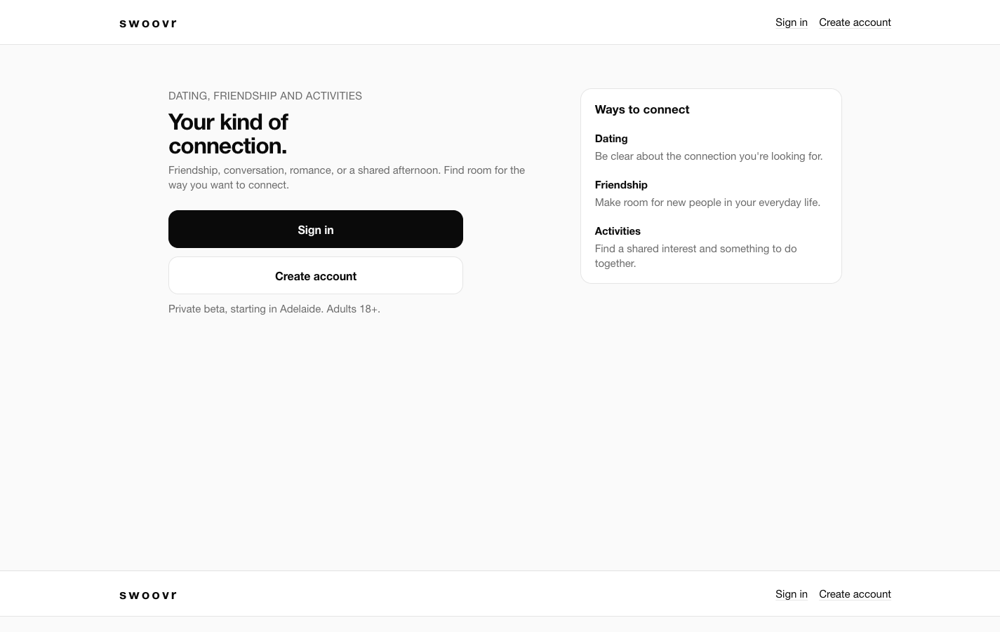
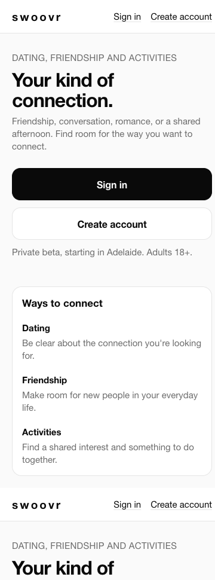
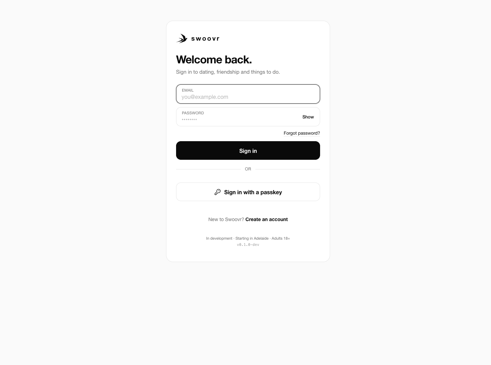
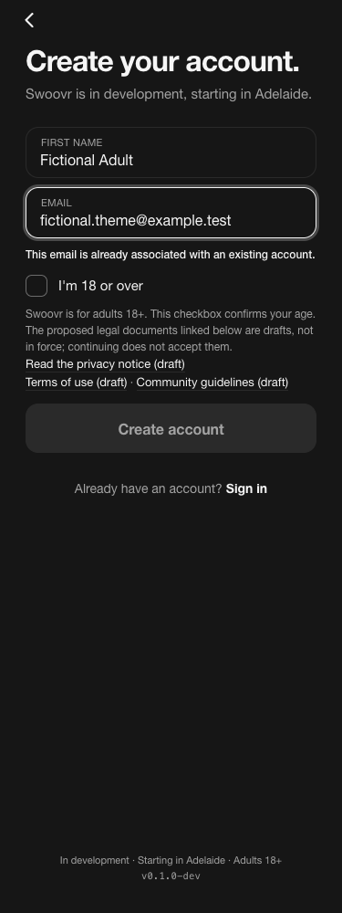
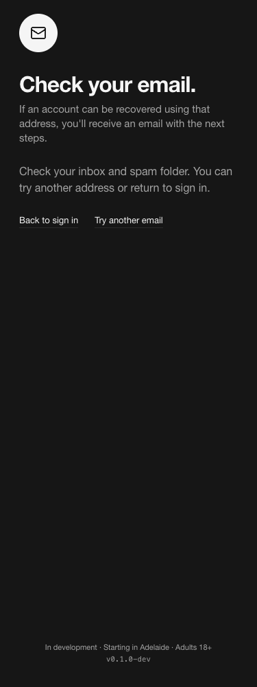

# Public entry and authentication fixes — Q99–Q105

2 November 2026. DEFAULT reversible presentation changes, preserving CONFIRMED authentication, theme and safety rules. Proposed through a feature PR to main; no merge, deployment, Actions or installed-realm change.

## Results and remaining acceptance

| Record | Implemented | Remaining boundary |
| --- | --- | --- |
| Q99 / #141 | Guests get sign-in/create navigation and a connection-focused landing; obsolete “sign-in not connected” copy and the primary appearance CTA are removed. | Private-beta/adult status and draft-policy links stay truthful. Removing required disclosures is not approved. |
| Q100 / #142 | Configured guest GET `/account` and `/account/` redirect to existing sign-in before page rendering. | Unconfigured fallback and `?signin=retry` remain reachable. No original private-data disclosure was established; BFF/API gates are unchanged. |
| Q101 / #143 | Shared theme has a deliberate desktop frame while preserving the canonical 420px form, phone layout, Standard tokens and available provider methods. | Native system-browser/device acceptance remains outstanding. No social provider is invented. |
| Q102 / #144 | Registration uses the same responsive frame. | Email-first registration, adult attestation and draft legal copy remain; no onboarding or legal approval is inferred. |
| Q103 / #145 | First invalid registration field receives focus; errors are linked by `aria-describedby`. Duplicate-email error tested with a fictional account. | No invitation/identity-sync defect is claimed. Human assistive-technology acceptance remains. |
| Q104 / #146 | Reset shares the frame and uses an email input/autocomplete for an email-as-username realm, retaining text/username for other realms. | Provider delivery and native acceptance remain; reset-token semantics are unchanged. |
| Q105 / #147 | The neutral provider reset success renders a dedicated “Check your email” view with recovery links and no sign-in/password/social/passkey form. | Visible-response neutrality is verified; timing side-channel resistance and hosted rate-limit acceptance are not established. |

The queue-wide [handoff](https://github.com/repasscloud/wanderconnect/blob/codex/fix/intake-admin-account-errors/docs/delivery/ISSUE-FIX-HANDOFF.md) is maintained on the coordination work branch in PR #152.

## Cause and provider contract

The old public layout always rendered member navigation; the account page rendered a guest hub instead of routing configured guests into authentication. Provider theme fields had no error descriptions/focus correction, and reset acknowledgement reused login.ftl with the credential form still present. The old theme forced its main section to full viewport height on desktop.

Keycloak26.8.1 [ResetCredentialEmail](https://github.com/keycloak/keycloak/blob/26.8.1/services/src/main/java/org/keycloak/authentication/authenticators/resetcred/ResetCredentialEmail.java) forks enabled, absent and email-send-failure paths with the same neutral success message; [Messages.EMAIL_SENT](https://github.com/keycloak/keycloak/blob/26.8.1/services/src/main/java/org/keycloak/services/messages/Messages.java) maps to `emailSentMessage`. The theme recognises only that success message. It never looks up or branches on the submitted address. Existing provider URLs own reset/restart and token handling.

## Validation

- Public regression failed before the fixes on guest routing, member navigation and obsolete claims, then passed in actual Edge at375/768/1440px. HTTP checks verify302 to local sign-in, retry200 and guest BFF401.
- Theme regression failed seven assertions before the fixes, then passed in an owned Keycloak26.8.1 container, owned mail sink and actual Edge. It covers constrained sign-in, desktop framing, duplicate-email focus/description, adult checkbox presence, reset input, dedicated acknowledgement, and light/dark reflow at375/768/1440px across sign-in, registration error, reset request and confirmation.
- Enabled, absent and disabled fictional addresses showed identical acknowledgement text. Only the enabled existing account received a reset message in the owned local sink. This is local acceptance, not external delivery proof. One sample per category was373/122/136ms; this is insufficient to establish timing resistance, and the difference is retained as an acceptance gap rather than hidden.
- Independent read-only code reviews found no concrete blockers in public routing or the theme slice.
- Final `./scripts/check.sh`: exit0, zero build warnings/errors,596 PostgreSQL cases and all three smoke suites passed. The first full runs exposed two assertions tied to the retired guest-account/copy behavior: CSP coverage now renders the public landing (retaining exact import-map hashing and unsafe-script prohibitions); smoke asserts the new guest entry/nav contract. Both focused checks and the complete suite passed after those updates.

No installed realm, shared mail, private configuration or original sensitive screenshot was changed or copied. All provider fixtures are fictional adults. The harness removed its provider/mail containers, network, browser profile and private import file.

## Safe synthetic screenshots

## Reproduce without merging

Publish `src/Swoovr.Web` in Release to a temporary directory and set `SWOOVR_WEB_TEST_PUBLISH` to its absolute path; run `node tests/auth/intake-public.browser.cjs`. It refuses occupied15881 and starts/stops only its owned host/browser. Its provider configuration is deliberately synthetic and unused: it does not follow sign-in or demonstrate member eligibility.

Run `node tests/auth/intake-theme.browser.cjs` for the provider UI. It requires the cached images used by `swoovr-platform-keycloak-1` and `swoovr-platform-mailpit-1`, Docker, Edge and Playwright. It refuses occupied18180/18025, creates an isolated provider/mail network, imports the committed member realm into its own ephemeral storage, and applies the existing registration/adult-attestation configuration only there. It never changes the installed realms. Screenshots/logs under `/tmp/swoovr-intake-*` are local diagnostics; private fixture imports are deleted. No owned resources remain after successful cleanup.
