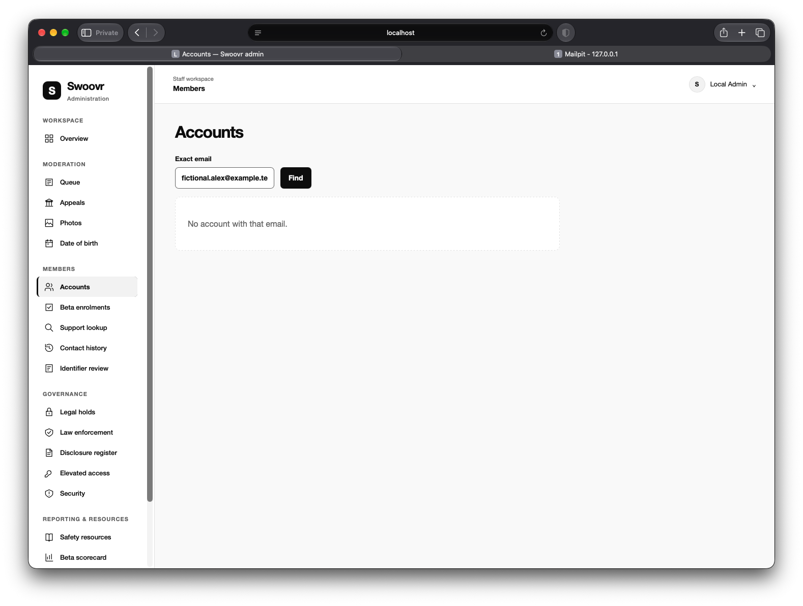
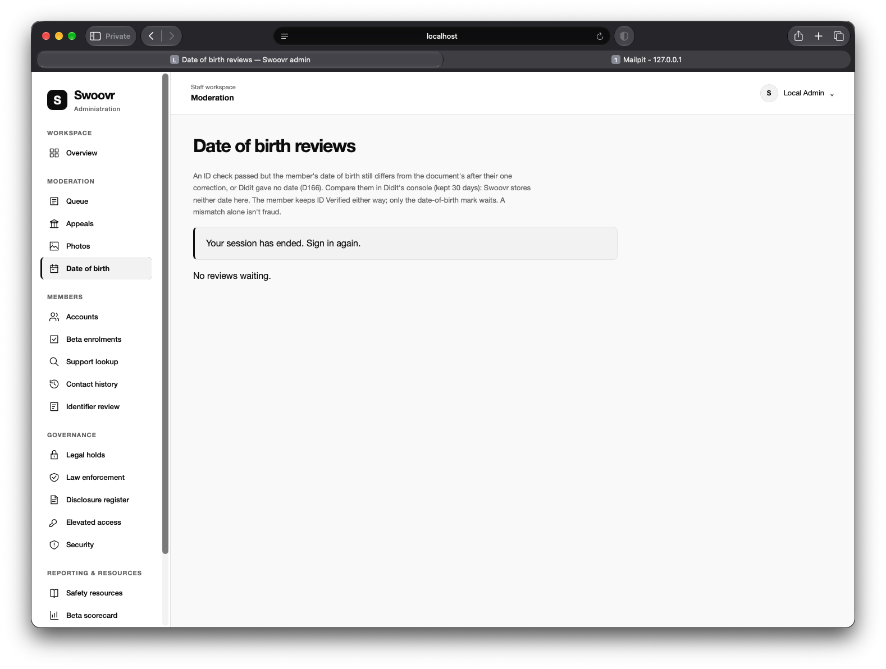
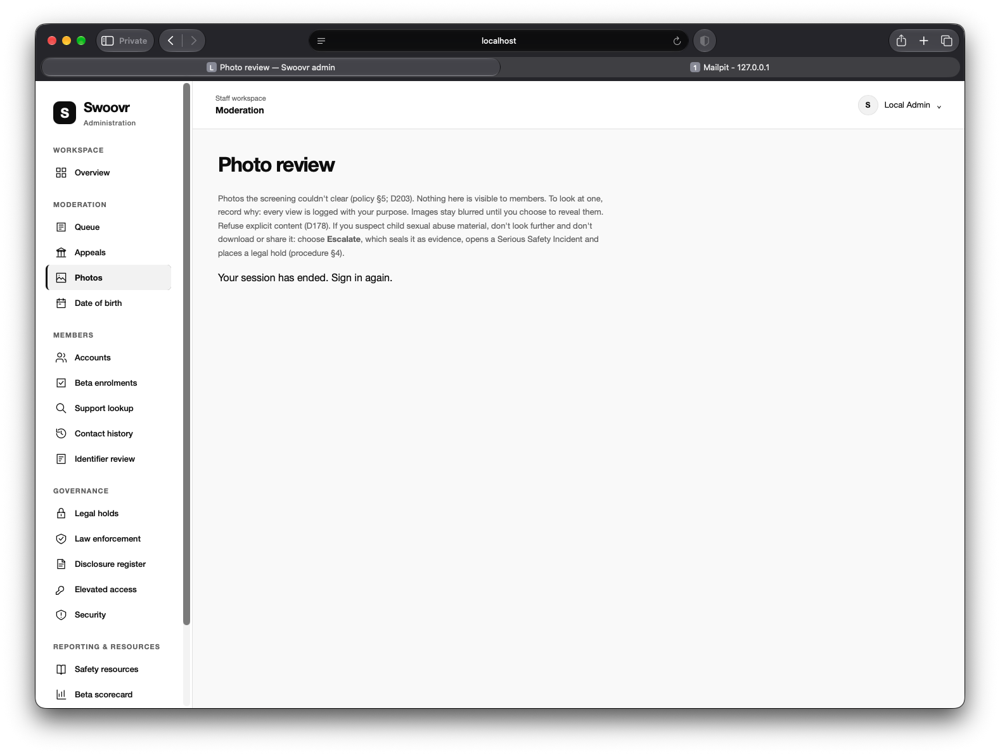
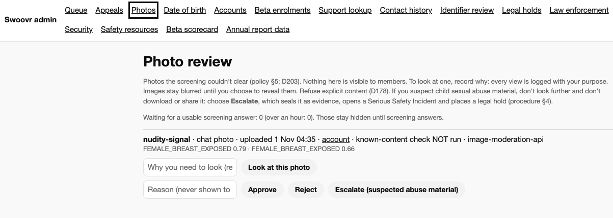
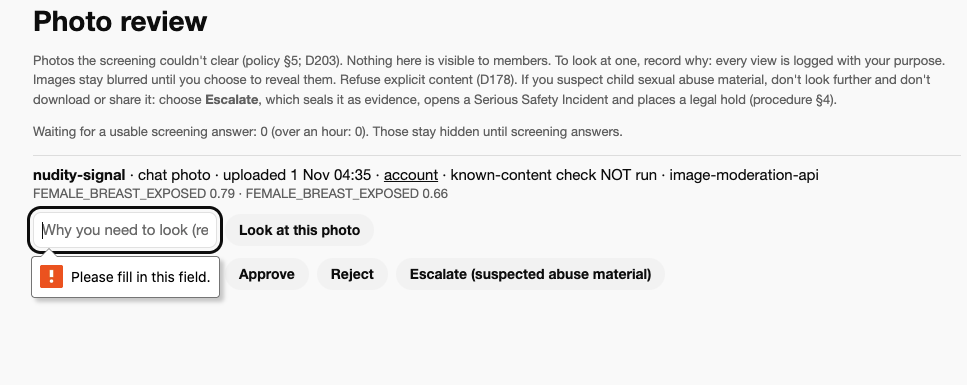
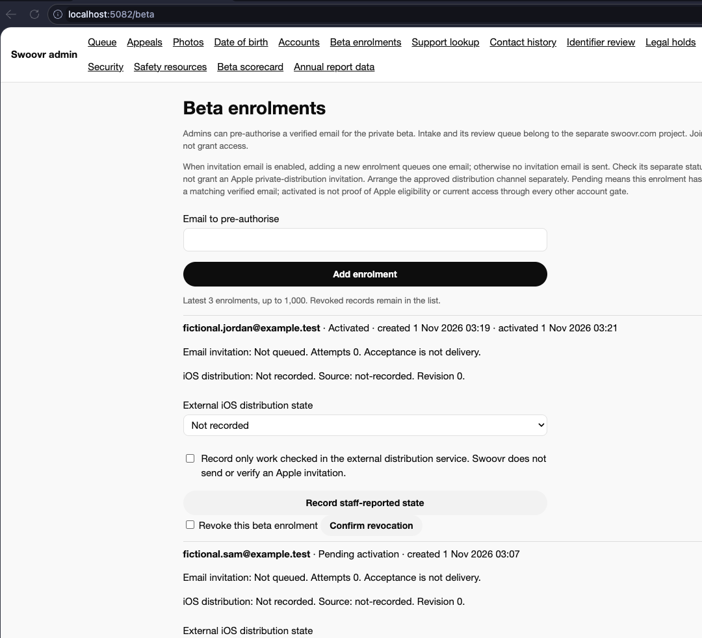
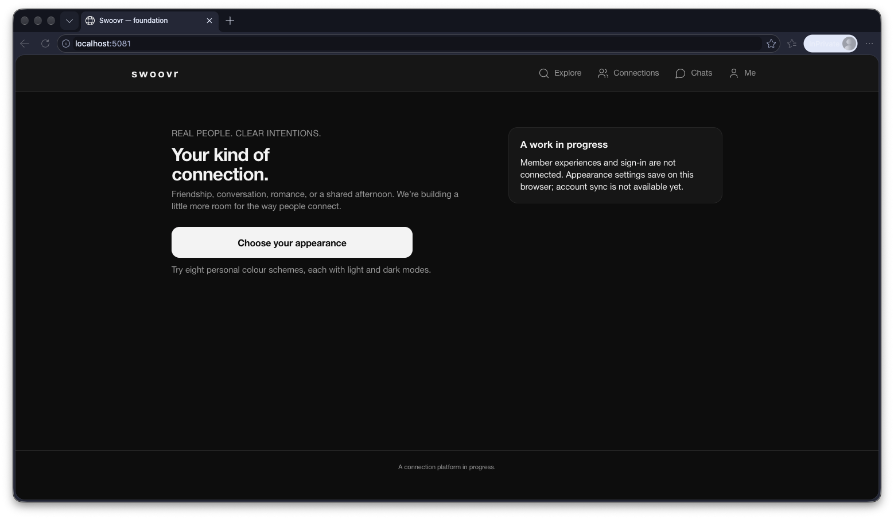
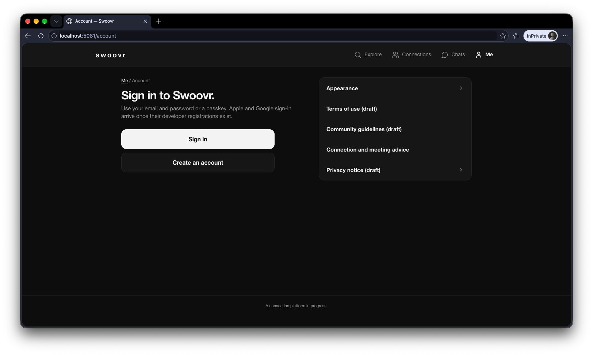
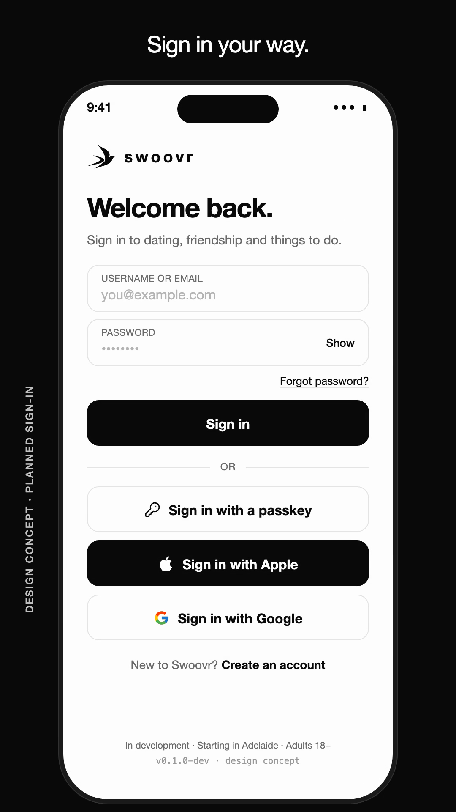

# Issue intake

Use this file to investigate reported items and create GitHub issues.
Do not implement fixes unless separately requested.

Processing run: 2 November 2026. Items 2–5 and 7–17 are tracked as Q95–Q109 / GitHub #137–#151. Item 1 is an unused template, not a report; item 6 was not supplied. No substantive item remains unprocessed. See each investigation note and the [evidence publication review](evidence/2026-11-01-issue-intake/README.md). References to “issue #7” etc. in original report prose mean intake item numbers, not GitHub issue numbers; the metadata links are authoritative. Proposed acceptance below is feedback, subject to existing CONFIRMED policy and the explicit OPEN conflicts in investigation notes.

## 1. Short, descriptive title

- Status: Template only — not a report
- Area: Member web / Admin / API / Docker / Mobile
- Page or URL:
- Type: Bug / Improvement / Question
- Priority: High / Medium / Low
- GitHub issue: Not created
- Tracking Q: Not assigned

### What happened
Describe the behaviour you observed.

### What I expected
Describe what should happen instead, or say “Needs investigation”.

### Steps to reproduce
1.
2.
3.

### Evidence
Paste relevant error messages or link screenshots.
Do not include passwords, tokens or real personal information.

### Impact
Who is affected, and what does it prevent?

### Notes or constraints
Optional context, suggested explanations or requirements.

## 2. Admin account search fails to find existing users by email address

- **Status:** Processed — new issue created; investigation remains OPEN
- **Area:** Admin
- **Page or URL:** `http://localhost:5082/accounts?email=fictional.alex%40example.test`
- **Type:** Bug
- **Priority:** High
- **GitHub issue:** [#137](https://github.com/repasscloud/wanderconnect/issues/137)
- **Tracking Q:** Q95

### Intake investigation — 2 November 2026

Q95: Accounts.razor discards unsuccessful lookup status with Value ?? [], so an API refusal can appear as no match. The API normalises email, queries application Accounts and left-joins optional MemberProfiles; it does not search Keycloak directly. Neither missing application records nor provider/database mismatch is established. Capture status/code and canonical subject/account linkage with a fictional fixture before diagnosing.

Source inspection: `src/Swoovr.Admin/Components/Pages/Accounts.razor; src/Swoovr.Api/Accounts/AdminEndpoints.cs:195`.

Duplicate review: Related #88 (staff permissions), #134 (auth harness); neither covers this lookup failure.

Evidence and scope: screenshots reviewed locally; no runtime reproduction or token/SSO lifetime measurement performed. Original report below is retained as feedback, not a verified diagnosis or automatic amendment of CONFIRMED policy. See [publication review](evidence/2026-11-01-issue-intake/README.md).

### What happened

The Admin application fails to locate an existing member account when searching by its registered email address.

The account is confirmed to exist, and the member can successfully sign in to Swoovr using the same email address. The email address has also been verified.

However, searching for that exact email address in the Admin application's Accounts section returns:

> No account with that email.

This incorrectly indicates that the account does not exist.

### What I expected

When an administrator searches for an existing member using their registered email address, the application should:

1. Find the matching member account.
2. Display the relevant account details in the search results.
3. Allow the administrator to open the account in the Admin application.
4. Provide access to the appropriate account management, verification, standing and review functions according to the administrator's permissions.

Searching using a valid, registered email address should reliably return the corresponding account, regardless of whether the member has completed optional profile setup.

### Steps to reproduce

1. Sign in to the Swoovr Admin application using an authorised administrator account.
2. Navigate to `/accounts`.
3. Enter the registered email address of an existing, verified Swoovr member.
4. Submit the search.
5. Observe the message: "No account with that email."
6. Confirm that the member account exists by successfully signing in to the member application using the same email address.

### Evidence

### Impact

**Affected users:** Swoovr administrators and authorised support staff.

Administrators cannot reliably locate member accounts using their registered email addresses.

This prevents or delays:

- Account investigations and support requests.
- Identity and verification reviews.
- Account standing and restriction reviews.
- Trust and Safety investigations.
- Member account recovery assistance.
- General account administration.

This is a **high-priority bug** because account lookup is a fundamental administrative capability, particularly for support and Trust and Safety operations.

### Notes or constraints

Investigate the account search implementation across the Admin frontend, API and underlying identity/account storage.

Areas to verify:

- Whether the search queries the correct member account data source.
- Whether registered email addresses are correctly associated with member account records.
- Whether the search relies on a separate account table, projection or synchronisation process that may not contain the member.
- Whether email lookup is affected by case sensitivity, whitespace or normalisation.
- Whether URL-encoded email addresses are correctly decoded and handled.
- Whether verified accounts are incorrectly excluded by account status or other filters.
- Whether the Admin application is querying the same environment and database as the member application.
- Whether identity-provider user records and Swoovr member records are correctly linked.

Do not assume the cause is a database or synchronisation issue without investigation.

Email lookup should use the canonical identity/account relationship and must respect existing administrator permissions and audit requirements.

### Acceptance criteria

- [ ] Searching by the exact registered email address returns the correct member account.
- [ ] Email lookup handles case differences and surrounding whitespace appropriately.
- [ ] Email addresses containing valid special characters are handled correctly.
- [ ] Verified member accounts are searchable.
- [ ] Accounts with incomplete optional profile information remain searchable.
- [ ] Administrators can open matching accounts and access functions permitted by their role.
- [ ] Search results do not expose accounts outside the administrator's authorised scope.
- [ ] The underlying cause is identified and corrected rather than bypassed with a frontend workaround.
- [ ] Appropriate automated tests cover existing-account lookup and genuine no-match scenarios.
- [ ] The "No account with that email" message is displayed only when no matching account exists within the administrator's authorised search scope.

## 3. Admin session incorrectly reports expiration and displays inconsistent, unbranded authentication pages

- **Status:** Processed — new issue created; investigation remains OPEN
- **Area:** Admin
- **Page or URL:** `http://localhost:5082/media` (and other Admin pages)
- **Type:** Bug
- **Priority:** High
- **GitHub issue:** [#138](https://github.com/repasscloud/wanderconnect/issues/138)
- **Tracking Q:** Q96

### Intake investigation — 2 November 2026

Q96: AdminText maps any API 401 to session-ended; StaffTokenHandler forwards the stored access token. The signed-out endpoint returns minimal raw HTML. The header can reflect the cookie while the API refuses a token; expiration/renewal failure remains a hypothesis, not a reproduced cause. Screenshots show date-of-birth and media routes with different message treatment.

Source inspection: `src/Swoovr.Admin/StaffSession.cs; src/Swoovr.Admin/Program.cs; src/Swoovr.Admin/Components/Pages/MediaReview.razor`.

Duplicate review: Related #88 and #135; neither investigates the cookie/API lifecycle or signed-out presentation.

Evidence and scope: screenshots reviewed locally; no runtime reproduction or token/SSO lifetime measurement performed. Original report below is retained as feedback, not a verified diagnosis or automatic amendment of CONFIRMED policy. See [publication review](evidence/2026-11-01-issue-intake/README.md).

### What happened

When navigating between pages in the Swoovr Admin application, an authentication-related message intermittently appears:

> Your session has ended. Sign in again.

However, the administrator does not appear to have been completely signed out.

The authenticated user's name remains visible in the top-right corner of the application, suggesting an active session.

The affected page displays two options:

- **Sign in again** — a text hyperlink.
- **Sign out** — a button.

This creates a confusing and contradictory state where the application simultaneously suggests that the session has expired while still displaying the administrator as signed in.

**Observed behaviour**

1. While navigating through the Admin application, the session-ended message appears unexpectedly.
2. The administrator's name remains visible in the navigation header.
3. The page offers both "Sign in again" and "Sign out".
4. Clicking "Sign out" navigates to a plain, text-based page displaying:

   > You're signed out. Sign in again.

5. This page does not use the Swoovr design system, layout or branding.
6. Clicking the "Sign in again" hyperlink initiates authentication and returns the administrator to the application.
7. The administrator can then resume normal work.

The session-ended message also appears differently depending on which Admin page is being viewed.

Two examples have been captured, demonstrating inconsistent presentation.

**Additional concerns**

- The application does not clearly distinguish between an expired session, an authentication failure and a deliberate sign-out.
- It is unclear whether authentication credentials remain valid and are being silently reused during sign-in.
- It is unclear whether the issue is related to expired access tokens, authentication cookies, session state, token renewal or another authentication mechanism.
- The current recovery process requires unnecessary navigation and multiple actions.
- The authentication and sign-out pages do not provide a consistent Swoovr-branded experience.

### What I expected

The Admin application should maintain a reliable and consistent authentication state throughout navigation.

An administrator should either be authenticated and able to use the application, or unauthenticated and directed through an appropriate sign-in flow.

The interface must not display contradictory authentication states.

#### A. Correct authentication and session handling

When the administrator has a valid authenticated session:

- Navigation between Admin pages should work normally.
- The application should not unexpectedly display session-expired messages.
- Access tokens should be renewed when appropriate, using the configured authentication mechanism.
- The application should correctly handle token expiration and session renewal.
- Authentication state should remain consistent between the frontend, API and identity provider.

Do not require the administrator to sign out and sign back in simply to recover from a temporary authentication state mismatch.

#### B. Handle genuinely expired sessions correctly

If the session has genuinely expired and cannot be renewed:

1. Display a consistent, Swoovr-branded session-expired screen.
2. Clearly explain that the administrator must authenticate again.
3. Provide a prominent **Sign in again** action.
4. Preserve the intended destination where safe and appropriate.
5. Return the administrator to the requested Admin page after successful authentication.

The expired session must not continue to provide access to protected resources.

Do not display the administrator as actively signed in when the application has determined that authentication is no longer valid.

#### C. Separate session expiration from deliberate sign-out

These are different events and should not share confusing or contradictory messaging.

**Session expired**

Message:

"Your session has expired."

Supporting text:

"For security, please sign in again to continue."

Action:

**Sign in again**

**Signed out**

Message:

"You've signed out of Swoovr Admin."

Supporting text:

"Your session has ended."

Action:

**Sign in**

Both states should use Swoovr's standard design system and provide clear navigation.

Do not display a Sign out button on a session-expired page unless there is a specific, technically valid reason to do so.

#### D. Ensure sign-out behaves consistently

When an administrator deliberately selects Sign out:

- Clear the appropriate application authentication state.
- Complete the configured identity-provider logout flow where required.
- Invalidate or clear local authentication cookies and tokens as appropriate.
- Redirect to a properly designed Swoovr Admin signed-out page or sign-in experience.
- Do not leave protected Admin content accessible through stale application state.

If the identity provider still has an active single sign-on session, clicking Sign in may authenticate the administrator again without requiring credentials.

That behaviour may be valid, depending on the configured authentication and logout policy.

However, the application should not present it as an authentication error, and sign-out behaviour must follow the intended security policy.

#### E. Standardise authentication-related pages

All Admin authentication states should use the same visual design and interaction patterns.

This includes:

- Session expired.
- Sign-in required.
- Signed out.
- Authentication failed.
- Access denied.

These pages should:

- Use Swoovr branding.
- Use consistent typography and spacing.
- Provide clear, concise explanations.
- Offer appropriate recovery actions.
- Avoid raw text-only pages.
- Render consistently regardless of which Admin route triggered the state.

Prefer reusable authentication-state components rather than separate inconsistent implementations across individual pages.

#### F. Avoid unnecessary authentication interruptions

If a valid identity-provider session exists and the application can securely renew its local authentication state, investigate whether renewal can occur without disrupting the administrator's workflow.

A temporary expired API access token should not automatically result in an interactive sign-out process if secure renewal is supported.

However, this must not bypass:

- Explicit session expiration.
- Administrator account suspension or revocation.
- Security-required reauthentication.
- Logout actions.
- Multi-factor authentication requirements.
- Configured session lifetime policies.

Security controls must remain authoritative.

### Steps to reproduce

1. Sign in to the Swoovr Admin application using an authorised administrator account.
2. Navigate between Admin pages, including `/media`.
3. Continue navigating until the intermittent message appears:

   "Your session has ended. Sign in again."

4. Observe that the administrator's name remains visible in the top-right navigation.
5. Observe the simultaneous "Sign in again" and "Sign out" actions.
6. Click Sign out.
7. Observe the unbranded, text-only signed-out page.
8. Click the Sign in again hyperlink.
9. Observe that authentication completes and the Admin application becomes accessible again.
10. Repeat the process from different Admin pages and compare the presentation of the session-ended message.

**Note:** The issue is intermittent. Investigation should include session lifetime, navigation patterns and authentication renewal behaviour.

### Evidence

The screenshots demonstrate inconsistent session-ended presentation across Admin pages.

### Impact

**Affected users:** Swoovr administrators, support staff and Trust and Safety personnel.

**Impact:**

- Administrators experience unexpected interruptions while navigating the application.
- Authentication state becomes unclear and potentially misleading.
- Additional sign-out and sign-in steps create unnecessary workflow friction.
- Administrative investigations and moderation tasks may be interrupted.
- Inconsistent authentication messaging reduces confidence in the Admin application's reliability.
- Unbranded authentication pages create an unfinished and unprofessional experience.
- Incorrect authentication state handling may indicate a deeper session lifecycle issue requiring investigation.

Because the Admin application provides access to sensitive member information and administrative functions, authentication state consistency is particularly important.

### Notes or constraints

**Investigation requirements**

Review the existing authentication implementation before making changes.

Relevant areas may include:

- Authentication middleware.
- OpenID Connect / OAuth session handling.
- Identity-provider integration.
- Access token expiration and renewal.
- Refresh token handling, where applicable.
- Authentication cookie lifetime and validation.
- Frontend authentication state management.
- API responses to expired or invalid credentials.
- HTTP 401 and 403 handling.
- Authentication redirects and return URLs.
- Differences between full-page navigation and client-side navigation.
- Server-side rendering and interactive component authentication state.
- Session expiration and sign-out endpoints.

Determine whether the problem results from actual session expiration, failed renewal, stale frontend state or inconsistent error handling.

Do not simply suppress the session-ended message without addressing the underlying authentication behaviour.

**Security considerations**

- Do not extend session lifetimes merely to hide the problem.
- Do not bypass authentication checks.
- Do not automatically reauthenticate an administrator after an explicit logout.
- Preserve configured identity-provider and MFA requirements.
- Ensure revoked, suspended or expired accounts cannot continue accessing protected resources.
- Do not expose authentication tokens or sensitive session details in application logs.
- Use appropriate audit logging for sign-in, sign-out and security-relevant session events.
- Preserve safe return URL handling and prevent open redirects.

**Design requirements**

The Admin application should use a consistent Swoovr-branded authentication experience.

Authentication-related messages must be presented uniformly across all Admin routes.

Where technically appropriate, use a shared authentication layout that is separate from the authenticated Admin layout, preventing stale user information from appearing on signed-out or session-expired pages.

**Suggested implementation order**

1. Reproduce the intermittent session-ended behaviour.
2. Identify whether the underlying session is actually expired.
3. Review frontend, API and identity-provider authentication state.
4. Investigate token renewal and cookie lifecycle behaviour.
5. Correct the underlying authentication state inconsistency.
6. Standardise handling of expired sessions and unauthorised responses.
7. Implement consistent Swoovr-branded authentication and signed-out pages.
8. Verify sign-out and subsequent sign-in behaviour.
9. Test navigation, session renewal, expiration and account revocation scenarios.

### Acceptance criteria

- [ ] Valid administrator sessions remain authenticated during normal navigation.
- [ ] Session-ended messages are not displayed while the application has a valid, usable session.
- [ ] Authentication state is consistent between the Admin UI, API and identity provider.
- [ ] Access tokens are renewed appropriately when supported by the existing authentication configuration.
- [ ] Genuine session expiration is handled clearly and securely.
- [ ] Expired sessions cannot access protected Admin resources.
- [ ] Session-expired pages do not misleadingly display the administrator as actively signed in.
- [ ] Session-expired and signed-out states are clearly distinguished.
- [ ] Sign-out correctly clears or terminates the appropriate authentication state.
- [ ] All authentication-related pages use consistent Swoovr branding and styling.
- [ ] Authentication messages render consistently across Admin routes.
- [ ] Administrators can return to their intended page after reauthentication where safe.
- [ ] Authentication handling does not weaken existing security policies.
- [ ] Automated tests cover valid sessions, token expiration, session renewal, explicit logout and unauthorised access.
- [ ] The underlying cause is identified and resolved rather than hidden through UI changes.

## 4. Improve Admin photo moderation workflow, reveal controls and standardised review decisions

- **Status:** Processed — new issue created; investigation remains OPEN
- **Area:** Admin
- **Page or URL:** `http://localhost:5082/media`
- **Type:** Improvement
- **Priority:** High
- **GitHub issue:** [#139](https://github.com/repasscloud/wanderconnect/issues/139)
- **Tracking Q:** Q97

### Intake investigation — 2 November 2026

Q97: Code confirms required purpose before a media link, CSS blur/reveal checkbox and free-text decision reason; escalation already exists. The second screenshot shows browser required-field validation, not a revealed photograph. OPEN: intake permission for explicit private-chat media conflicts with CONFIRMED D178 (no explicit content anywhere in beta). Preserve screening, conflict exclusions, audit and evidence holds; no permission change is approved here.

Source inspection: `src/Swoovr.Admin/Components/Pages/MediaReview.razor; docs/delivery/DECISIONS.md (D178, D203, D205)`.

Duplicate review: Related #85 (screening), #88 (sensitive access), #116 (playbook), #54 (explicit-media policy); these do not cover the combined review-controls/reason-code UX.

Evidence and scope: screenshots reviewed locally; no runtime reproduction or token/SSO lifetime measurement performed. Original report below is retained as feedback, not a verified diagnosis or automatic amendment of CONFIRMED policy. See [publication review](evidence/2026-11-01-issue-intake/README.md).

### What happened

The Swoovr Admin photo moderation interface introduces unnecessary steps when reviewing member photographs and does not provide sufficiently structured approval and rejection decisions.

When an administrator attempts to review a photo, the interface requires a manually entered reason before the photo can be displayed.

This is confusing because the administrator is already working within the dedicated photo moderation queue. The purpose of accessing the photograph is to perform a moderation review.

The current process is:

1. Open the Media moderation page.
2. Enter a free-text reason for viewing the photograph.
3. Click "Show photo".
4. The photograph appears blurred.
5. Click "Reveal" to display the actual image.
6. Enter another reason when approving or rejecting the photograph.

The workflow creates avoidable administrative overhead.

There are also problems with how moderation decisions are recorded.

**1. Viewing a photograph requires an unnecessary free-text explanation**

Administrators must manually enter a reason to view content already assigned to the photo moderation queue.

The review context itself should provide the reason for access.

**2. The reveal process is unnecessarily complicated**

The two-stage blurred/revealed presentation is useful, particularly when reviewing potentially sensitive content.

However, the administrator should not need to enter free text before reaching the blurred preview.

**3. Approval and rejection reasons are not standardised**

The interface relies on manually entered explanations instead of structured moderation categories.

This permits inconsistent values such as ".", "OK", "No" or arbitrary wording.

It also makes moderation statistics and subsequent investigations difficult.

**4. The purpose of Reject is not sufficiently clear**

The interface appears to treat approval and rejection as separate actions without clearly explaining how rejection reasons should be classified.

A rejection should be a moderation decision supported by a predefined reason, rather than an unexplained action.

**5. Adult private-chat media requires a different moderation workflow**

Swoovr allows permitted adult content within private messaging under the applicable member preferences and platform policies.

This content should not automatically enter the same routine photo approval queue as public profile photos.

The distinction between public profile media and permitted private-chat media must be reflected in the moderation workflow.

### What I expected

The Admin photo moderation interface should provide a fast, consistent and auditable review process.

Routine photo reviews should require minimal unnecessary input while preserving appropriate access controls, privacy protections and moderation records.

#### A. Remove mandatory free-text reasons for routine photo review

When an administrator opens a photo assigned to the moderation queue:

- Display the photograph in its blurred state.
- Do not require a manually typed reason to access the review.
- Provide a clear "Reveal photo" action.
- Allow the administrator to reveal the photograph when ready.
- Record the access automatically in the audit system.

The reason for access should be derived from the workflow.

For example:

**Access reason:** Routine photo moderation

This should be recorded automatically rather than entered manually.

The audit record should include:

- Administrator ID.
- Media ID.
- Associated moderation case or queue item.
- Access timestamp (UTC).
- Access purpose.
- Whether the photograph was revealed.

Do not allow administrators to bypass auditing by omitting a reason.

**Important distinction:** Routine assigned moderation should not require free-text justification. Access to media outside an assigned review or investigation may still require a documented justification and additional permissions.

#### B. Keep the blurred preview and deliberate reveal action

The blurred image preview is useful and should be retained.

Expected workflow:

1. Administrator opens a photo review item.
2. A blurred preview appears.
3. Administrator selects **Reveal photo**.
4. The photograph becomes visible.
5. Administrator makes a moderation decision.

The reveal action should be clearly labelled and consistently positioned.

Avoid confusing sequences involving "Show photo" followed by another "Reveal" control.

The same preview behaviour should be available across relevant moderation interfaces.

Revealing a photo must remain restricted to authorised administrators and should be auditable.

#### C. Introduce predefined approval reasons

When approving a photograph, administrators should choose from standardised approval categories.

Suggested approval reasons:

| Code | Approval reason |
|---|---|
| APPROVED_STANDARD | Meets Swoovr photo guidelines |
| APPROVED_NON_EXPLICIT | Non-explicit image permitted |
| APPROVED_AFTER_REVIEW | Acceptable following manual review |
| APPROVED_FALSE_POSITIVE | Automated screening incorrectly flagged content |

For routine approvals, **Meets Swoovr photo guidelines** may be the default selection.

The administrator should not need to type a free-text explanation for every routine approval.

Optional notes may be provided when additional context is useful.

The selected reason must be stored as a structured code rather than relying solely on display text.

#### D. Introduce predefined rejection reasons

Rejection should remain available because some photographs must not be displayed on Swoovr.

However, the administrator should select a clear reason for rejection.

Suggested rejection categories:

| Code | Rejection reason |
|---|---|
| REJECT_EXPLICIT_PUBLIC | Nudity or explicit sexual content in a public profile |
| REJECT_UNDERAGE | Suspected underage or child-safety concern |
| REJECT_NON_CONSENSUAL | Suspected non-consensual or intimate-image abuse |
| REJECT_IMPERSONATION | Suspected impersonation or unauthorised use of another person's image |
| REJECT_PRIVACY | Contains prohibited personal or location information |
| REJECT_VIOLENCE | Graphic violence or disturbing content |
| REJECT_HATE | Hateful or prohibited extremist imagery |
| REJECT_SPAM | Spam, advertising or prohibited promotional content |
| REJECT_IMAGE_QUALITY | Image does not meet applicable technical or quality requirements |
| REJECT_OTHER | Other policy violation |

The selected category should determine the recorded moderation outcome.

For "Other", require an additional explanation.

For serious categories, such as suspected child sexual abuse material or non-consensual intimate imagery, use the established Trust and Safety escalation workflow rather than treating the matter as an ordinary rejected photo.

Do not automatically delete or permanently destroy evidence subject to a legitimate preservation requirement.

#### E. Separate moderation decisions from escalation actions

The interface should distinguish between ordinary moderation and content requiring further investigation.

Suggested actions:

- **Approve** — The photograph meets applicable requirements.
- **Reject** — The photograph violates an applicable policy.
- **Escalate** — The photograph requires specialist Trust and Safety review.

An escalated item should be assigned to the appropriate restricted review queue.

Do not require the reviewer to make a definitive policy finding when the evidence is uncertain.

All outcomes should be auditable.

#### F. Ensure rejection decisions are useful for reporting

Store moderation outcomes in a structured format suitable for reporting and investigation.

At minimum:

- Media ID.
- Member ID.
- Media context: public profile, private album or private chat.
- Moderation case ID.
- Reviewer ID.
- Decision.
- Reason code.
- Optional notes.
- Decision timestamp (UTC).
- Previous and resulting moderation status.

This should allow administrators to report on:

- Total approved photographs.
- Total rejected photographs.
- Rejection counts by category.
- Escalated moderation cases.
- Automated screening false positives.
- Moderation outcomes over time.
- Reviewer activity and decision history.

Reason codes should remain stable even if their display labels are updated.

#### G. Separate public profile photos from permitted private-chat media

Swoovr has different content rules depending on where media is shared.

**Public profile photographs**

- Must comply with public profile content requirements.
- Nudity and explicit sexual content are prohibited.
- Continue through the appropriate automated screening and moderation workflow.
- Photographs must not become publicly visible until the applicable approval requirements are met.

**Permitted adult private-chat media**

Where adult media is permitted under Swoovr's policies and the applicable member preferences:

- Do not automatically send every permitted adult private-chat image into the routine public-profile photo approval queue.
- Do not require routine human approval before delivery solely because the image contains permitted adult nudity.
- Respect the receiving member's media preferences and existing reveal protections.
- Continue applying automated safety screening where required.
- Route flagged, reported, prohibited or high-risk content into the appropriate Trust and Safety workflow.
- Preserve existing blocking, reporting and evidence-handling requirements.

**Important:** Adult-media permission must not disable safety screening.

Permitted consensual adult nudity is different from suspected child sexual abuse material, non-consensual intimate imagery and other prohibited content.

Media with serious safety indicators must remain subject to the appropriate detection, restriction, escalation and reporting processes.

The system should distinguish between **content permitted by policy** and **content requiring intervention**.

#### H. Improve the Admin moderation interface

The photo review screen should be redesigned around the reviewer's task.

Suggested layout:

**Media review panel**

- Member reference.
- Media type and source.
- Upload timestamp.
- Automated screening status.
- Blurred photo preview.
- Reveal photo action.
- Relevant moderation history.

**Decision panel**

- Approve.
- Reject.
- Escalate.
- Contextual reason dropdown.
- Optional reviewer notes.
- Submit decision.

The reason dropdown should change depending on the selected action.

For example, choosing Reject should display rejection categories rather than approval categories.

Keep controls consistent across all photo review screens.

Avoid excessive forms, unnecessary confirmation steps and inconsistent button placement.

#### I. Provide clear outcomes and confirmation

After submitting a moderation decision:

- Confirm the action was saved.
- Update the media status.
- Record the structured reason.
- Update the relevant queue.
- Move to the next review item where appropriate.
- Prevent accidental duplicate submissions.

Require additional confirmation only for sensitive or irreversible actions where justified.

Do not add unnecessary confirmation dialogs to ordinary approval workflows.

### Steps to reproduce

1. Sign in to the Swoovr Admin application using an authorised administrator account.
2. Navigate to `http://localhost:5082/media`.
3. Open a photograph requiring moderation.
4. Observe that a free-text reason is required before viewing.
5. Enter a reason and click "Show photo".
6. Observe that the photo appears blurred.
7. Click "Reveal" to display the image.
8. Attempt to approve or reject the photograph.
9. Observe the current reason-entry controls.
10. Review whether approval and rejection reasons use predefined categories.
11. Compare the workflow with private-chat media handling, where applicable.

### Evidence

### Impact

**Affected users:** Swoovr administrators and authorised Trust and Safety reviewers.

**Impact:**

- Routine moderation requires unnecessary manual input.
- Reviewers spend additional time accessing content already assigned for review.
- Unstructured reasons produce inconsistent moderation records.
- Arbitrary free-text explanations undermine reporting accuracy.
- Approval and rejection statistics cannot be reliably categorised.
- Moderation decisions are more difficult to audit.
- Private adult media may be unnecessarily delayed if routed through the wrong moderation workflow.
- Inconsistent presentation increases reviewer workload.

Structured moderation reasons will improve reporting, consistency and subsequent case investigations.

### Notes or constraints

**Access control and auditing**

Removing the mandatory free-text access reason must not remove access auditing.

Routine access reasons should be recorded automatically based on the moderation workflow.

Access outside assigned moderation workflows may require a separate justification and stricter authorisation.

**Private media**

Do not implement a blanket bypass of media safety checks merely because a member has enabled adult private-chat content.

Distinguish between:

- Routine public photo moderation.
- Permitted private adult content.
- Automatically flagged content.
- Member-reported content.
- Serious Trust and Safety incidents.

Private media should not routinely require manual approval solely because permitted adult content is present, but prohibited and high-risk material must still be handled appropriately.

**Moderation reason codes**

Use stable reason codes suitable for database storage, reporting and future localisation.

Do not use arbitrary user-entered text as the primary moderation classification.

Optional notes should supplement, not replace, structured reasons.

**Suggested implementation order**

1. Review the existing media access and moderation workflow.
2. Remove unnecessary free-text justification for assigned routine reviews.
3. Preserve automatic access and reveal auditing.
4. Standardise the blurred preview and Reveal photo interaction.
5. Introduce structured approval and rejection reasons.
6. Add a distinct escalation action where needed.
7. Store structured moderation outcomes and optional reviewer notes.
8. Separate public photo moderation from permitted private-chat media handling.
9. Ensure automated screening and serious safety escalation remain effective.
10. Validate review permissions, audit records and reporting.

### Acceptance criteria

- [ ] Assigned routine photo reviews do not require manually typed access reasons.
- [ ] Routine review access is automatically recorded with an appropriate purpose.
- [ ] Photos initially display blurred where required.
- [ ] Administrators can deliberately reveal photos using a clearly labelled control.
- [ ] Photo reveal actions are audited.
- [ ] Approval reasons are selected from predefined categories.
- [ ] Rejection reasons are selected from predefined categories.
- [ ] An optional notes field is available.
- [ ] "Other" rejection reasons require an explanation.
- [ ] Serious safety concerns can be escalated to the appropriate restricted Trust and Safety workflow.
- [ ] Moderation outcomes are stored using stable reason codes.
- [ ] Approval, rejection and escalation statistics can be reported by category.
- [ ] Media review controls and messages are consistent across Admin pages.
- [ ] Permitted private adult-chat media is not automatically routed into routine public-profile approval queues.
- [ ] Private-chat media remains subject to applicable automated safety checks and reporting controls.
- [ ] Prohibited and high-risk media continues to be restricted or escalated appropriately.
- [ ] Existing permissions, audit logging and evidence preservation requirements remain enforced.

## 5. Redesign Beta Enrollments screen with searchable table, improved layout and scalable administration

- **Status:** Processed — new issue created; investigation remains OPEN
- **Area:** Admin
- **Page or URL:** `http://localhost:5082/beta`
- **Type:** Improvement
- **Priority:** High
- **GitHub issue:** [#140](https://github.com/repasscloud/wanderconnect/issues/140)
- **Tracking Q:** Q98

### Intake investigation — 2 November 2026

Q98: Code renders a list of up to 1,000 enrolments with per-record forms and no table search/sort/pagination controls. Screenshot supports dense stacked controls, not a measured 1,000-record performance failure. Preserve distinction between enrolment, invitation delivery and staff-reported Apple status.

Source inspection: `src/Swoovr.Admin/Components/Pages/BetaEnrolments.razor; src/Swoovr.Api/Accounts/AdminEndpoints.cs`.

Duplicate review: Related #25 covers original enrolment portal/delivery follow-ups; this is a distinct scalable table/search redesign, not a duplicate of the original missing portal.

Evidence and scope: screenshots reviewed locally; no runtime reproduction or token/SSO lifetime measurement performed. Original report below is retained as feedback, not a verified diagnosis or automatic amendment of CONFIRMED policy. See [publication review](evidence/2026-11-01-issue-intake/README.md).

### What happened

The current Beta Enrollments screen is poorly organised and difficult to navigate.

Beta participants are displayed as individual blocks or cards rather than in a structured table. This creates excessive vertical scrolling, wastes available desktop screen space and makes it difficult to find, compare and manage enrollments.

While this layout may be manageable with a small number of beta participants, it will become increasingly impractical as Swoovr approaches 1,000 or more beta members.

There are also spacing and presentation problems with administrative actions.

Specifically:

1. **Enrollment records are displayed as separate blocks.** This makes scanning and comparing participants unnecessarily difficult.
2. **There is no effective tabular overview.** Administrators cannot easily review enrollment status, dates and relevant account information across multiple participants.
3. **Searching and navigating enrollments is inefficient.** The current layout does not scale well as the number of participants increases.
4. **Administrative actions are poorly positioned.** The "Record staff-reported state" and "Confirm revocation" buttons are vertically touching, making the interface visually cramped and difficult to use.
5. **The visual hierarchy is weak.** Enrollment information, administrative controls and potentially sensitive actions compete for attention.
6. **The page does not make effective use of desktop screen space.** The design should prioritise efficient administrative workflows rather than member-facing card layouts.

### What I expected

The Beta Enrollments page should be redesigned as a professional administrative management interface built around a searchable, sortable and paginated data table.

Administrators should be able to find a participant, review enrollment status and perform authorised actions without navigating through a long collection of cards.

#### A. Replace enrollment cards with a data table

Use a responsive table as the primary enrollment overview.

Suggested columns:

| Column | Description |
|---|---|
| Member | Display name and member reference |
| Email | Registered email address, subject to permissions |
| Enrollment date | Date the member joined the beta |
| Beta status | Current enrollment status |
| Account status | Relevant member account standing |
| Last updated | Most recent enrollment state change |
| Actions | View, manage or open enrollment details |

Use the existing data model and supported enrollment states rather than introducing new statuses unnecessarily.

Additional columns may be included if they provide meaningful administrative value.

Keep the table concise. Detailed information should be available through an enrollment detail view rather than overcrowding every row.

#### B. Add search and filtering

Provide a search field above the table.

Administrators should be able to find beta enrollments using relevant identifiers, including:

- Member name.
- Registered email address.
- Member or enrollment reference.

Provide appropriate filters for:

- Enrollment status.
- Enrollment date or date range.
- Account status, where relevant.

Search and filters should work together.

Provide a clear action to reset active filters.

When no results match, display a useful empty-state message rather than a blank table.

#### C. Support sorting and pagination

The table must remain responsive and performant with at least 1,000 beta enrollments, with capacity to scale beyond that.

Requirements:

- Server-side pagination.
- Server-side searching and filtering.
- Sortable relevant columns.
- Configurable page sizes, such as 25, 50 and 100 records.
- Clear total result count.
- Previous and next page navigation.
- Stable sorting to avoid duplicate or missing records between pages.

Do not retrieve every enrollment into the browser and perform all filtering locally.

Where practical, preserve filters, sorting and page selection when navigating into an enrollment and returning to the table.

#### D. Move enrollment management actions into a detail view

The main table should focus on locating and reviewing enrollments.

Selecting an enrollment should open a dedicated detail view, drawer or side panel.

This should display:

- Member information.
- Current beta enrollment state.
- Enrollment history.
- Relevant timestamps.
- Available administrative actions.
- Existing staff-reported state information.
- Revocation information, where applicable.

Actions such as "Record staff-reported state" and "Confirm revocation" should not dominate the primary enrollment listing.

Keep administrative actions close to the information they affect.

#### E. Correct button spacing and visual hierarchy

The current "Record staff-reported state" and "Confirm revocation" buttons are vertically touching.

All administrative controls should have consistent spacing and clearly distinguish between different actions.

Requirements:

- Buttons must not touch or visually merge.
- Use consistent button heights and padding.
- Maintain appropriate gaps between adjacent controls.
- Avoid oversized full-width buttons where unnecessary.
- Use clear primary and secondary action styling.
- Visually distinguish destructive or sensitive actions.

Revocation should use appropriate warning or destructive-action styling.

On narrower screens, buttons may stack vertically, but must retain sufficient spacing.

#### F. Improve revocation workflow

Revoking beta enrollment is a sensitive administrative action and should be clearly separated from routine status management.

Expected behaviour:

1. Administrator opens an enrollment.
2. Selects the relevant revoke action.
3. Reviews a confirmation dialog showing the affected member and intended change.
4. Selects an appropriate reason, using structured categories where supported.
5. Confirms the action.
6. Receives confirmation that the change was saved.

Do not make accidental revocation possible through a poorly positioned button.

Preserve existing business rules determining what beta revocation actually changes.

Revoking beta enrollment must not automatically suspend or delete the member's account unless that is explicitly part of the established workflow.

#### G. Improve staff-reported state management

The "Record staff-reported state" functionality should be presented in its own clearly labelled section or action dialog.

The interface must explain:

- What state is being recorded.
- Whether it is an observed external state or an actual system state change.
- Whether the action affects the member's eligibility or access.
- Who last updated the record.
- When the change was recorded.

Use structured state selections rather than arbitrary free text where the underlying workflow supports predefined states.

Allow optional notes for additional context.

Do not confuse manually recorded staff observations with authoritative enrollment state.

#### H. Provide consistent status indicators

Enrollment statuses should be easy to identify when scanning the table.

Use concise text labels and restrained visual indicators.

For example, existing statuses might be displayed as Active, Pending, Revoked or Expired, where those states are supported by the current implementation.

Do not invent new enrollment states solely for the interface.

Status must be conveyed through text, not colour alone.

#### I. Ensure responsive behaviour

**Desktop**

- Use the available horizontal space effectively.
- Display enrollment records in a structured table.
- Keep search and filters clearly accessible.
- Avoid unnecessary scrolling through cards.
- Provide a clean detail panel or page for administrative actions.

**Tablet and narrower screens**

- Adapt table columns appropriately.
- Allow horizontal scrolling where necessary.
- Preserve access to important actions.
- Avoid overlapping controls or clipped information.

The Admin application is primarily a desktop-oriented operational tool. Its design should prioritise efficient desktop use while remaining functional at smaller viewport sizes.

#### J. Preserve auditing and permissions

All enrollment state changes must continue to respect existing administrative permissions.

Record relevant administrative actions, including:

- Administrator ID.
- Enrollment/member reference.
- Action performed.
- Previous state.
- New state.
- Reason, where applicable.
- Timestamp in UTC.

Routine viewing and state-changing actions must follow their appropriate existing audit requirements.

The redesigned interface must not bypass existing authorisation, enrollment rules or audit logging.

### Steps to reproduce

1. Sign in to the Swoovr Admin application using an authorised administrator account.
2. Navigate to `http://localhost:5082/beta`.
3. Observe that beta enrollments are displayed as separate blocks rather than a table.
4. Review the amount of scrolling required to locate and compare enrollment records.
5. Locate the "Record staff-reported state" and "Confirm revocation" buttons.
6. Observe that these buttons are vertically touching with inadequate spacing.
7. Review how administrators locate specific participants and perform enrollment management actions.
8. Consider the usability of the current presentation with 1,000 or more enrollment records.

### Evidence

The screenshot demonstrates the existing card-based enrollment layout and poorly spaced administrative actions.

### Impact

**Affected users:** Swoovr administrators and staff responsible for beta enrollment management.

**Impact:**

- Administrators cannot efficiently scan and compare beta enrollment records.
- Finding individual participants becomes increasingly difficult as enrollment numbers grow.
- Excessive scrolling slows routine administration.
- Poorly positioned buttons increase the risk of selecting the wrong action.
- Enrollment management becomes more time-consuming as the beta program expands.
- The current layout does not scale effectively to 1,000 or more beta participants.
- The interface lacks the consistency and efficiency expected from a production administrative system.

This is a high-priority improvement because Swoovr's beta enrollment program needs to support a growing member population without creating unnecessary operational overhead.

### Notes or constraints

**Design direction**

The Swoovr Admin application should use a professional, data-oriented design appropriate for operational administration.

Card-based layouts may be appropriate for individual record details, but tables should be preferred for managing larger collections of structured records.

**Technical considerations**

- Preserve existing beta enrollment records and state transitions.
- Use server-side search, sorting, filtering and pagination.
- Avoid loading the entire enrollment dataset into the browser.
- Preserve existing administrative permissions.
- Maintain audit records for state-changing actions.
- Keep member and enrollment status distinct.
- Do not unintentionally alter member account standing when managing beta enrollment.
- Reuse existing Admin design components where appropriate.
- Ensure sensitive actions require deliberate confirmation.
- Maintain accessibility and keyboard navigation.
- Use existing API conventions without introducing unnecessary versioned routes.
- Ensure the interface remains responsive with at least 1,000 enrollment records.

**Suggested implementation order**

1. Review the existing beta enrollment data model and administrative functions.
2. Replace the enrollment card listing with a structured data table.
3. Implement server-side search, filtering, sorting and pagination.
4. Introduce a dedicated enrollment detail view or side panel.
5. Relocate administrative actions into the appropriate detail context.
6. Fix button sizing, spacing and visual hierarchy.
7. Improve staff-reported state and revocation workflows.
8. Verify permissions, auditing and state transitions.
9. Test with realistic datasets containing 1,000 or more enrollments.

### Acceptance criteria

- [ ] Beta enrollments are displayed in a structured table rather than individual cards.
- [ ] Administrators can search by member name, email address and relevant reference identifiers.
- [ ] Table columns support appropriate sorting.
- [ ] Enrollment records can be filtered by status and relevant dates.
- [ ] Pagination is handled server-side.
- [ ] Page size can be selected.
- [ ] Total result count is displayed.
- [ ] The table performs acceptably with 1,000 or more enrollments.
- [ ] Enrollment details and administrative actions are accessible without overcrowding the table.
- [ ] "Record staff-reported state" and "Confirm revocation" controls no longer touch or overlap.
- [ ] Buttons use consistent spacing, sizing and styling.
- [ ] Revocation requires clear confirmation.
- [ ] Staff-reported state is clearly distinguished from authoritative enrollment state.
- [ ] Status information is easy to understand and visually consistent.
- [ ] Existing enrollment data and business rules remain unchanged unless explicitly required.
- [ ] Administrative permissions and audit logging remain enforced.
- [ ] Desktop and narrower viewport layouts remain usable and accessible.

## 7. Redesign public landing page and remove authenticated navigation and development messaging

- **Status:** Processed — new issue created; investigation remains OPEN
- **Area:** Member web
- **Page or URL:** `http://localhost:5081/`
- **Type:** Improvement
- **Priority:** High
- **GitHub issue:** [#141](https://github.com/repasscloud/wanderconnect/issues/141)
- **Tracking Q:** Q99

### Intake investigation — 2 November 2026

Q99: Home source confirms work-in-progress copy and appearance CTA. Shared navigation is visible in the screenshot. OPEN: removing genuine draft/legal/readiness disclosures must not imply approved documents or a live service. Keep Standard default and personal choices; no rebranding.

Source inspection: `src/Swoovr.Web/Components/Pages/Home.razor; src/Swoovr.Web/Components/Layout/MainLayout.razor`.

Duplicate review: Related #48 (accessibility) and #57 (release review); neither covers public entry navigation/copy.

Evidence and scope: screenshots reviewed locally; no runtime reproduction or token/SSO lifetime measurement performed. Original report below is retained as feedback, not a verified diagnosis or automatic amendment of CONFIRMED policy. See [publication review](evidence/2026-11-01-issue-intake/README.md).

### What happened

The current Swoovr landing page displays development-oriented messaging and application navigation that should not be visible to unauthenticated visitors.

The page currently includes:

- "A work in progress".
- "Choose your appearance".
- Explore, Connections, Chats and Me navigation.
- Messaging explaining that the platform is still being developed.
- "A connection platform in progress" in the footer.

This gives the impression of an unfinished application rather than a professional dating and social discovery platform.

The unauthenticated landing page should have a clearly defined purpose: introduce Swoovr and direct visitors to sign in or create an account.

### What I expected

The `/` route should present a professionally designed Swoovr welcome and authentication entry page.

#### A. Preserve the existing brand identity

Retain:

- The Swoovr wordmark in the top-left corner.
- The existing top header/bar styling.
- The tagline **"Your kind of connection"**.
- The introductory messaging and overall brand direction.

Refine the supporting copy to describe Swoovr as a dating, meeting and social discovery platform.

Remove references suggesting the platform is unfinished, under development or not ready for use.

Do not introduce replacement marketing slogans without reviewing existing approved brand copy.

#### B. Simplify unauthenticated navigation

Unauthenticated visitors should not see the authenticated application navigation:

- Explore.
- Connections.
- Chats.
- Me.

Instead, the header should provide clear authentication actions:

- **Sign in**
- **Create account**

These should be the primary actions.

Do not expose member-only navigation before authentication.

#### C. Remove unnecessary controls

Remove "Choose your appearance" from the public landing page.

Appearance preferences belong in appropriate application settings, not as a prominent landing-page feature.

The page should remain focused on introducing Swoovr and entering the application.

#### D. Replace development messaging

Remove all development disclaimers and placeholders, including:

- "A work in progress".
- "A connection platform in progress".
- "We're building a little more room..." and similar unfinished-product language.
- Development version labels.
- Unnecessary references to UAT or testing.

Development diagnostics and build information may remain available to authorised developers through appropriate non-public tools.

They should not appear in the normal member-facing interface.

#### E. Implement a proper public footer

The unauthenticated landing page should have a professional business footer.

Include appropriate links to:

- Terms of Use.
- Privacy.
- Community Guidelines.
- Connection & Meeting Advice.
- Support or Contact, where available.

Use clear, concise labels.

Do not display development status, internal build identifiers or draft labels in the footer.

Footer links must navigate to actual pages containing the correct content.

#### F. Support desktop, tablet and mobile layouts

The landing page must be responsive and professionally designed for each viewport.

**Desktop**

- Use the available space effectively.
- Present the brand and authentication actions with a balanced layout.
- Avoid oversized buttons and unnecessarily narrow content columns.

**Mobile web**

- Use an appropriately adapted layout.
- Keep Sign in and Create account prominent.
- Avoid horizontal overflow or cramped content.

The web experience should align visually with native mobile applications without forcing desktop users into a mobile-sized design.

### Steps to reproduce

1. Open `http://localhost:5081/` in a browser without an authenticated member session.
2. Observe the development-related text and unfinished-product messaging.
3. Observe the appearance selector and authenticated navigation.
4. Review the footer.
5. Compare the current presentation against the expected production-ready Swoovr welcome experience.

### Evidence

### Impact

**Affected users:** All new and returning visitors accessing Swoovr without an authenticated session.

The current page:

- Creates an unprofessional first impression.
- Suggests the application is incomplete.
- Exposes navigation irrelevant to unauthenticated users.
- Makes the intended sign-in and registration journey less clear.
- Undermines the quality of UAT because the interface does not represent the intended production experience.

### Notes or constraints

- Preserve existing Swoovr branding and approved copy where appropriate.
- Do not expose authenticated navigation to unauthenticated visitors.
- Keep public landing-page content separate from authenticated member layouts.
- Do not use development disclaimers to compensate for unfinished functionality.
- UAT should reflect the intended production user experience.
- Coordinate the authentication navigation with issues #8, #9 and #10.
- Do not remove legally necessary disclosures or links simply to improve visual appearance.

### Acceptance criteria

- [ ] `/` presents a professionally designed public Swoovr landing page.
- [ ] The Swoovr wordmark and "Your kind of connection" tagline are retained.
- [ ] Sign in and Create account are the primary actions.
- [ ] Explore, Connections, Chats and Me are not displayed to unauthenticated visitors.
- [ ] "Choose your appearance" is removed from the landing page.
- [ ] Development-oriented messaging is removed.
- [ ] A professional business footer is provided.
- [ ] Footer links navigate correctly.
- [ ] Desktop, tablet and mobile layouts are responsive and visually polished.
- [ ] The UAT experience reflects the intended production appearance.

## 8. Correct unauthenticated /account routing and prevent account content being displayed before sign-in

- **Status:** Processed — new issue created; investigation remains OPEN
- **Area:** Member web
- **Page or URL:** `http://localhost:5081/account`
- **Type:** Improvement
- **Priority:** Medium
- **GitHub issue:** [#142](https://github.com/repasscloud/wanderconnect/issues/142)
- **Tracking Q:** Q100

### Intake investigation — 2 November 2026

Q100: The unauthenticated branch renders sign-in/create links and public settings/legal links. Private MemberAccountPanel is in the authenticated branch with prerender disabled. Screenshot supports routing/UX dissatisfaction; private account data exposure is not demonstrated. Verify guest HTML/API responses and safe return paths independently.

Source inspection: `src/Swoovr.Web/Components/Pages/Account.razor`.

Duplicate review: Related intake 7/9/14; #134 is a harness issue, not this route change.

Evidence and scope: screenshots reviewed locally; no runtime reproduction or token/SSO lifetime measurement performed. Original report below is retained as feedback, not a verified diagnosis or automatic amendment of CONFIRMED policy. See [publication review](evidence/2026-11-01-issue-intake/README.md).

### What happened

When an unauthenticated visitor navigates directly to `/account`, the application displays account-related content and authentication options that should not appear on this route without a valid member session.

The page also exposes appearance controls and presents authentication information separately from the main landing page.

This creates an inconsistent navigation experience because unauthenticated visitors encounter different login-related interfaces depending on which URL they access.

The `/account` route should be part of the authenticated member application, not an alternative public login or registration page.

### What I expected

The application must distinguish between authenticated and unauthenticated requests.

#### A. Redirect unauthenticated visitors

When a visitor without a valid authenticated session requests:

`/account`

The application should redirect them to:

`/`

The public landing page should provide the appropriate Sign in and Create account actions, as defined in issue #7.

Do not render the member account page before the redirect.

#### B. Preserve authenticated access

When a properly authenticated member navigates to `/account`, the application should display their account page normally.

Existing onboarding requirements must continue to apply.

In particular:

- Mobile number verification.
- Date-of-birth completion.
- Minimum age eligibility.

If an authenticated member has not completed required onboarding, they should follow the established onboarding sequence rather than gaining unrestricted access to the account experience.

#### C. Prevent unauthorised content exposure

The redirect must not be the only security control.

- Protect account data at the appropriate server and API layers.
- Do not render member information before verifying authentication.
- Do not rely solely on client-side navigation guards.
- Do not expose private account information in page source, initial application state or API responses to unauthenticated visitors.

Authentication and authorisation remain backend responsibilities.

#### D. Maintain consistent authentication entry points

Sign in and registration should originate from the public Swoovr experience.

The `/account` page should not introduce a separate login screen with different styling or navigation.

Coordinate the visual design and routing with issues #7, #9 and #10.

#### E. Handle expired sessions

If an authenticated member's session expires while accessing `/account`:

- Follow the established session expiration and authentication recovery process.
- Do not display stale member information.
- Redirect to the appropriate public or authentication entry point.
- Preserve a safe return destination where supported.

Avoid redirect loops between `/`, `/account` and the identity provider.

### Steps to reproduce

1. Open a new private browser window.
2. Confirm there is no authenticated Swoovr member session.
3. Navigate directly to `http://localhost:5081/account`.
4. Observe that account-related information and login controls are displayed.
5. Confirm that the application does not immediately redirect to `/`.
6. Repeat the test with an authenticated member session.

### Evidence

### Impact

**Affected users:** Unauthenticated visitors and members with expired sessions.

The issue:

- Creates inconsistent sign-in navigation.
- Exposes account-related UI before authentication.
- Duplicates functionality that belongs on the public landing page.
- Allows account settings such as appearance to be accessed in an unintended context.
- Complicates the authentication and onboarding journey.

### Notes or constraints

- Unauthenticated requests to `/account` must redirect to `/`.
- Authenticated members must retain normal account access, subject to onboarding requirements.
- Do not change the authentication provider or existing account identity model unnecessarily.
- Preserve secure return URL handling.
- Prevent redirect loops.
- Ensure server-side route protection remains effective.
- Follow the public landing-page design defined in issue #7.
- Coordinate login and registration with issues #9 and #10.

### Acceptance criteria

- [ ] Unauthenticated requests to `/account` redirect to `/`.
- [ ] Unauthenticated visitors do not see member account content.
- [ ] Authenticated members can access `/account`.
- [ ] Incomplete onboarding remains correctly enforced.
- [ ] Account information is protected server-side.
- [ ] Expired sessions are handled consistently.
- [ ] No redirect loops occur.
- [ ] Login and registration options are presented through the correct public entry points.

## 9. Restore approved Swoovr sign-in design and correct desktop and mobile authentication layouts

- **Status:** Processed — new issue created; investigation remains OPEN
- **Area:** Member web / Mobile
- **Page or URL:** Member sign-in flow, including `/account` where currently used
- **Type:** Improvement
- **Priority:** High
- **GitHub issue:** [#143](https://github.com/repasscloud/wanderconnect/issues/143)
- **Tracking Q:** Q101

### Intake investigation — 2 November 2026

Q101: Custom Keycloak theme already exists. Compare current browser viewports and system-browser mobile auth against reference, rather than assuming no theme. Read-only reference is a layout concept; canonical Standard sign-in tokens govern. Native presentation not reproduced.

Source inspection: `containers/keycloak/themes/swoovr/login/login.ftl; containers/keycloak/themes/swoovr/login/resources/css/swoovr.css; docs/product/03-SCREENS-AND-DESIGN.md`.

Duplicate review: Related #48; separate from intake 10/12 page-specific registration/recovery acceptance.

Evidence and scope: screenshots reviewed locally; no runtime reproduction or token/SSO lifetime measurement performed. Original report below is retained as feedback, not a verified diagnosis or automatic amendment of CONFIRMED policy. See [publication review](evidence/2026-11-01-issue-intake/README.md).

### What happened

The current Swoovr sign-in interface does not follow the previously established visual design.

The page feels generic, poorly proportioned and inconsistent with the intended Swoovr authentication experience.

Several controls, particularly authentication buttons, are excessively wide.

The interface appears to have been implemented around functional authentication requirements without properly following the approved mobile design references or adapting them for desktop.

The existing sign-in reference design was already established and should be used as the visual starting point.

### What I expected

The member sign-in interface should follow the previously approved Swoovr aesthetic and be adapted appropriately for desktop, tablet, mobile web and native applications.

#### A. Use the existing design reference

Primary reference:

`../design/reference/screens/04-sign-in.png`

Additional visual reference:

`evidence/2026-11-01-issue-intake/13-forgot-password-screen-notification-incorrect.png`

Use the first reference as the intended sign-in concept.

The second reference provides additional styling guidance.

Do not simply reproduce a mobile screenshot at desktop dimensions.

Use the existing design language to create layouts appropriate for each platform.

#### B. Improve the desktop sign-in layout

The desktop sign-in experience should:

- Make appropriate use of available screen space.
- Use a balanced authentication panel.
- Avoid excessively wide input fields or buttons.
- Apply consistent spacing between controls.
- Preserve the Swoovr visual identity.
- Maintain readable typography and clear visual hierarchy.

A centred, appropriately constrained authentication panel is acceptable on desktop.

However, the entire desktop page should not resemble a mobile screen stretched or placed awkwardly in the browser.

The surrounding layout should feel intentional and professionally designed.

#### C. Correct button sizing

Sign-in actions should use sensible dimensions.

- Avoid ultra-wide buttons spanning unnecessarily large containers.
- Use consistent control heights.
- Provide adequate spacing between buttons.
- Clearly distinguish primary and secondary actions.
- Keep touch-friendly dimensions on mobile.
- Avoid controls touching or visually merging.

Full-width buttons may be appropriate within a reasonably sized mobile authentication form, but should not automatically span the full desktop viewport.

#### D. Maintain a consistent authentication journey

The sign-in experience should provide the appropriate existing options, including:

- Email and password sign-in.
- Create account.
- Forgot password.
- Other supported authentication methods, where implemented.

Do not invent or expose authentication methods that are not supported.

Provide clear feedback for:

- Invalid credentials.
- Required fields.
- Authentication failures.
- Account restrictions.
- Network or service errors.

Error messages should be understandable without exposing sensitive authentication details.

#### E. Ensure consistency across platforms

The same Swoovr design system should apply to:

- Desktop web.
- Tablet web.
- Mobile web.
- Native iOS.
- Native Android.

The layouts do not need to be identical.

Each platform should receive appropriate spacing, navigation and interaction patterns.

Native mobile applications should use platform-appropriate authentication behaviour while maintaining Swoovr branding.

#### F. Remove unprofessional authentication presentation

Authentication pages must not contain:

- Development disclaimers.
- Internal build information.
- Unfinished-product messaging.
- Unstyled browser-like controls.
- Inconsistent typography or spacing.

Sign-in, registration, password recovery and other authentication screens should feel like one coherent application.

### Steps to reproduce

1. Open the unauthenticated Swoovr member web application.
2. Select Sign in.
3. Observe the current sign-in page.
4. Review the width of buttons and form controls.
5. Compare the interface with `04-sign-in.png`.
6. Repeat at desktop, tablet and mobile viewport sizes.
7. Review consistency with the forgot-password design.

### Evidence

**Approved design reference:**

**Additional styling reference:**

Evidence withheld from publication: `13-forgot-password-screen-notification-incorrect.png` (authentication transaction identifiers and populated masked credential field). See [evidence review](evidence/2026-11-01-issue-intake/README.md).

### Impact

**Affected users:** All members signing in to Swoovr.

The current design:

- Does not reflect the previously approved authentication concept.
- Creates an inconsistent first impression.
- Makes the interface appear unfinished.
- Uses unnecessarily large controls.
- Reduces visual consistency between web and native mobile experiences.

Sign-in is a primary interaction and must meet the same design standards as the rest of the application.

### Notes or constraints

- Follow the approved Swoovr sign-in reference.
- Preserve existing authentication functionality.
- Do not alter security or identity-provider behaviour merely to change visual presentation.
- Apply consistent design to authentication-related errors and recovery states.
- Coordinate with issue #7 for the public landing page.
- Coordinate with issue #8 for unauthenticated routing.
- Coordinate with issue #10 for registration and identity-provider styling.
- Ensure responsive layouts are properly designed rather than mechanically scaled.

### Acceptance criteria

- [ ] Sign-in presentation follows the approved Swoovr design direction.
- [ ] Desktop sign-in is properly proportioned.
- [ ] Buttons are not excessively wide.
- [ ] Inputs and buttons use consistent spacing and sizing.
- [ ] Mobile web remains touch-friendly.
- [ ] Native iOS and Android use visually consistent authentication styling.
- [ ] Forgot-password and other authentication screens follow the same design system.
- [ ] Existing authentication functionality remains intact.
- [ ] Error states are styled consistently.
- [ ] No development messaging appears in the user-facing sign-in experience.

## 10. Redesign account registration screen to meet Swoovr's production design standards

- **Status:** Processed — new issue created; investigation remains OPEN
- **Area:** Member web / Mobile
- **Page or URL:** `http://localhost:8180/realms/swoovr-members-dev/` (Keycloak registration flow)
- **Type:** Improvement
- **Priority:** High
- **GitHub issue:** [#144](https://github.com/repasscloud/wanderconnect/issues/144)
- **Tracking Q:** Q102

### Intake investigation — 2 November 2026

Q102: Theme code includes registration, adult checkbox, legal draft wording and development footer. Registration screenshot for intake 11 supports narrow layout. OPEN: cosmetic removal of draft/acceptance caveats cannot make draft legal documents operative; coordinate legal gate #57. Do not change provider or age checks.

Source inspection: `containers/keycloak/themes/swoovr/login/register.ftl; containers/keycloak/themes/swoovr/login/register-commons.ftl; containers/keycloak/themes/swoovr/login/footer.ftl`.

Duplicate review: Related #57 and intake 9/11; registration layout is independently actionable.

Evidence and scope: screenshots reviewed locally; no runtime reproduction or token/SSO lifetime measurement performed. Original report below is retained as feedback, not a verified diagnosis or automatic amendment of CONFIRMED policy. See [publication review](evidence/2026-11-01-issue-intake/README.md).

### What happened

The current Swoovr "Create your account" screen does not meet the expected design standards for a professional dating and social discovery application.

The registration page is poorly proportioned, unnecessarily constrained and visually inconsistent with the previously established Swoovr authentication designs.

Several elements make the application appear unfinished or still under development, despite this being a user-facing registration experience intended for UAT and ultimately production.

Specific issues include:

**1. Poor layout and proportions**

The registration form is constrained to a narrow area without making effective use of the available desktop screen space.

The overall layout feels more like a basic identity-provider form than a purpose-designed Swoovr registration experience.

**2. Awkward back navigation**

The back arrow (`<`) appears above the surrounding text rather than being aligned within a proper navigation control.

This looks unfinished and creates an inconsistent navigation experience.

**3. Legal links are poorly presented**

Links to the following documents are displayed within the registration content without an appropriate visual hierarchy:

- Privacy Notice.
- Terms of Use.
- Community Guidelines.

These should be presented professionally, preferably through a dedicated footer for general navigation, while keeping any legally required acknowledgement near the registration action.

**4. Draft labels are exposed to users**

The legal links include `(draft)` labels.

This makes the application appear unfinished and is inappropriate for a production-ready UAT experience.

**5. Unprofessional age and legal messaging**

The registration page currently displays text similar to:

> Swoovr is for adults 18+. This checkbox confirms your age. The proposed legal documents linked below are drafts, not in force; continuing does not accept them.

This is unnecessarily technical and draws attention to unfinished legal arrangements.

The wording is confusing and does not provide a polished registration experience.

**6. Development information is displayed in the footer**

The footer includes messaging such as:

> In development · Starting in Adelaide · Adults 18+ · v0.1.0-dev

This should not be visible as part of the normal user-facing registration experience.

Internal build numbers, environment information and development status do not belong in the public interface.

**7. Inconsistent authentication design**

The registration screen does not follow the previously established Swoovr sign-in design.

The registration experience should feel like a natural continuation of the Swoovr application rather than a separate, unrelated website.

**8. Responsive design requires improvement**

The registration experience must be properly adapted for desktop, tablet, mobile web and authentication launched from the native iOS and Android applications.

A single narrow layout should not be used indiscriminately across every screen size.

### What I expected

The account registration page should be redesigned as a polished, professional and responsive Swoovr authentication experience.

The design should follow the existing Swoovr branding and approved authentication concepts rather than introducing a separate visual style.

UAT should represent the intended production experience, including the appearance, layout and language shown to members.

#### A. Apply the approved Swoovr design

Use the established authentication design reference:

`../design/reference/screens/04-sign-in.png`

The registration page should use:

- The Swoovr wordmark.
- Consistent typography and brand colours.
- Appropriate form proportions.
- Clear headings and supporting text.
- Consistent input fields and validation styling.
- Proper spacing between controls.
- Appropriately sized primary and secondary buttons.
- A professional page background and layout.

The visual design must remain consistent with the Sign in and Forgot password experiences.

Do not simply use the default Keycloak registration template with minor colour changes.

#### B. Design properly for desktop, tablet and mobile

**Desktop**

- Use an intentionally designed desktop layout.
- Avoid an excessively narrow form floating awkwardly in a large viewport.
- Keep the form at a readable, practical width.
- Use balanced spacing and alignment.
- Avoid oversized or full-viewport-width buttons.
- Position supporting content and footer links appropriately.

**Tablet**

- Adapt the layout to the available width.
- Maintain appropriate padding and control spacing.
- Avoid awkwardly constrained or stretched content.

**Mobile web, iOS and Android**

- Use a responsive, touch-friendly layout.
- Ensure controls remain accessible when the keyboard is visible.
- Respect safe areas and smaller viewports.
- Avoid clipped labels, overlapping controls or horizontal scrolling.
- Maintain the same Swoovr visual identity.

The screens do not need identical layouts, but they must feel like the same application.

#### C. Correct the back-navigation control

Replace the awkward standalone `<` arrow with a properly aligned navigation action.

Suggested label:

**Back to sign in**

Use an appropriate back-arrow icon alongside the label if desired.

The navigation control should:

- Be clearly visible.
- Have proper spacing.
- Align with the surrounding content.
- Return the user to the correct sign-in screen.
- Preserve the supported authentication flow.

Do not position an isolated arrow above unrelated text.

#### D. Simplify the registration messaging

The registration page should use concise, understandable wording.

Suggested heading:

**Create your account**

Supporting text:

"Join Swoovr and start making connections your way."

For age eligibility:

**You must be 18 or older to use Swoovr.**

If an age declaration checkbox is required, use clear wording such as:

"I confirm that I am at least 18 years old."

Do not include technical explanations about draft legal documents or incomplete development work.

The age declaration must remain separate from the actual date-of-birth eligibility checks performed during onboarding.

#### E. Correct legal document placement and presentation

Provide professionally styled links to:

- Terms of Use.
- Privacy.
- Community Guidelines.

General navigation links should be placed in a dedicated footer.

Where registration requires explicit agreement to the Terms of Use or Community Guidelines, the relevant links and consent control should remain visible near the registration action.

Do not hide legally required acknowledgements in the footer.

Use **Privacy** as the visible label rather than "Privacy Notice", consistent with the wider Swoovr application.

Remove `(draft)` labels only when the referenced documents have been finalised and are suitable for use.

If the documents are not yet operative, resolve the legal content and consent requirements before production release rather than presenting misleading acceptance language.

#### F. Replace the development footer

Remove user-facing footer text such as:

- "In development".
- "Starting in Adelaide".
- "Adults 18+" as a decorative footer label.
- `v0.1.0-dev`.
- Internal environment or build information.

Replace it with a consistent Swoovr business footer.

Suggested footer:

- Terms of Use.
- Privacy.
- Community Guidelines.
- Connection & Meeting Advice.
- Support, where available.
- © Swoovr.

Keep the footer visually separated from the registration form.

It should remain at the bottom of short pages while flowing naturally below longer content.

Build versions and environment diagnostics may remain available through developer tooling or restricted administrative interfaces.

#### G. Apply consistent styling across Keycloak authentication pages

The registration experience uses Keycloak.

Review the existing Swoovr Keycloak theme and ensure the same design system is applied across relevant authentication screens, including:

- Sign in.
- Create account.
- Forgot password.
- Reset password.
- Email verification.
- Authentication errors.
- Account recovery.
- Other applicable identity-provider flows.

These screens should not look like unrelated applications.

Prefer a maintainable shared Keycloak theme using supported customisation mechanisms.

Do not unnecessarily modify Keycloak internals or replace the existing authentication architecture.

#### H. Preserve the registration and onboarding sequence

The registration redesign must not change the approved member onboarding workflow.

After initial account registration, members must complete:

1. Mobile number registration and verification.
2. Date-of-birth collection and age eligibility validation.
3. Entry into the Me / Account experience.

The registration page should collect only the information required at that stage.

Avoid asking members to enter information repeatedly.

Ensure the transition between Keycloak registration and Swoovr onboarding feels continuous and professionally integrated.

#### I. Ensure UAT matches production quality

The UAT environment should present the intended production design.

This includes:

- Complete and consistent branding.
- Professional registration and authentication layouts.
- Correct responsive behaviour.
- Appropriate finalised legal messaging.
- No user-facing development placeholders.
- No incomplete-product disclaimers.
- No unnecessary debug or build information.

The purpose of UAT is to validate the application experience members will actually receive.

Environment-specific behaviour may exist where required for testing, but it should not degrade the user-facing interface.

### Steps to reproduce

1. Open the Swoovr member web application without an authenticated session.
2. Select **Create account**.
3. Observe the Keycloak-hosted registration page.
4. Review the overall form width, spacing and visual hierarchy.
5. Observe the awkwardly positioned back arrow.
6. Review the legal links and `(draft)` labels.
7. Review the age confirmation and legal disclaimer text.
8. Observe the development-related footer.
9. Compare the registration screen against the approved Swoovr sign-in design.
10. Repeat the review using desktop, tablet and mobile viewport sizes.
11. Verify the same registration flow when initiated from iOS and Android.

### Evidence

Approved Swoovr authentication design reference:

Also refer to issue intake **#9 — Login/registration screen incorrect** for related authentication styling requirements.

The existing Keycloak registration implementation can be inspected directly to reproduce the current design problems.

### Impact

**Affected users:** All new members registering for Swoovr through web or native mobile authentication flows.

**Impact:**

- Creates a poor first impression during account registration.
- Makes the application appear unfinished.
- Introduces confusion around age eligibility and legal agreements.
- Breaks visual consistency between the member application and Keycloak.
- Makes registration less intuitive across different devices.
- Reduces confidence in the quality of the application.
- Prevents UAT from accurately representing the intended production user experience.

Registration is one of the most important interactions in the member journey. Its design must reflect the same quality standard as the rest of Swoovr.

### Notes or constraints

**Design requirements**

- Follow the approved Swoovr authentication design.
- Do not invent a completely new visual identity.
- Maintain consistency with the landing page, sign-in screen and password recovery flows.
- Use responsive layouts purpose-built for desktop, tablet and mobile.
- Ensure fields and buttons have appropriate spacing and dimensions.
- Avoid default-looking identity-provider screens.
- Use concise, professional member-facing language.

**Keycloak considerations**

- Preserve existing OpenID Connect functionality.
- Use supported Keycloak theme customisation.
- Maintain correct redirects and authentication state.
- Do not expose temporary authentication request parameters in user-facing content.
- Ensure authentication error states are styled consistently.
- Test the theme in both desktop browsers and mobile authentication sessions.

**Legal and eligibility requirements**

- Keep Swoovr restricted to members aged 18 or older.
- Preserve the approved date-of-birth onboarding process.
- Do not treat an age checkbox as verified proof of age.
- Ensure required legal documents are finalised before production release.
- Do not misrepresent draft documents as binding terms.
- Preserve appropriate consent collection and version tracking.
- Keep required legal disclosures accessible.

**Related issues**

- **#7:** Public landing page redesign.
- **#8:** Unauthenticated `/account` routing.
- **#9:** Sign-in screen redesign.

These issues should share consistent branding and authentication design components but remain independently trackable.

**Suggested implementation order**

1. Review the existing Keycloak registration templates and theme.
2. Compare the implementation with the approved Swoovr design reference.
3. Establish shared authentication design tokens and layout components.
4. Redesign the desktop registration experience.
5. Implement responsive tablet and mobile layouts.
6. Correct navigation controls and form spacing.
7. Reorganise legal links and consent presentation.
8. Replace development-oriented text with appropriate member-facing content.
9. Standardise the registration footer.
10. Verify the updated theme across other Keycloak authentication screens.
11. Test registration and onboarding end-to-end.
12. Validate the final experience across supported devices and viewport sizes.

### Acceptance criteria

- [ ] Registration follows the approved Swoovr authentication design.
- [ ] The desktop page uses a balanced, professional layout.
- [ ] Tablet and mobile layouts are properly responsive.
- [ ] Native iOS and Android authentication experiences display correctly.
- [ ] The back-navigation control is clearly labelled and correctly aligned.
- [ ] Form fields and buttons use consistent sizing and spacing.
- [ ] No controls overlap or visually touch unnecessarily.
- [ ] Legal links are professionally positioned and functional.
- [ ] Required consent controls remain clearly visible.
- [ ] Draft legal labels are removed once the underlying documents are finalised.
- [ ] Age eligibility messaging is concise and understandable.
- [ ] Development disclaimers and internal version details are absent from normal member-facing pages.
- [ ] A consistent Swoovr business footer is provided.
- [ ] Keycloak authentication pages use consistent Swoovr branding.
- [ ] Existing registration, authentication and onboarding functionality remains intact.
- [ ] UAT presents the intended production-quality registration experience.

## 11. Registration errors are difficult to identify when an email address is already registered

- **Status:** Processed — new issue created; investigation remains OPEN
- **Area:** Member web
- **Page or URL:** Keycloak registration flow (`http://localhost:8180/realms/swoovr-members-dev/`)
- **Type:** Bug
- **Priority:** High
- **GitHub issue:** [#145](https://github.com/repasscloud/wanderconnect/issues/145)
- **Tracking Q:** Q103

### Intake investigation — 2 November 2026

Q103: Screenshot visibly contains an existing-email error; it does not establish broken registration or invitation activation. Field macro renders error text with aria-live, but prominence/focus need actual browser/assistive-technology checks. Balance recovery guidance with neutral responses and enumeration controls; beta invitation is not a new identity.

Source inspection: `containers/keycloak/themes/swoovr/login/field.ftl; containers/keycloak/themes/swoovr/login/register.ftl`.

Duplicate review: Related intake 10 and #25; neither specifically covers validation prominence/recovery.

Evidence and scope: screenshots reviewed locally; no runtime reproduction or token/SSO lifetime measurement performed. Original report below is retained as feedback, not a verified diagnosis or automatic amendment of CONFIRMED policy. See [publication review](evidence/2026-11-01-issue-intake/README.md).

### What happened

When attempting to register a beta-invited member using an email address that already exists in Swoovr, the registration process does not communicate the problem clearly.

The test account `fictional.alex@example.test` already exists in the system and has an associated beta enrollment record.

During registration, the application displays an error indicating that the email address is already registered. However, the error message is too small, poorly positioned and does not attract sufficient attention.

As a result, the registration appears to fail without a clear explanation, potentially giving the impression that the application is looping or experiencing a technical problem.

The issue was initially mistaken for a registration failure because the existing-account error was not sufficiently visible.

**Specific problems identified:**

1. The existing-email error is not visually prominent.
2. The message is easy to overlook when completing the registration form.
3. The page does not provide sufficiently clear guidance on what the member should do next.
4. The error presentation does not meet the expected Swoovr design standards.
5. The distinction between a beta invitation and an existing registered account is not obvious.
6. Members may repeatedly attempt registration without understanding why it cannot proceed.

This is primarily a registration error presentation and user experience issue, rather than a confirmed failure of account creation or beta enrollment.

### What I expected

The registration interface should clearly communicate validation failures and provide actionable guidance.

When an email address is already associated with an account, the member should immediately understand that they cannot create a second account using that address.

#### A. Display prominent registration errors

Registration errors should be displayed in a clearly visible error summary near the top of the registration form.

The error summary should:

- Be positioned below the page heading and above the relevant input fields.
- Use a visually distinct error treatment consistent with Swoovr's design system.
- Have readable text, appropriate padding and spacing.
- Include an appropriate error icon where useful.
- Remain visible after the form is submitted.
- Clearly explain what went wrong.

Do not rely on small, low-contrast helper text that can be overlooked.

For validation errors, the affected field should also display an inline error message.

#### B. Improve the existing-email error message

Suggested member-facing message:

**Unable to create account**

"An account may already exist with this email address. Try signing in or resetting your password."

Provide clearly labelled actions:

- **Sign in**
- **Reset password**

The links must preserve the appropriate authentication client and redirect flow.

Do not require the member to restart the entire registration journey manually.

**Security consideration:** Account-existence messaging must follow the established account-enumeration protection policy. Where revealing whether an email is registered would create an information-disclosure risk, use generic messaging and a secure account-recovery flow rather than explicitly confirming account existence.

#### C. Highlight the affected field

If the registration form identifies an email validation error:

- Highlight the Email field using the standard error style.
- Display a short explanation immediately below the field.
- Ensure the error is programmatically associated with the input.
- Avoid displaying unrelated technical error codes.

For example:

**Email**

"Unable to register with this email address. Try signing in instead."

The error summary and inline validation should work together rather than showing contradictory messages.

#### D. Improve validation feedback

Apply consistent error presentation across registration fields, including:

- Required first name.
- Invalid email format.
- Existing or unavailable email address.
- Missing age declaration.
- Invalid or expired registration session.
- Server-side registration failures.

Where multiple validation errors occur, display a concise error summary and highlight the affected fields.

Ensure errors are not hidden below the visible viewport.

Focus should move appropriately to the error summary or first invalid field after unsuccessful submission, with accessible announcements for screen readers.

#### E. Preserve form input after validation failure

When registration validation fails:

- Retain the member's entered first name.
- Retain the entered email address.
- Preserve applicable non-sensitive selections where appropriate.
- Display the error without unnecessarily resetting the form.
- Do not create a duplicate account.
- Do not trigger an uncontrolled authentication redirect loop.

The member should be able to correct the problem or choose an alternative action without re-entering everything.

#### F. Clarify beta enrollment versus account registration

A beta invitation or enrollment record is not necessarily equivalent to an active authenticated member account.

The application should distinguish between:

1. A beta invitation or pending enrollment for an email address.
2. An existing identity-provider account.
3. An existing Swoovr member profile.
4. An account that has completed onboarding.

Confirm that pending beta enrollment does not incorrectly prevent an invited member from registering when no identity account exists.

If the identity account already exists, provide an appropriate sign-in or account-recovery path rather than attempting duplicate registration.

The beta enrollment should be associated with the correct member identity according to the existing enrollment workflow.

Do not automatically merge accounts solely because email addresses match without appropriate identity verification.

#### G. Ensure consistent styling across Keycloak registration

The registration form is served through Keycloak and must follow Swoovr's established authentication design.

Error messages should use the same visual language as:

- Sign-in errors.
- Password recovery errors.
- Email verification errors.
- Session expiration messages.
- Account restrictions.

Avoid default-looking Keycloak error text that does not match the rest of the application.

This should be coordinated with issue #10, which addresses the wider registration screen redesign.

### Steps to reproduce

1. Sign in to the Swoovr Admin application.
2. Confirm that `fictional.alex@example.test` exists and has a beta enrollment record.
3. Open a new private browser session.
4. Navigate to `http://localhost:5081/`.
5. Open the member authentication flow.
6. Select **Create an account**.
7. Enter `Alex` in the First Name field.
8. Enter `fictional.alex@example.test` in the Email field.
9. Select the **I'm 18 or over** confirmation.
10. Click **Create an account**.
11. Observe the registration error message.
12. Confirm that the existing-email error is difficult to identify and does not provide sufficiently prominent recovery guidance.

### Evidence

Evidence withheld from publication: `11-fictional-alex-account-cannot-register.png` (authentication transaction identifiers in browser URL). See [evidence review](evidence/2026-11-01-issue-intake/README.md).

The screenshot demonstrates the current registration error presentation.

### Impact

**Affected users:** New members, beta-invited participants and existing members who attempt to register again.

**Impact:**

- Members may not understand why registration failed.
- Small or poorly positioned errors can be overlooked.
- Members may repeatedly submit the same registration details.
- Existing members may not realise they should sign in or recover their account.
- Beta participants may mistakenly believe their invitation or registration is broken.
- Support requests may increase due to unclear authentication messaging.
- The registration process appears less reliable than it actually is.

This is a high-priority issue because registration is a critical entry point and unclear errors can directly prevent members from successfully accessing Swoovr.

### Notes or constraints

**Confirmed observation**

The test email address already has an account.

The reported registration behaviour therefore does not, by itself, establish a backend account creation defect.

The confirmed problem is the poor visibility and presentation of the existing-account error.

**Investigation requirements**

- Review how Keycloak registration validation errors are generated.
- Review how those errors are rendered in the Swoovr Keycloak theme.
- Check whether error messages are visible without scrolling.
- Confirm whether failed submissions preserve entered form values.
- Verify that existing-account errors do not cause redirect loops.
- Verify that beta invitations are correctly associated with existing or newly created member identities.
- Confirm the appropriate account-enumeration protection policy.
- Review accessibility behaviour for validation summaries and inline errors.

**Design requirements**

- Follow the approved Swoovr authentication styling.
- Use clear, accessible error summaries.
- Provide inline validation near affected fields.
- Use consistent spacing, typography and contrast.
- Keep recovery actions clearly visible.
- Avoid raw technical messages and default identity-provider styling.
- Ensure errors display correctly on desktop, tablet and mobile.

**Related issues**

- **#7:** Public landing page redesign.
- **#8:** Unauthenticated account routing.
- **#9:** Sign-in screen redesign.
- **#10:** Registration screen redesign.

The validation improvements should reuse the same design components introduced for the wider authentication redesign.

### Acceptance criteria

- [ ] Registration errors are prominently displayed near the top of the form.
- [ ] Affected fields display clear inline validation messages.
- [ ] Existing-email registration attempts provide understandable guidance.
- [ ] Sign-in and password recovery actions are available where appropriate.
- [ ] Error messages comply with the account-enumeration protection policy.
- [ ] Validation errors do not appear only as small, easily overlooked text.
- [ ] Form values are preserved appropriately after validation failure.
- [ ] Registration errors do not cause uncontrolled redirect loops.
- [ ] Duplicate member identities are not created.
- [ ] Pending beta invitations do not incorrectly block valid account registration.
- [ ] Existing accounts remain correctly associated with their beta enrollment records.
- [ ] Validation errors use consistent Swoovr styling across Keycloak authentication pages.
- [ ] Error summaries and inline validation are accessible to keyboard and screen-reader users.
- [ ] Desktop, tablet and mobile layouts display errors correctly.
- [ ] Automated tests cover duplicate-email registration, invalid inputs and beta-invited account scenarios.

## 12. Redesign Forgot Password screen to match Swoovr authentication standards

- **Status:** Processed — new issue created; investigation remains OPEN
- **Area:** Member web
- **Page or URL:** Keycloak password recovery flow (`http://localhost:8180/realms/swoovr-members-dev/`)
- **Type:** Improvement
- **Priority:** High
- **GitHub issue:** [#146](https://github.com/repasscloud/wanderconnect/issues/146)
- **Tracking Q:** Q104

### Intake investigation — 2 November 2026

Q104: Custom reset form uses shared theme, email input and send-reset-link action; this is a refinement request rather than evidence of an unthemed default provider page. Screenshot supports layout criticism, not failed email delivery. Preserve provider reset token semantics.

Source inspection: `containers/keycloak/themes/swoovr/login/login-reset-password.ftl; containers/keycloak/themes/swoovr/login/template.ftl; containers/keycloak/themes/swoovr/login/resources/css/swoovr.css`.

Duplicate review: Related intake 9/13; form styling and post-submit confirmation have different acceptance.

Evidence and scope: screenshots reviewed locally; no runtime reproduction or token/SSO lifetime measurement performed. Original report below is retained as feedback, not a verified diagnosis or automatic amendment of CONFIRMED policy. See [publication review](evidence/2026-11-01-issue-intake/README.md).

### What happened

The current Swoovr Forgot Password screen does not meet the expected visual or usability standards for the application.

The page appears unfinished and is inconsistent with the previously approved Swoovr authentication design.

The layout, spacing, typography and navigation do not provide the professional, polished experience expected of a production-ready dating and social discovery platform.

The page also includes unnecessary development-oriented messaging and navigation elements that distract from the password recovery task.

Specific issues include:

1. **Inconsistent authentication styling.** The Forgot Password page does not sufficiently resemble the approved Swoovr sign-in design.
2. **Poor layout and proportions.** The form does not make effective use of desktop screen space and lacks an appropriately balanced presentation.
3. **Unnecessary development messaging.** Text implying the application is incomplete or under development should not appear in the member-facing experience.
4. **Unclear navigation hierarchy.** The password recovery screen should only provide a route back to Sign in, rather than offering additional navigation branches.
5. **Inconsistent spacing and controls.** Buttons, fields, descriptions and navigation elements should follow the same design standards as other authentication screens.
6. **Insufficient responsive design.** Desktop, tablet and mobile layouts should be purpose-built rather than reusing an awkwardly constrained form.

### What I expected

The Forgot Password screen should be a dedicated, professionally designed password recovery page using the approved Swoovr authentication design system.

#### A. Apply the approved authentication design

Use the established Swoovr sign-in design:

`../design/reference/screens/04-sign-in.png`

Maintain consistency with:

- Swoovr wordmark and branding.
- Typography and colours.
- Form components.
- Input and button styling.
- Spacing and alignment.
- Error and validation presentation.
- Page background and footer.

The screen should look like a natural continuation of Sign in, not a separate identity-provider application.

#### B. Simplify the screen

The Forgot Password page should contain only the information necessary to request a password reset.

Suggested content:

**Forgot your password?**

"Enter your email address and we'll send you instructions to reset your password, if an account is associated with it."

**Email address**

An appropriately sized email input.

**Send reset instructions**

The primary action.

**Back to sign in**

A secondary navigation link.

Do not display an additional Create account action or other unnecessary authentication navigation on this page.

The Sign in screen is responsible for offering access to both registration and password recovery.

#### C. Establish a clear authentication navigation flow

The expected navigation structure is:

**Sign in**

- Create account → Registration.
- Forgot password → Password recovery.

**Forgot password**

- Back to sign in → Sign in.
- Send reset instructions → Dedicated request confirmation screen.

**Request confirmation**

- Back to sign in → Sign in.
- Support link, where appropriate.

Registration and password recovery should not link directly to one another.

Avoid circular or confusing authentication navigation.

#### D. Correct form dimensions and button sizing

**Desktop**

- Use a balanced, appropriately constrained form.
- Avoid excessively wide inputs and buttons.
- Maintain consistent spacing between fields.
- Use a comfortable maximum width.
- Ensure the layout feels intentionally designed for desktop.

**Tablet and mobile**

- Adapt the layout to available screen space.
- Maintain appropriate touch targets.
- Avoid controls touching or overlapping.
- Ensure the form remains usable when the keyboard is open.
- Respect mobile safe areas.

Buttons may occupy the available form width on mobile, but should not unnecessarily span a large desktop viewport.

#### E. Remove development and placeholder messaging

Remove user-facing text such as:

- "In development".
- "Work in progress".
- Internal build numbers.
- Draft or incomplete-product notices.
- Unnecessary test environment information.

UAT should represent the intended production design.

The user-facing screen should not advertise the application's development state.

#### F. Use a consistent authentication footer

Use the same professional footer as the Sign in and Registration screens.

Include appropriate links to:

- Terms of Use.
- Privacy.
- Community Guidelines.
- Connection & Meeting Advice.
- Support, where available.

These are footer links, not additional authentication navigation branches.

Do not include internal version numbers or development status.

#### G. Improve validation and error handling

The form should clearly handle:

- Missing email address.
- Invalid email format.
- Network failures.
- Temporary password recovery service failures.
- Expired authentication sessions.

Validation errors should appear near the affected field and, where useful, in a clearly visible error summary.

Use the same validation components introduced for issue #11.

Do not reveal whether an email address is associated with an existing account.

#### H. Preserve secure password recovery behaviour

The visual redesign must not weaken password recovery security.

- Use the existing supported Keycloak reset credentials flow.
- Preserve token expiry and single-use behaviour.
- Apply existing rate limiting and abuse controls.
- Do not reveal whether an account exists.
- Do not expose sensitive authentication transaction information in the interface.
- Do not automatically authenticate the user merely because a reset request was submitted.

The confirmation experience after submission is addressed separately in issue #13.

### Steps to reproduce

1. Open the Swoovr member web application without an authenticated session.
2. Navigate to Sign in.
3. Select **Forgot password**.
4. Observe the current Keycloak password recovery page.
5. Review the page layout, form width, typography and button sizing.
6. Review the available navigation links.
7. Observe development-oriented text and footer content.
8. Compare the appearance with the approved Swoovr sign-in reference.
9. Repeat at desktop, tablet and mobile viewport sizes.

### Evidence

Evidence withheld from publication: `12-forgot-password-screen-is-ugly.png` (authentication transaction identifiers in browser URL). See [evidence review](evidence/2026-11-01-issue-intake/README.md).

Approved design reference:

### Impact

**Affected users:** Members attempting to recover access to their accounts.

**Impact:**

- Password recovery does not feel consistent with the rest of Swoovr.
- The interface appears unfinished.
- Members may be confused by unnecessary navigation options.
- Poor visual hierarchy makes the recovery process less intuitive.
- Inconsistent styling reduces confidence in the authentication experience.
- UAT does not accurately represent the intended production-quality interface.

Password recovery is a security-sensitive account function and should be clear, predictable and professionally presented.

### Notes or constraints

**Design requirements**

- Reuse the approved Swoovr authentication design.
- Keep the recovery form concise.
- Provide only a Back to sign in navigation action within the authentication flow.
- Keep required business and legal links in the standard footer.
- Avoid oversized buttons and awkward desktop layouts.
- Maintain accessible validation and keyboard navigation.
- Ensure consistent behaviour on desktop, tablet, mobile web, iOS and Android.

**Keycloak considerations**

- Preserve the existing Keycloak password reset functionality.
- Use supported Keycloak theme customisation.
- Avoid modifying core Keycloak authentication behaviour unnecessarily.
- Maintain secure redirect and recovery token handling.
- Ensure password reset requests cannot be used to enumerate registered accounts.

**Related issues**

- **#7:** Public landing page.
- **#8:** Unauthenticated account routing.
- **#9:** Sign-in design.
- **#10:** Registration design.
- **#11:** Registration validation presentation.
- **#13:** Password reset request confirmation.

The authentication screens should share one coherent design system.

### Acceptance criteria

- [ ] Forgot Password follows the approved Swoovr authentication design.
- [ ] The page contains a clear heading, description, email input and primary action.
- [ ] Back to sign in is the only authentication navigation link on the recovery form.
- [ ] No unnecessary registration navigation appears on the recovery screen.
- [ ] Desktop layout is properly proportioned.
- [ ] Tablet and mobile layouts are responsive.
- [ ] Form controls have consistent dimensions and spacing.
- [ ] Validation errors are clearly presented.
- [ ] Development messaging and internal version information are removed.
- [ ] The standard Swoovr footer is displayed.
- [ ] Password recovery remains secure and does not disclose account existence.
- [ ] Successful submission navigates to the dedicated confirmation experience defined in issue #13.

## 13. Replace password reset notification with dedicated confirmation screen and prevent account enumeration

- **Status:** Processed — new issue created; investigation remains OPEN
- **Area:** Member web
- **Page or URL:** Keycloak password recovery confirmation flow (`http://localhost:8180/realms/swoovr-members-dev/`)
- **Type:** Bug
- **Priority:** High
- **GitHub issue:** [#147](https://github.com/repasscloud/wanderconnect/issues/147)
- **Tracking Q:** Q105

### Intake investigation — 2 November 2026

Q105: Screenshot shows a generic email acknowledgement embedded above a sign-in form, with a populated masked password field. It does not prove account enumeration, password disclosure, email delivery or automatic sign-in. Compare existing/nonexistent/disabled addresses including timing and email effects using safe fixtures; keep confirmation neutral.

Source inspection: `containers/keycloak/themes/swoovr/login/login.ftl; containers/keycloak/themes/swoovr/login/template.ftl; containers/keycloak/realms/swoovr-members-dev.json`.

Duplicate review: Related intake 12; no existing issue specifically covers reset confirmation or comparative enumeration testing.

Evidence and scope: screenshots reviewed locally; no runtime reproduction or token/SSO lifetime measurement performed. Original report below is retained as feedback, not a verified diagnosis or automatic amendment of CONFIRMED policy. See [publication review](evidence/2026-11-01-issue-intake/README.md).

### What happened

After submitting a password reset request, the application redirects the member to a sign-in screen and displays the notification:

> You should receive an email shortly with further instructions.

The email address entered during the password reset request is also automatically populated into the sign-in form.

This is not the expected behaviour.

The current implementation has several problems.

**1. There is no dedicated confirmation screen**

The member is returned to a sign-in page rather than seeing a clear confirmation that the password reset request has been processed.

The interface does not distinguish between requesting a reset and actually completing one.

**2. The email address is automatically populated**

The email address supplied during password recovery appears in the sign-in field.

This should not happen as part of the password recovery workflow.

A password reset request should not automatically prepare the sign-in form using the submitted email address.

**3. The notification wording is ambiguous**

The message:

"You should receive an email shortly with further instructions."

may lead members to assume the submitted email address is recognised by Swoovr.

Although the wording does not explicitly confirm account existence, the recovery interface should make the conditional nature of the process clear.

**4. The screen encourages an immediate return to sign-in**

Returning directly to the login form, particularly with the email address populated, creates a confusing workflow.

The member has just requested a reset and should instead be shown what to do next.

**5. The confirmation is not presented consistently**

The current notification appears within a sign-in interface rather than on a dedicated, properly styled Swoovr confirmation page.

This is inconsistent with the intended authentication experience.

### What I expected

After submitting a password reset request, the member should be taken to a dedicated Swoovr-branded confirmation screen.

The confirmation must use generic wording and must not disclose whether the submitted email address belongs to an existing account.

#### A. Introduce a dedicated confirmation screen

After a syntactically valid password reset request is accepted for processing, display a dedicated confirmation page.

Suggested content:

**Check your email**

"If an account exists with the email address you entered, we'll send password reset instructions to that address."

Supporting text:

"Please check your inbox and spam folder. If you need help accessing your account, contact Swoovr Support."

Actions:

**Back to sign in**

**Contact support** — `https://swoovr.com/support`

The support link should open the official Swoovr support page.

Do not claim that a message was definitely sent.

#### B. Do not reveal account existence

The password recovery flow must not disclose whether a submitted email address is registered.

For example, do not display different public messages such as:

- "Account found. Email sent."
- "No account exists with that email."
- "This user has not registered."

The confirmation message should remain the same regardless of whether the account exists.

The application should also avoid exposing account existence through:

- Different HTTP responses.
- Distinct error messages.
- Different redirects.
- Obvious response-time differences, where reasonably preventable.
- Other observable recovery-flow behaviour.

Rate limiting and abuse protection must remain enforced.

Invalid email formats and genuine technical failures may still display appropriate errors, without revealing membership information.

#### C. Do not prepopulate the sign-in email field

The email address entered during password recovery should not automatically populate the sign-in form.

Expected behaviour:

1. Member enters an email address on Forgot Password.
2. Member submits the request.
3. Member sees the generic confirmation screen.
4. The sign-in form is not displayed on the confirmation screen.
5. If the member selects Back to sign in, the sign-in form opens without carrying over the recovery email.

This requirement applies specifically to data transferred from the password recovery process.

Other intentional sign-in conveniences, such as a previously selected remembered account, should be evaluated separately and must not override the expected recovery behaviour.

Do not automatically initiate sign-in after a reset request.

#### D. Separate reset requests from completed password resets

The interface should distinguish between:

**Password reset requested**

The member submitted their email address.

No password has been changed at this stage.

**Password reset completed**

The member followed a valid reset link and successfully established a new password.

These are different outcomes and should not use the same confirmation page or message.

A successful password change should have its own clearly labelled completion state, consistent with the authentication design.

#### E. Preserve privacy during recovery

The confirmation page should not unnecessarily display the submitted email address.

Avoid including the email address in:

- Query string parameters.
- Public page URLs.
- Visible confirmation messages.
- Client-side diagnostics.
- Analytics events.

If internal correlation is necessary, use an appropriate opaque identifier rather than exposing the email address.

Do not retain the submitted email address in client-side state longer than necessary for the recovery process.

#### F. Maintain consistent authentication navigation

Expected recovery journey:

**Sign in**

- Forgot password → Password recovery.
- Create account → Registration.

**Forgot password**

- Enter email.
- Send reset instructions.
- Back to sign in.

**Reset request confirmation**

- Generic confirmation message.
- Back to sign in.
- Contact support.

**Password reset completed**

- Password successfully changed.
- Return to sign in, or follow an explicitly approved secure authentication flow.

Do not redirect the member to the sign-in form immediately after requesting a reset.

#### G. Apply the approved Swoovr design

The confirmation screen should follow the established authentication styling.

Requirements:

- Swoovr wordmark and branding.
- Clear confirmation heading.
- Readable supporting text.
- Appropriate iconography, where useful.
- Properly sized navigation buttons.
- Consistent spacing and alignment.
- Standard business footer.
- Responsive desktop, tablet and mobile presentation.

Avoid displaying a small notification above an otherwise unrelated login form.

The confirmation page should feel like a complete screen with a clear purpose.

#### H. Preserve secure recovery behaviour

The change should not weaken Keycloak's existing password recovery protections.

Maintain:

- Single-use password reset tokens.
- Appropriate token expiry.
- Existing email delivery protections.
- Rate limiting.
- Secure reset links.
- Appropriate authentication session handling.
- Audit records for recovery requests and successful password changes.

Do not automatically sign in a member simply because they requested a password reset.

Ensure the confirmation screen only represents that the request was accepted for processing, not that email delivery succeeded or the password was changed.

#### I. Handle delivery failures appropriately

The member-facing confirmation should remain generic when an account does not exist.

However, genuine infrastructure or email delivery failures must not be silently ignored internally.

Record appropriate diagnostic information without exposing sensitive account details to unauthorised users.

Support staff should have suitable means to investigate delivery problems through authorised systems.

Do not expose internal email-provider errors or registered-account status in the public confirmation screen.

### Steps to reproduce

1. Open the Swoovr member web application without an authenticated session.
2. Navigate to Sign in.
3. Select Forgot password.
4. Enter an email address.
5. Submit the password reset request.
6. Observe that the application returns to the sign-in screen.
7. Observe the notification: "You should receive an email shortly with further instructions."
8. Observe that the submitted email address is automatically populated into the sign-in field.
9. Repeat using an email address that is not registered with Swoovr.
10. Compare the resulting messages and navigation behaviour.

### Evidence

Evidence withheld from publication: `13-forgot-password-screen-notification-incorrect.png` (authentication transaction identifiers and populated masked credential field). See [evidence review](evidence/2026-11-01-issue-intake/README.md).

The screenshot demonstrates the current notification presentation and sign-in form state following a password reset request.

### Impact

**Affected users:** Members requesting password recovery and visitors entering email addresses into the recovery form.

**Impact:**

- Members do not receive a clear confirmation of their recovery request.
- The application returns them to sign-in prematurely.
- Automatically populating the email field creates unnecessary confusion.
- Members may incorrectly assume that the submitted email address has been verified as registered.
- Inconsistent messages may increase account enumeration risk if different recovery outcomes are exposed.
- The interface does not clearly explain the next step.
- The recovery experience appears incomplete and inconsistent with Swoovr branding.

A dedicated confirmation screen improves clarity while strengthening the consistency of account privacy protections.

### Notes or constraints

**Keycloak implementation**

Investigate the supported Keycloak reset-credentials flow and theme templates.

Where possible, implement the confirmation state through supported Keycloak customisation rather than introducing an unnecessary replacement authentication system.

If a dedicated application route is used, preserve secure authentication redirects and avoid leaking recovery information.

The original URL contains temporary authentication transaction parameters and should not be used as a permanent issue reference.

**Security requirements**

- Do not expose whether an account exists.
- Do not display the submitted email address on the confirmation page.
- Do not carry the recovery email into the sign-in form.
- Do not automatically authenticate after a reset request.
- Keep reset tokens single-use and time-limited.
- Maintain rate limiting and abuse protections.
- Preserve useful internal audit and diagnostic information without disclosing sensitive data.

**Design requirements**

- Use the established Swoovr authentication theme.
- Display a dedicated confirmation screen rather than a notification within Sign in.
- Provide clear Back to sign in and Contact support actions.
- Use the official support URL: `https://swoovr.com/support`.
- Keep authentication navigation simple and predictable.
- Ensure desktop, tablet and mobile layouts are properly designed.
- Remove development-oriented messaging from the confirmation page.

**Related issues**

- **#7:** Public landing page.
- **#8:** Unauthenticated account routing.
- **#9:** Sign-in design.
- **#10:** Registration design.
- **#11:** Registration validation and error presentation.
- **#12:** Forgot Password screen redesign.

These issues should share the same visual design system and authentication navigation conventions.

**Suggested implementation order**

1. Review the current Keycloak password recovery flow.
2. Identify why the submitted email is carried into Sign in.
3. Remove unintended email prepopulation.
4. Implement a dedicated reset-request confirmation state.
5. Apply generic, account-existence-neutral messaging.
6. Add Back to sign in and Contact support actions.
7. Apply the Swoovr authentication design system.
8. Validate recovery behaviour for registered and unregistered addresses.
9. Verify reset token handling, rate limiting and security controls.
10. Test desktop, tablet, mobile web and native app authentication flows.

### Acceptance criteria

- [ ] Password reset requests display a dedicated confirmation screen.
- [ ] The confirmation screen is separate from Sign in.
- [ ] The confirmation message does not confirm account existence.
- [ ] Registered and unregistered addresses receive equivalent public confirmation behaviour.
- [ ] The submitted email is not displayed on the confirmation page.
- [ ] The submitted email is not automatically transferred to the sign-in form.
- [ ] Back to sign in navigates to the correct authentication screen.
- [ ] Contact support navigates to `https://swoovr.com/support`.
- [ ] Password reset requests do not automatically authenticate members.
- [ ] Reset-request confirmation is distinct from successful password-change confirmation.
- [ ] The screen follows Swoovr's approved authentication design.
- [ ] Desktop, tablet and mobile layouts are responsive and professional.
- [ ] Development and internal diagnostic messaging are absent from the public interface.
- [ ] Existing Keycloak recovery security controls remain intact.
- [ ] Tests cover registered addresses, unregistered addresses, invalid inputs and recovery failures.

## 14. Redesign Swoovr Me / Account page for a desktop-first experience and clearer onboarding flow

Implementation progress (2 November 2026): [PR #154](https://github.com/repasscloud/wanderconnect/pull/154). Partial fix proposed: grouped settings and truthful account heading. Onboarding order and revision-persisted safety-dismissal proposals remain deferred. Real Edge with gates enabled and synthetic fixtures passed; full `./scripts/check.sh` passed (596 PostgreSQL cases, three smoke suites, zero warnings/errors). See [member evidence and limitations](ISSUE-MEMBER-FIXES.md).

- **Status:** Processed — new issue created; investigation remains OPEN
- **Area:** Member web
- **Page or URL:** `/account` (`http://localhost:5081/account`)
- **Type:** Improvement
- **Priority:** High
- **GitHub issue:** [#148](https://github.com/repasscloud/wanderconnect/issues/148)
- **Tracking Q:** Q106

### Intake investigation — 2 November 2026

Q106: Signed-in screenshot shows dense account/safety/status/settings composition. Recent responsive work already widened account layout; verify current baseline before attributing all desktop problems to old width. OPEN: fixed phone-then-DOB order and revision-persisted safety dismissal need reconciliation with configured backend gates and existing safety notices; do not weaken them.

Source inspection: `src/Swoovr.Web.Client/Account/MemberAccountPanel.razor; src/Swoovr.Web/Components/Pages/Account.razor; docs/delivery/MEMBER-RESPONSIVE-LAYOUT.md`.

Duplicate review: Related #50 (standing), #121 (safety advice), #48; none covers this account/onboarding composition.

Evidence and scope: screenshots reviewed locally; no runtime reproduction or token/SSO lifetime measurement performed. Original report below is retained as feedback, not a verified diagnosis or automatic amendment of CONFIRMED policy. See [publication review](evidence/2026-11-01-issue-intake/README.md).

### What happened

The current Swoovr "Me / Account" page does not provide a clear, intuitive or engaging account management experience.

Although the page is visually consistent with Swoovr's dark theme, its layout feels more like an administrative settings dashboard than the account area of a dating, meeting and social discovery platform.

There is too much information presented simultaneously, several elements are positioned incorrectly, and the page lacks a logical visual hierarchy.

Specific observations:

1. **Too much information on the main account page.** Safety advice, account verification details, mobile number management, profile options, legal documents and other settings all compete for attention.

2. **No clear flow or hierarchy.** The member is presented with multiple cards and a long settings menu without an obvious starting point or meaningful grouping.

3. **The "Before you connect or meet" notice is permanently visible.** This information is useful, but it occupies substantial space and should not need to be read every time the member opens their account.

4. **The account setup requirements are unclear.** Members must provide a mobile number before they can access other areas of Swoovr, but this restriction is not clearly communicated when they sign in or attempt to navigate.

5. **Redundant account information is prominently displayed.** The card showing "Signed in with", "Email", "18+ confirmation" and "Member area" provides little practical value in this position.

6. **Legal and informational pages are mixed into account settings.** Terms of Use, Community Guidelines, Connection and Meeting Advice, and Privacy Notice are currently presented as menu items alongside member functionality.

7. **Coupon code redemption is in the wrong location.** A coupon code input should not be part of the primary account experience.

8. **The desktop interface appears to inherit the mobile layout.** The desktop experience does not make effective use of the available screen space or provide a navigation structure appropriate for desktop users.

9. **Desktop navigation and account navigation are not clearly separated.** The primary Explore, Connections, Chats and Me navigation is shared across platforms, but the account page needs its own desktop-appropriate navigation.

### What I expected

The Swoovr member experience should have a clearly defined onboarding sequence, followed by a dedicated, professionally designed account area.

Swoovr is launching primarily as a dating platform, with social discovery, friendships and additional meeting modes. The account experience should reflect that purpose rather than resembling an administrative application.

#### A. Mandatory account setup flow

When a member signs in for the first time, they should complete the required setup steps in this order:

1. **Add and verify mobile number**
   - Prompt the member to enter their mobile number.
   - Send and verify a six-digit OTP.
   - Explain why verification is required.
   - Prevent navigation to restricted member features until verification succeeds.

2. **Set date of birth**
   - Request the member's date of birth.
   - Validate that the member meets Swoovr's minimum age requirement of 18.
   - Explain any restrictions or consequences associated with an ineligible age.
   - Do not treat a simple 18+ confirmation as age or identity verification.

3. **Continue to Me / Account**
   - Once both mandatory steps are completed, direct the member to the account page.
   - Clearly show any remaining optional or required profile setup tasks.
   - Provide an obvious next action for completing their profile and becoming ready to connect.

The onboarding sequence should be explicit, with a progress indicator such as "Step 1 of 2" and "Step 2 of 2".

If a member has not completed mobile verification or date-of-birth setup, attempts to navigate elsewhere must display a clear explanation of what is required and provide a direct action to complete it.

The member should not simply encounter disabled navigation or an unexplained redirect.

#### B. Redesign the desktop account experience

The desktop layout should be designed independently of the mobile layout rather than simply expanding the mobile interface.

Suggested approach:

- Retain the primary desktop navigation: Explore, Connections, Chats and Me.
- Introduce dedicated account navigation, potentially using a collapsible sidebar or hamburger menu.
- Keep the main content area focused on the section currently selected.
- Avoid displaying every account setting simultaneously.
- Use the additional desktop width to create a balanced, spacious layout.
- Clearly distinguish between account management, profile configuration, safety, and membership functionality.

A persistent sidebar may be preferable to a hamburger menu on larger desktop screens, because settings can remain discoverable without requiring additional clicks. A collapsible sidebar would accommodate narrower desktop windows.

**Suggested desktop account sections:**

| Section | Purpose |
|---|---|
| Overview | Welcome, profile completion, account readiness and relevant actions |
| My profile | Profile details, personal information, photos and active modes |
| Discovery preferences | Who I'd like to meet and related preferences |
| Travel | Current location preferences, planned travel and visibility |
| Verification | Mobile, email, photo and ID verification status |
| Membership & billing | Membership tier, subscription, payments and coupon redemption |
| Notifications | Notification preferences |
| Privacy & safety | Privacy controls, blocking, safety options and account standing |
| Account settings | Account management, security, appearance and data controls |

This is a proposed information architecture, not a requirement to create these exact menu names. Existing features should be mapped into sensible groups without duplicating functionality.

The overview should be concise and action-oriented, rather than becoming another long settings page.

#### C. Make the "Before you connect or meet" notice dismissible

Retain the existing safety notice because its message is valuable.

However:

- Display it as an introductory notice when a member first reaches their account page after completing the required onboarding steps.
- Provide a clearly visible dismiss or "Got it" action.
- Once dismissed, do not show it automatically on subsequent visits.
- Persist acknowledgement server-side so it applies across devices and sessions.
- Keep the information available through the dedicated Safety area or Connection and Meeting Advice page.
- If the wording is materially updated in future, support a new notice revision so members can be shown important changes.

The notice should be visually polished and compact, without dominating the main page.

#### D. Remove redundant information from the account overview

The following information does not need to appear prominently on the account landing page:

- Signed in with: Password or passkey
- Email: Verified
- 18+ confirmation: Confirmed when you joined
- Member area: Allowed

Where appropriate, relocate relevant information to account security or verification settings.

Verification information should be presented meaningfully, using actionable status indicators where necessary.

For example, an unverified mobile number should be highlighted with a "Verify now" action rather than buried inside a generic information card.

#### E. Move legal and informational pages to a dedicated desktop footer

The following links should appear in a dedicated, consistently positioned footer on desktop:

- Terms of Use
- Community Guidelines
- Connection & Meeting Advice
- Privacy

These links must navigate to their respective pages.

Use **"Privacy"** rather than "Privacy Notice" for the visible footer label.

The footer should:

- Remain available throughout the signed-in desktop experience.
- Be visually separated from the account management navigation.
- Stay at the bottom of the page when content is short, without overlapping or hiding content on longer pages.
- Work consistently across appropriate desktop pages.

Avoid duplicating these links within the primary account settings menu unless a specific contextual reason exists.

#### F. Move coupon redemption to Membership & Billing

Coupon code entry should not appear in the primary account overview.

Move it into a dedicated membership or billing area where the member can:

- View their current membership tier.
- Review available membership options.
- Manage subscription and billing details, where applicable.
- Redeem eligible promotional or coupon codes.
- See clear confirmation of the benefit and any applicable conditions before redemption.

Coupon redemption should feel like an account benefit, not an unrelated form field.

#### G. Maintain distinct desktop and mobile navigation experiences

The four primary navigation destinations remain:

- Explore
- Connections
- Chats
- Me

On native iOS and Android applications, and on mobile web, these should remain accessible using the mobile bottom navigation pattern.

For desktop web:

- Preserve these destinations in the primary desktop navigation.
- Use a desktop-appropriate layout, such as the existing top navigation.
- Provide a separate, coherent account navigation system within Me.
- Do not directly reuse mobile page composition when it results in awkward desktop layouts.

Components and business logic may be shared, but layout and interaction should be responsive to the platform and viewport.

The overall experience should feel intentionally designed for desktop.

### Steps to reproduce

1. Launch the Swoovr member web application.
2. Sign in using a test member account.
3. Navigate to `http://localhost:5081/account`.
4. Observe the two-column layout, with several informational cards on the left and a long list of account links on the right.
5. Review the permanent "Before you connect or meet" card and the redundant account status information.
6. Scroll through the page and locate the mobile number section and coupon code functionality.
7. Review the positioning of legal and informational links.
8. Attempt to access Explore, Connections or Chats using an account that has not completed mandatory mobile verification.
9. Observe whether the restriction and required next step are clearly communicated.
10. Compare the desktop presentation with the intended mobile navigation experience.

### Evidence

Screenshot provided of the existing Swoovr Me / Account page, captured on desktop using Microsoft Edge at:

`http://localhost:5081/account`

Visible issues include:

- Excessive information density.
- Weak distinction between account setup and account management.
- Permanent safety introduction card.
- Redundant authentication and eligibility status card.
- Unstructured account navigation.
- Legal links mixed with functional account settings.
- Poor prioritisation of important member actions.

Additional screenshots should be captured when reviewing incomplete onboarding states and navigation restrictions.

### Impact

**Affected users:** All Swoovr members using the member web application, particularly desktop users and newly registered members.

**Impact:**

- New members may not understand the mandatory setup process.
- Mobile verification restrictions may appear confusing or arbitrary.
- Members may struggle to identify the next action needed to complete their account.
- Important account functionality becomes harder to discover.
- Excessive safety and administrative content competes with the core dating and discovery experience.
- The desktop application feels less polished and engaging than it should.
- Members may abandon onboarding or account setup due to unclear progression.

This is a high-priority improvement because the account experience is one of the first areas new members encounter.

### Notes or constraints

**Product direction**

Swoovr should feel like a modern dating and social discovery platform, not a business administration dashboard.

The experience should prioritise:

1. Getting the member set up.
2. Helping the member complete their profile.
3. Making them ready to discover and connect with others.
4. Keeping account, subscription, privacy and safety settings accessible without overwhelming them.

**Implementation considerations**

- The desktop account experience should have its own responsive information architecture.
- Shared components must not force desktop pages to imitate mobile layouts.
- Maintain consistency with Swoovr's existing branding, dark theme and overall design system.
- Preserve the existing mandatory mobile verification gate.
- Ensure age eligibility checks are enforced server-side.
- Keep mandatory onboarding states separate from optional profile completion.
- Persist safety notice acknowledgement in the database, not only browser storage.
- Keep navigation restrictions and feature availability enforced by the backend, not only by the UI.
- Do not remove existing features; relocate or restructure them appropriately.
- Make desktop account navigation keyboard-accessible and compatible with assistive technologies.
- Existing mobile apps and mobile web should retain a mobile-appropriate experience.
- Review the final design at multiple desktop and mobile viewport sizes.

**Suggested implementation order**

1. Review and document the current account navigation and onboarding behaviour.
2. Establish the mandatory mobile verification and date-of-birth setup flow.
3. Introduce clear incomplete-onboarding messaging and navigation handling.
4. Define the desktop account navigation hierarchy.
5. Redesign the desktop Me / Account overview.
6. Relocate redundant information, legal links and coupon redemption.
7. Implement dismissible, persisted safety guidance.
8. Validate desktop, mobile web and native mobile consistency.

**Acceptance criteria**

- [ ] First-time members follow the required mobile verification → date of birth → account flow.
- [ ] Incomplete onboarding restrictions are explained clearly with actionable guidance.
- [ ] The desktop account overview displays only relevant, prioritised information.
- [ ] Desktop account navigation is logically grouped and separate from primary navigation.
- [ ] Safety introduction appears once per applicable notice revision and can be dismissed.
- [ ] Safety advice remains accessible after dismissal.
- [ ] Redundant account status fields are removed from the main overview.
- [ ] Terms of Use, Community Guidelines, Connection & Meeting Advice and Privacy are accessible from the desktop footer.
- [ ] Coupon redemption is moved to Membership & Billing.
- [ ] Desktop and mobile layouts are intentionally designed for their respective form factors.
- [ ] Explore, Connections, Chats and Me remain consistently accessible when the member is eligible.
- [ ] Existing account management and safety functionality remains available.
- [ ] The redesigned page is responsive, accessible and consistent with Swoovr branding.

Additional reviewed evidence: [Signed-in account capture](https://github.com/repasscloud/wanderconnect/blob/main/docs/delivery/evidence/2026-11-01-issue-intake/Screenshot%202026-11-01%20at%2023.13.40.png).

## 15. Redesign Profile and Modes page for responsive layouts, clearer controls and improved profile management

Implementation progress (2 November 2026): [PR #154](https://github.com/repasscloud/wanderconnect/pull/154). Partial fix proposed: responsive profile/mode workspace, non-overlapping city labels, compact controls and scoped saves. Custom names and explicit about sharing preserved; visibility off/reload passed. Automatic initial-name mapping remains an unapproved product/data-mapping follow-up. Real Edge with gates enabled and synthetic fixtures passed; full `./scripts/check.sh` passed (596 PostgreSQL cases, three smoke suites, zero warnings/errors). See [member evidence and limitations](ISSUE-MEMBER-FIXES.md).

- **Status:** Processed — new issue created; investigation remains OPEN
- **Area:** Member web
- **Page or URL:** `/me/profile` (Profile and modes)
- **Type:** Improvement
- **Priority:** High
- **GitHub issue:** [#149](https://github.com/repasscloud/wanderconnect/issues/149)
- **Tracking Q:** Q107

### Intake investigation — 2 November 2026

Q107: Screenshots support long narrow form, empty display name in one capture and home-city label overlap in another. Code uses checkboxes (styled like large controls), automatically enables visibility when enabling a mode, and also exposes a separate visibility checkbox: inability to turn visibility off is reported, not established. Check persistence and stale updates. Preserve customised names and explicit cross-mode about consent (D199).

Source inspection: `src/Swoovr.Web.Client/Profiles/ProfileEditor.razor; src/Swoovr.Web.Client/UI/CitySearch.razor; docs/delivery/MEMBER-RESPONSIVE-LAYOUT.md`.

Duplicate review: Related #37/#91 (mode privacy), #48; no exact profile-editor UX/label/initialisation duplicate.

Evidence and scope: screenshots reviewed locally; no runtime reproduction or token/SSO lifetime measurement performed. Original report below is retained as feedback, not a verified diagnosis or automatic amendment of CONFIRMED policy. See [publication review](evidence/2026-11-01-issue-intake/README.md).

### What happened

After completing mobile number verification and setting a date of birth, the member can access the "Profile and modes" page.

The page currently presents all profile information and connection modes in one extremely long, narrow column.

On desktop, the interface appears constrained to mobile dimensions, despite having substantial horizontal screen space available.

The layout does not feel purpose-built for desktop or mobile and lacks appropriate spacing, visual hierarchy and separation of functionality.

Several usability problems were identified.

**1. Desktop layout is unnecessarily narrow**

The profile editor occupies a small central column, leaving most of the desktop viewport unused.

The member must scroll through an excessively long page containing their profile details and all four connection modes.

The page appears to use a mobile-sized layout regardless of the available screen width.

**2. Registration details are not automatically populated**

Members are required to provide their first name during registration.

However, the Display Name field on the profile page is empty rather than being populated from their registration details.

This creates unnecessary duplicate data entry.

**3. Form fields lack sufficient spacing**

Several input fields, descriptions and controls appear too close together.

Labels, helper text and field boundaries need more consistent vertical spacing to improve readability.

**4. Some controls resemble buttons when they are actually settings**

The option labelled:

"SHOW MY MAIN ABOUT IN DATING WHEN THIS IS EMPTY"

(and equivalent options for other connection modes) visually resembles a button or text entry control.

Its purpose and current state are not immediately clear.

**5. Buttons are excessively large**

Several actions, particularly the mode activation and profile visibility buttons, occupy the full width of their containers and have excessive height.

These controls dominate the interface rather than supporting it.

**6. Home City autocomplete has a label rendering issue**

The Home City field correctly provides location suggestions when a member begins typing.

However, after selecting a city, the "HOME CITY" label remains displayed behind or overlapping the selected city text.

The selected value and field label visually interfere with each other.

**7. Connection mode activation uses buttons instead of switches**

Each connection mode currently presents a large action button:

- Use Dating
- Use Friends
- Use Activities
- Use Business

These are persistent on/off settings and should be represented by switches rather than large buttons.

**8. Mode profile visibility cannot be independently controlled**

When a member enables a connection mode, the corresponding "Show my profile in [Mode]" control becomes enabled.

However, the member does not appear able to switch profile visibility off independently.

Activating a mode and making the member discoverable in that mode should be separate decisions.

**9. Excessive capitalisation makes labels difficult to read**

For example:

"ABOUT ME IN ACTIVITIES (OPTIONAL, ONLY SHOWN IN ACTIVITIES)"

This is visually loud, difficult to scan and unnecessarily long.

The interface should use sentence case and concise contextual descriptions.

**10. Photos are poorly integrated into the profile management flow**

After adding text to the main About Me section and saving, the interface displays guidance referring to:

"Your photos: a main photo for every mode, and photos for each mode."

Photos are managed separately, but their relationship to individual connection modes is not clearly presented.

Members should be able to understand and manage each mode's profile content and associated photos without navigating through a confusing collection of unrelated sections.

**11. The introductory safety notice is repeated**

The "Before you connect or meet" notice appears at the top of this page, despite already appearing on the account overview.

This reinforces the issue of repeated introductory information taking space away from the actual task.

### What I expected

The Profile and Modes page should be redesigned around a logical, responsive profile management experience.

The design must accommodate desktop and mobile web appropriately, rather than relying on a single narrow layout for both.

#### A. Responsive desktop and mobile layouts

**Desktop**

- Use an appropriately sized content area that takes advantage of desktop screen width.
- Avoid an excessively narrow central column.
- Use a structured layout with clear section boundaries.
- Consider a two-column arrangement for profile details and contextual information.
- Keep individual connection modes in dedicated sections, tabs, or another clearly organised interface.
- Avoid displaying every mode's full editing form in one continuous page.
- Maintain comfortable spacing around forms and controls.

A suggested desktop structure:

1. Profile overview and completion status.
2. About You — shared profile information.
3. Connection Modes — selectable mode navigation.
4. Selected Mode — dedicated editor for its settings, introduction and photos.

For example, selecting Dating should display Dating settings and content, without requiring the member to scroll past Friends, Activities and Business.

**Mobile web**

- Use a properly responsive single-column layout.
- Ensure form fields, switches and actions are comfortably usable on a touch screen.
- Display mode navigation using mobile-appropriate tabs, cards or accordions.
- Avoid dense content and overly long pages.
- Retain consistency with the native iOS and Android experience where practical.

The application may share components and business logic, but desktop and mobile layouts should be intentionally designed for their respective form factors.

#### B. Automatically initialise Display Name

When creating the member's initial profile:

- Prepopulate Display Name using the first name provided at registration.
- Allow the member to change their display name independently of their registration details.
- Do not overwrite a previously customised display name on subsequent visits.
- Apply this initialisation to existing accounts where the display name is currently empty, using the registered first name where available.
- Avoid overwriting an existing profile value during migration or profile updates.

The member should not need to re-enter information already provided.

#### C. Improve form spacing and input presentation

All fields should have consistent:

- Label positioning.
- Input height.
- Horizontal and vertical padding.
- Spacing between fields.
- Helper text alignment.
- Error and validation message placement.

Labels must never overlap populated values.

Form sections should use consistent spacing, avoiding controls that touch or visually merge.

#### D. Fix Home City autocomplete presentation

The Home City autocomplete behaviour should remain, but its presentation must be corrected.

Expected behaviour:

1. Member enters a city name.
2. Matching city suggestions appear.
3. Member selects a suggestion.
4. The selected location displays correctly inside the input.
5. The field label remains readable and does not overlap the selected value.

If floating labels are used, they must correctly transition to their populated state.

The same behaviour should be verified for any similar autocomplete fields.

#### E. Replace mode activation buttons with switches

Replace "Use Dating", "Use Friends", "Use Activities" and "Use Business" buttons with clearly labelled on/off switches.

For example:

**Dating**

Use Dating: On / Off

Show my profile in Dating: On / Off

The mode activation control determines whether that mode is enabled for the member.

The visibility control determines whether the member's profile is discoverable in that mode.

These settings must be independently manageable.

Enabling a mode must not force profile visibility to remain enabled.

If the member disables a mode, its profile settings and content should be preserved for future reactivation rather than deleted.

#### F. Make mode visibility independently configurable

Each mode should support at least two distinct settings:

**Mode enabled**

Determines whether the member is actively using the mode.

**Profile visible**

Determines whether the member's profile can appear in discovery for that mode.

A member should be able to configure a mode and keep their profile hidden until they are ready.

A disabled mode should not produce a discoverable profile, regardless of its stored visibility preference.

Visibility controls should clearly communicate their effective state, without implying that a profile is discoverable when the mode itself is disabled.

Any mode-specific eligibility or verification requirements must continue to be enforced.

#### G. Replace confusing fallback controls

The existing:

"SHOW MY MAIN ABOUT IN [MODE] WHEN THIS IS EMPTY"

should be redesigned as a clearly labelled setting.

Suggested text:

**Use my main About Me when this is empty**

Helper text:

"If you haven't written a separate introduction for this mode, we'll show your main About Me instead."

Use a checkbox or switch, not a button-like text field.

The setting should be positioned near the mode-specific About Me editor.

The actual state must be visually obvious, and the fallback behaviour should be explained without excessive capitalisation.

#### H. Reduce button sizes and visual dominance

Use an appropriate visual hierarchy for actions.

- Primary Save actions should be clearly identifiable.
- Persistent settings should use switches or checkboxes.
- Secondary actions should use smaller buttons or text links.
- Avoid full-width buttons on desktop unless there is a specific usability reason.
- Maintain appropriate touch targets on mobile.
- Use consistent button sizing across the profile editor.

Buttons should represent actions, while switches should represent persistent boolean settings.

#### I. Improve wording and capitalisation

Use sentence case for field labels and supporting text.

For example, replace:

"ABOUT ME IN ACTIVITIES (OPTIONAL, ONLY SHOWN IN ACTIVITIES)"

with:

**About me in Activities**

"Optional. Only visible to people viewing your Activities profile."

Apply this approach consistently across Dating, Friends, Activities and Business.

Avoid unnecessary uppercase text and excessively long labels.

#### J. Organise photos within the relevant profile sections

Photo management should have a clear relationship to shared and mode-specific profiles.

Suggested structure:

**Main profile**

- Display name.
- Area and home city.
- Main About Me.
- Shared or main profile photo, where applicable.

**Dating profile**

- Dating enabled.
- Dating visibility.
- Dating intentions.
- Dating About Me.
- Dating photos.

**Friends profile**

- Friends enabled.
- Friends visibility.
- Friends intentions.
- Friends About Me.
- Friends photos.

**Activities profile**

- Activities enabled.
- Activities visibility.
- Activities intentions.
- Activities About Me.
- Activities photos.

**Business profile**

- Business enabled.
- Business visibility.
- Business intentions.
- Business About Me.
- Business photos.

This does not necessarily require duplicating photo storage or creating four separate upload systems.

The application should preserve existing photo ownership, visibility, moderation and sharing rules.

However, members should be able to understand which photos belong to which profile and manage them within the appropriate context.

Consider dedicated mode editor sections or tabs, with Profile Details and Photos grouped under the selected mode.

Avoid displaying every photo management interface for every mode simultaneously.

#### K. Remove repeated safety notices

The "Before you connect or meet" notice should follow the behaviour defined in the broader account redesign issue.

Once acknowledged, it should not repeatedly appear on each profile or account settings page.

The guidance should remain accessible through Safety and the dedicated Connection & Meeting Advice page.

### Steps to reproduce

1. Sign in to the Swoovr member web application using a test account.
2. Complete mobile number verification.
3. Set the required date of birth.
4. Navigate to Me → Profile and modes.
5. Observe that the desktop profile editor occupies a narrow, mobile-sized central column.
6. Review the Display Name field and confirm whether it has been initialised using the first name supplied at registration.
7. Review spacing between fields, descriptions and buttons.
8. Enter a location into Home City and select a city from autocomplete suggestions.
9. Observe the Home City label overlapping the selected location.
10. Enable Dating, Friends, Activities or Business.
11. Attempt to disable "Show my profile in [Mode]" independently.
12. Review the large activation controls and mode-specific About Me fallback controls.
13. Inspect the capitalisation and layout of labels and descriptions.
14. Enter and save Main About Me content.
15. Review the photo guidance and the relationship between main profile photos and mode-specific photos.
16. Repeat the layout review at desktop, tablet and mobile viewport sizes.

### Evidence

Attached screenshot: `15-profile-screen.jpeg`

The screenshot shows the complete Profile and Modes page in a desktop browser.

It illustrates the unusually narrow content column, excessive vertical page length, oversized controls, repetitive mode editing sections, repeated safety guidance and inconsistent information hierarchy.

**Additional evidence recommended:** A close-up screenshot of the Home City label overlapping a selected city, and a short recording demonstrating the profile visibility toggle behaviour.

### Impact

**Affected users:** All Swoovr members editing their profiles through the member web application.

Particularly affected are new members completing their initial profiles and desktop users.

**Impact:**

- The desktop experience appears unfinished or insufficiently adapted to desktop browsers.
- Excessive scrolling makes profile editing unnecessarily time-consuming.
- Members must re-enter details already collected during registration.
- Overlapping text reduces usability and perceived quality.
- Oversized controls and unclear settings make the interface harder to understand.
- Members may unintentionally expose their profiles when enabling a mode.
- Confusing fallback controls make it difficult to understand which About Me text is displayed.
- Poor separation between mode-specific content and photos complicates profile management.
- Repeated safety notices consume valuable editing space.

The distinction between enabling a mode and choosing to be visible within it is particularly important for member privacy and control.

### Evidence
Evidence withheld from publication: `15-redesign-profile-and-modes-page-for-responsive-layout.jpeg` (populated personal profile/intention data; fictional provenance unverified). See [evidence review](evidence/2026-11-01-issue-intake/README.md).

### Notes or constraints

**Product direction**

Swoovr is launching primarily as a dating and social discovery platform.

The profile experience should feel modern, approachable and polished, with a strong focus on helping members create attractive, complete profiles.

The application supports four connection modes:

- Dating
- Friends
- Activities
- Business

Mode-specific editing should scale cleanly as the platform evolves.

**Implementation considerations**

- Preserve existing member profile data.
- Preserve existing mode settings and intention selections.
- Maintain the maximum of five intention selections per mode.
- Do not automatically expose hidden profiles when updating mode settings.
- Persist mode activation and profile visibility independently.
- Preserve profile content when a mode is disabled.
- Retain existing photo moderation, storage and access rules.
- Ensure profile visibility is enforced by discovery services, not just by frontend controls.
- Do not automatically copy mode-specific About Me text into other modes.
- Respect existing behaviour for displaying Main About Me as a fallback.
- Avoid unnecessary database or API changes where the current model already supports the required behaviour.
- Keep shared responsive components reusable without compromising desktop presentation.
- Ensure form controls remain keyboard-accessible and suitable for screen readers.
- Validate the interface using realistic profile data and longer text values.

**Suggested implementation order**

1. Fix Home City autocomplete label overlap.
2. Correct Display Name initialisation.
3. Separate mode activation from profile visibility.
4. Replace activation buttons and ambiguous fallback controls with appropriate switches.
5. Improve field spacing, label text and button sizing.
6. Redesign desktop and mobile responsive layouts.
7. Restructure the mode editing workflow to avoid displaying all four complete forms simultaneously.
8. Integrate or clearly group photo management with the relevant profile sections.
9. Remove repeated introductory safety notices.
10. Verify responsive behaviour and persistence across all supported connection modes.

**Acceptance criteria**

- [ ] Desktop profile editor uses an appropriately sized, responsive content layout.
- [ ] Mobile web profile editor has a properly designed, touch-friendly layout.
- [ ] All four mode editors no longer need to be displayed as one continuous long form.
- [ ] Display Name is initialised using the registered first name when no display name exists.
- [ ] Existing customised display names are never overwritten automatically.
- [ ] Form fields have consistent spacing, labels and helper text.
- [ ] Home City autocomplete does not overlap field labels or selected values.
- [ ] Dating, Friends, Activities and Business activation controls use switches.
- [ ] Each mode has an independent profile visibility switch.
- [ ] Enabling a mode does not force the member's profile to become discoverable.
- [ ] Disabling a mode preserves its existing settings and content.
- [ ] Main About Me fallback is presented as an understandable setting with a clear on/off state.
- [ ] Buttons are appropriately sized for desktop and mobile contexts.
- [ ] Labels use sentence case rather than unnecessary uppercase text.
- [ ] Main profile information and mode-specific information are clearly separated.
- [ ] Photos are accessible within a clear shared or mode-specific profile management structure.
- [ ] Existing photo ownership, moderation and visibility rules remain intact.
- [ ] Introductory safety guidance does not repeatedly occupy profile editing pages after acknowledgement.
- [ ] Existing profile data and mode configurations remain intact after the redesign.

Safe supplementary evidence: [Blank profile capture](evidence/2026-11-01-issue-intake/15-profile-screen.jpeg).

## 16. Redesign Your Photos page with shared photo library, independent mode galleries and membership limits

Implementation progress (2 November 2026): [PR #154](https://github.com/repasscloud/wanderconnect/pull/154). Partial fix proposed: one mode-assignment gallery at a time with shared library/main preserved. Independent main photos and proposed photo limits remain deferred; API quotas and screening rules unchanged. Real Edge with gates enabled and synthetic fixtures passed; full `./scripts/check.sh` passed (596 PostgreSQL cases, three smoke suites, zero warnings/errors). See [member evidence and limitations](ISSUE-MEMBER-FIXES.md).

- **Status:** Processed — new issue created; investigation remains OPEN
- **Area:** Member web
- **Page or URL:** `/me/photos` (Your photos)
- **Type:** Improvement
- **Priority:** High
- **GitHub issue:** [#150](https://github.com/repasscloud/wanderconnect/issues/150)
- **Tracking Q:** Q108

### Intake investigation — 2 November 2026

Q108: Code confirms shared main photo and optional per-mode assignments; screenshot shows a photo library and repetitive mode rows. OPEN: proposal for independent mode main photos changes CONFIRMED D175; 60 library / 8 Free / 16 Plus / 24 Premium limits are intake proposals pending reconciliation with current quotas/entitlements. Preserve existing assignments, moderation and downgrade data; no migration is authorised.

Source inspection: `src/Swoovr.Web.Client/Profiles/PhotosPanel.razor; docs/delivery/DECISIONS.md (D175, D203)`.

Duplicate review: Related #37/#73 (cross-mode policy), #85 (screening); new gallery/limits proposal is not covered in full.

Evidence and scope: screenshots reviewed locally; no runtime reproduction or token/SSO lifetime measurement performed. Original report below is retained as feedback, not a verified diagnosis or automatic amendment of CONFIRMED policy. See [publication review](evidence/2026-11-01-issue-intake/README.md).

### What happened

The current "Your photos" page has an awkward layout and an unintuitive photo management workflow.

Although the page uses more horizontal space than the Profile and Modes page, it still feels like a collection of administrative forms rather than a modern photo management experience for a dating and social discovery application.

Currently:

1. Members upload photos into a general collection.
2. One photo is designated as the main photo.
3. The same main photo automatically appears in Dating, Friends, Activities and Business.
4. Members assign additional photos to individual modes.
5. Each mode is displayed as a large, repetitive horizontal container.
6. The interface displays an outdated allowance of up to 30 uploaded photos.
7. There is no clear distinction between the shared photo library and each mode's photo gallery.
8. The interface does not clearly communicate membership-specific photo limits.

The overall presentation is excessively spacious in some areas, cramped in others, and makes poor use of available desktop screen space.

The photo upload control also uses the default browser file input, which looks inconsistent with the application's visual design.

### What I expected

The photo management experience should be redesigned around a **shared photo library**, with each connection mode having an independently configured photo gallery and main profile photo.

Members should upload their photos once and then decide where and how those photos appear.

There should be no mandatory global main photo shared automatically across all connection modes.

#### A. Shared photo library

Introduce a central photo library containing all photos uploaded by the member.

The library should:

- Display uploaded photos in a responsive thumbnail grid.
- Support uploading multiple photos at once.
- Allow members to add and remove photos.
- Display moderation status for each photo.
- Allow selection of existing photos for any connection mode.
- Avoid requiring the same image to be uploaded multiple times.
- Clearly indicate which photos are currently used in which modes.
- Support selecting a photo to preview it and manage its assignments.

**Proposed shared library limit: 60 photos per member, across all membership tiers.**

This is the total number of distinct photos the member may store, not the number visible in any particular mode.

A photo can be assigned to multiple modes without counting as a new upload or consuming additional shared-library storage.

The 60-photo limit gives members flexibility to maintain different sets of Dating, Friends, Activities and Business photos without unnecessarily duplicating files.

The shared library must remain private and must not automatically expose newly uploaded photos in discovery.

#### B. Independent photo galleries for each connection mode

Each mode must have its own photo gallery configuration.

Supported modes:

- Dating
- Friends
- Activities
- Business

Members should select photos from their shared library to assign to each mode independently.

For each mode, members should be able to:

- Select a main profile photo.
- Add additional photos from their shared library.
- Remove a photo from that mode without deleting it from the library.
- Replace the main profile photo.
- Reorder gallery photos.
- Use the same photo in multiple modes where desired.
- Keep different photos and different main photos for each mode.

For example, a member might use a casual portrait as their Dating main photo, a group activity photograph for Friends, and a professional headshot for Business.

There should be no requirement that all modes share the same main photo.

#### C. Membership-specific photo limits

The number of photos assigned to each individual mode must depend on the member's membership tier.

| Membership | Maximum photos per mode |
|---|---:|
| Free | 8 |
| Plus | 16 |
| Premium | 24 |

These limits include the mode's main profile photo.

For example, a Free member can assign one main photo plus seven additional photos to Dating.

A Premium member can assign one main photo plus 23 additional photos to Business.

The limits apply independently to each mode.

The same library photo assigned to Dating and Friends counts once toward Dating's allowance and once toward Friends' allowance.

**Important:** The shared library limit and mode-specific limits are separate concepts.

The library limit controls how many distinct images a member may store. Mode limits control how many library images can be assigned to a particular mode.

Do not use the shared library limit as a substitute for membership entitlements.

#### D. Main profile photo selection

Remove the concept of a mandatory global main photo.

Instead:

- Each mode has its own main photo assignment.
- The member selects that photo from their shared library.
- The main photo is clearly distinguished from the additional gallery photos.
- Members can change the main photo at any time.
- Changing the main photo in one mode must not affect another mode.
- Removing a photo from one mode must not remove it from other modes.

The main photo must count toward the mode's membership allowance.

If a mode has no main photo, clearly indicate that the mode's photo setup is incomplete.

Apply existing profile readiness and discovery eligibility requirements rather than silently assigning a global fallback photo.

#### E. Redesign the desktop photo management interface

The desktop layout should be purpose-built for larger screens.

Suggested structure:

**Top section — Your photos**

- Page heading and concise description.
- Upload Photos action.
- Library usage indicator, for example "12 of 60 photos".
- Responsive photo thumbnail grid.

**Second section — Mode galleries**

Provide a tabbed or similarly structured interface for:

- Dating
- Friends
- Activities
- Business

Selecting a mode should display only that mode's photo management interface.

Within the selected mode, display:

- Main profile photo.
- Assigned gallery photos.
- Current allowance, for example "5 of 8 photos".
- Add from library.
- Change main photo.
- Reorder and remove actions.

Avoid displaying all four mode galleries as large, repetitive stacked containers.

The main objective is to make it easy for members to understand which photos are assigned to each mode without excessive scrolling.

#### F. Improve photo selection and management

Replace the existing tiny thumbnails and large empty horizontal containers with a proper photo selection interface.

Suggested interaction:

1. Member opens the Dating gallery.
2. Selects "Add from library".
3. A photo picker opens showing their available uploaded photos.
4. Member selects the photos to include.
5. Member chooses which assigned photo is the main Dating photo.
6. Member saves their changes.
7. The Dating gallery updates accordingly.

The photo picker should clearly show which images are already assigned to the selected mode.

Prevent duplicate assignments of the same image within a single mode.

Provide clear visual feedback when the membership limit is reached.

A member should not need to delete a photo from their library merely to remove it from a particular mode.

#### G. Improve upload experience

Replace the native-looking "Choose File" control with a styled photo upload interface consistent with Swoovr's design system.

Support:

- Clicking to browse for images.
- Drag-and-drop uploading on desktop.
- Multiple file selection.
- Upload progress and failure states.
- Clear file format and maximum size guidance.
- Existing server-side validation and moderation.

Keep uploaded photos in a pending or unavailable state until they meet the applicable moderation requirements.

A photo must not become publicly visible merely because the upload completed successfully.

#### H. Improve responsive behaviour

**Desktop**

- Use a responsive photo grid.
- Make sensible use of available horizontal space.
- Avoid oversized empty containers.
- Provide clearly visible image previews and contextual actions.
- Use appropriate modal or panel layouts for photo selection.
- Keep related actions near their corresponding photos.

**Mobile web and native mobile**

- Adapt the gallery into a touch-friendly grid.
- Support easy photo selection and reordering.
- Keep actions accessible without excessive scrolling.
- Use mobile-appropriate photo pickers and controls.

Do not simply compress the desktop interface into a narrow column.

#### I. Membership upgrades and downgrades

Photo limits must be enforced according to the member's active membership tier.

When upgrading:

- The new per-mode allowance becomes available when the membership entitlement is active.
- Existing photos and assignments remain unchanged.

When downgrading:

- Do not automatically delete photos or remove library assignments.
- Retain existing gallery configuration.
- Clearly identify when a mode exceeds the new membership allowance.
- Prevent adding further photos to an over-limit mode.
- Require the member to reduce their assigned photo count to the applicable limit.
- Ensure the externally visible gallery respects the active tier's allowance, using a deterministic and clearly communicated rule until the member resolves the excess.

The downgrade behaviour must be predictable and must not result in accidental data loss.

#### J. Deleting photographs

Differentiate between two actions:

**Remove from mode**

Removes an image assignment from the selected mode only.

The photo remains in the shared library and in any other modes where it is assigned.

**Delete from library**

Removes the photo from the member's library and all associated mode assignments.

This action should require confirmation and clearly explain its consequences.

A deleted photo must no longer appear in profile galleries or discovery once deletion is applied.

Existing moderation, retention, reporting and legal preservation rules must still be respected.

### Steps to reproduce

1. Sign in to the Swoovr member web application.
2. Navigate to Me → Photos.
3. Observe the current photo upload form and main photo area.
4. Upload and approve a test photo.
5. Observe that one photo is treated as the main photo across the connection modes.
6. Review the large stacked sections for Dating, Friends, Activities and Business.
7. Attempt to configure a different main photo independently for each mode.
8. Review how additional photos are assigned to individual modes.
9. Observe whether per-mode photo allowances reflect the active membership tier.
10. Compare the desktop presentation with the intended mobile photo management experience.

### Evidence

Current page: `/me/photos`

The screenshot provided shows the existing photo management layout, including the shared main photo, repeated mode sections, small image thumbnails and oversized empty gallery containers.

### Impact

**Affected users:** All Swoovr members managing profile photos, across Free, Plus and Premium membership tiers.

**Impact:**

- Members cannot intuitively manage separate visual identities across different modes.
- The current global main photo behaviour does not reflect the intended product design.
- Photo management requires excessive scrolling and unnecessary navigation.
- The page does not clearly communicate membership benefits.
- Members may misunderstand whether removing a photo affects other modes.
- The desktop interface feels unfinished and inconsistent with a modern dating platform.
- Confusing photo assignment behaviour may lead to unintended visibility of images across modes.

Photo management is a core feature of a dating and social discovery platform and should be prioritised accordingly.

### Notes or constraints

**Photo entitlement model**

- Shared library: **60 distinct photos per member**.
- Free: **8 photos per mode**, including main photo.
- Plus: **16 photos per mode**, including main photo.
- Premium: **24 photos per mode**, including main photo.
- Each mode has exactly one main photo when its photo setup is complete.
- A photo may be reused across multiple modes.
- A mode assignment does not duplicate the underlying image file.
- Shared library uploads do not automatically become visible in any mode.

**Technical considerations**

- Continue using the existing Cloudflare R2 image storage architecture.
- Preserve image moderation and approval workflows.
- Maintain existing image processing and optimised delivery behaviour.
- Store mode assignments separately from underlying image records.
- Enforce membership entitlements server-side.
- Prevent duplicate assignments within the same mode.
- Preserve mode-specific image ordering.
- Make main photo selection an explicit mode-level operation.
- Ensure photo visibility respects the member's active modes and discovery settings.
- Do not expose unapproved images.
- Avoid destructive changes to existing member images during migration.
- Review existing global main photo assignments and migrate them safely into the new mode-based model, without requiring duplicate uploads.
- Keep applicable abuse reporting, moderation and retention requirements intact.

**Suggested implementation order**

1. Review the existing photo storage and assignment model.
2. Establish the shared library and per-mode gallery structure.
3. Implement the membership-specific photo entitlement rules.
4. Replace the global main photo model with independent mode main photos.
5. Redesign the desktop photo library and gallery interface.
6. Implement a reusable photo selection and assignment experience.
7. Improve upload controls and responsive layouts.
8. Implement safe removal, deletion and downgrade handling.
9. Validate image moderation and discovery visibility.
10. Test all membership tiers and all four connection modes.

**Acceptance criteria**

- [ ] Members have a shared library supporting up to 60 distinct photos.
- [ ] Photos are uploaded once and may be assigned to multiple modes.
- [ ] Each mode has its own independently selected main photo.
- [ ] No mandatory global main photo is imposed.
- [ ] Free members can assign up to 8 photos per mode.
- [ ] Plus members can assign up to 16 photos per mode.
- [ ] Premium members can assign up to 24 photos per mode.
- [ ] Photo allowances include the main photo.
- [ ] Members can add existing library photos to a selected mode.
- [ ] Members can remove photos from individual modes without deleting them from the library.
- [ ] Members can reorder assigned photos.
- [ ] Members can replace a mode's main photo independently.
- [ ] Members can see their library usage and per-mode allowances.
- [ ] Uploads support multiple image selection and clear progress feedback.
- [ ] Desktop layout uses a responsive thumbnail grid and organised mode navigation.
- [ ] Mobile layout is touch-friendly and purpose-built.
- [ ] Existing moderation and image visibility rules remain enforced.
- [ ] Membership downgrades do not automatically delete stored photographs.
- [ ] Library deletion clearly distinguishes itself from removing a mode assignment.
- [ ] Existing photos and assignments are migrated without data loss.

Additional evidence: `16.png` reviewed locally and withheld under the [publication review](evidence/2026-11-01-issue-intake/README.md); no public attachment.

## 17. Redesign "Who I'd Like to Meet" with responsive layouts, clearer discovery preferences and improved filtering controls

Implementation progress (2 November 2026): [PR #154](https://github.com/repasscloud/wanderconnect/pull/154). Fix proposed: per-mode unsaved filter drafts survive switching and failed reads; stale fields hidden while loading and controls disabled during save. Responsive workspace and selection counts added; Any/All, reciprocal exclusions and Plus rules preserved. Drafts remain local to this page. Real Edge with gates enabled and synthetic fixtures passed; full `./scripts/check.sh` passed (596 PostgreSQL cases, three smoke suites, zero warnings/errors). See [member evidence and limitations](ISSUE-MEMBER-FIXES.md).

- **Status:** Processed — new issue created; investigation remains OPEN
- **Area:** Member web
- **Page or URL:** `/me/matching` (confirmed in current route source; originally reported as `/me/who-id-like-to-meet`)
- **Type:** Improvement
- **Priority:** High
- **GitHub issue:** [#151](https://github.com/repasscloud/wanderconnect/issues/151)
- **Tracking Q:** Q109

### Intake investigation — 2 November 2026

Q109: Actual route is /me/matching, linked from Account. Screenshot supports long narrow combined identity/filter forms and separate saves. Current delivery explicitly retains 420px on matching/profile forms. Reorganise only after validating independent mode persistence, Any/All, five required/ten excluded, reciprocal exclusions and backend entitlements; no matching-semantic change is approved.

Source inspection: `src/Swoovr.Web/Components/Pages/Matching.razor; src/Swoovr.Web.Client/Profiles/MatchingPanel.razor; docs/delivery/MEMBER-RESPONSIVE-LAYOUT.md`.

Duplicate review: Related #44 is compatibility scoring/explanations, #48 accessibility; neither covers this settings composition.

Evidence and scope: screenshots reviewed locally; no runtime reproduction or token/SSO lifetime measurement performed. Original report below is retained as feedback, not a verified diagnosis or automatic amendment of CONFIRMED policy. See [publication review](evidence/2026-11-01-issue-intake/README.md).

### What happened

The current "Who I'd Like to Meet" page suffers from the same fundamental design problems identified in the Account, Profile and Photos pages.

On desktop, the entire interface is constrained to an extremely narrow, mobile-sized column, leaving most of the available screen space unused.

The page is also excessively long, with personal identity settings, privacy controls, dating preferences, discovery filters, exclusions, travel preferences and premium features all presented in one continuous form.

The result is a confusing settings experience that does not feel like a modern dating or social discovery application.

Specific observations:

**1. Desktop layout is effectively a stretched mobile experience**

The page occupies a narrow central column despite being displayed in a desktop browser.

Members must scroll extensively to access basic discovery settings.

There is no meaningful grouping or desktop navigation within the page.

**2. Personal identity and discovery preferences are mixed together**

The "About you" section includes:

- Gender.
- Pronouns.
- Sexual orientation.
- Gender and pronoun visibility.
- Sexual orientation visibility.
- Age visibility.
- Dating gender preferences.

These are not all the same type of setting.

Personal identity and profile visibility belong together, but discovery preferences should be managed separately.

**3. Poor organisation of discovery filters**

The Filters section combines:

- Connection mode selection.
- Age range.
- ID verification requirement.
- Required intentions.
- Excluded intentions.
- Visiting members.
- Distance.
- Compatibility sorting.

These settings have different purposes but are presented as one very long form.

**4. Intention selection is difficult to use**

The "Must have" and "Not for me" sections display long lists of vertically stacked checkboxes.

This requires excessive scrolling and makes it difficult to see which intentions have already been selected.

The same intentions appear in both sections.

There is no clear visual overview of positive and negative preferences.

**5. Filter labels and descriptions are unclear**

Examples include:

- "Must have (up to 5)"
- "Any of these"
- "All of these"
- "Not for me (up to 10, works both ways)"
- "Plus"

These labels are too terse or ambiguous.

In particular, "works both ways" does not adequately explain the consequences of excluding an intention.

**6. Personal identity fields have poor label presentation**

Labels such as:

"ORIENTATION (OPTIONAL, NEVER USED TO DECIDE WHO...)"

are truncated or excessively long.

The interface relies heavily on uppercase labels and small helper text, making the page difficult to scan.

**7. Checkboxes are used where better controls may exist**

Gender visibility, orientation visibility and age visibility are presented as checkboxes.

Although functionally acceptable, the interface would benefit from consistent, clearly labelled switches for persistent visibility preferences.

**8. Save behaviour is fragmented**

The page contains separate Save and Save filters buttons.

This may be technically appropriate for separate settings groups, but the boundaries between those groups are not sufficiently clear.

Members may not understand which changes are saved by each button.

**9. Premium filters are poorly distinguished**

Distance and compatibility options appear under a simple "Plus" heading, with a small explanation that these filters are part of Plus.

There is no clear distinction between available controls, locked benefits and upgrade opportunities.

**10. Travel discovery preferences are buried**

The "Visitors in travel" selector is placed deep inside the filter form.

This is a meaningful dating and discovery preference and deserves a clearer presentation.

### What I expected

The page should provide a structured, attractive and intuitive experience for configuring who a member wants to discover and connect with.

It should separate personal identity, profile visibility and discovery filtering into clear functional groups.

The desktop experience must use desktop-appropriate layouts, while mobile web should receive its own responsive presentation.

#### A. Redesign the desktop layout

Use the available desktop width intelligently.

Suggested structure:

**Discovery preferences**

Provide clear sections or tabs:

1. Who I am
2. Who I'd like to meet
3. Intentions & compatibility
4. Location & travel
5. Advanced filters

The exact section names may be refined during implementation.

The important requirement is to avoid one excessively long form containing every setting.

A desktop two-column layout could provide navigation or contextual information on one side and the selected settings form on the other.

Alternatively, use a tabbed layout with contained sections.

**Mobile web**

- Use an appropriately sized single-column layout.
- Group settings into collapsible sections or dedicated steps.
- Avoid unnecessarily long scrolling.
- Make controls comfortably touch-accessible.
- Keep navigation and save actions clear.

Do not simply constrain the desktop interface to a mobile-sized column.

#### B. Separate identity from discovery preferences

**Personal identity**

This should contain:

- Gender.
- Pronouns.
- Sexual orientation.
- Profile visibility for gender and pronouns.
- Profile visibility for sexual orientation.
- Profile visibility for age.

These settings describe the member and what they choose to display.

They should not be mixed with the filtering controls used to discover other members.

Sexual orientation must remain optional and must not be used to independently infer or override the member's dating preferences.

**Dating preferences**

This should contain the existing "Show me" options:

- Man.
- Woman.
- Non-binary.
- Another gender.

The member must be able to select more than one category.

Preserve the existing matching rules, including reciprocal preference requirements and the handling of members who prefer not to disclose their gender.

Provide a concise explanation of how matching works, with additional information available when requested.

Avoid displaying lengthy technical matching explanations directly inside the primary form.

#### C. Improve profile visibility controls

Replace the current visibility checkboxes with clearly labelled switches.

For example:

- Show my gender and pronouns.
- Show my sexual orientation.
- Show my age.

Each should display an obvious On or Off state.

Use appropriate helper text where a choice may have consequences for the member's public profile.

Ensure the actual profile presentation respects these choices.

Do not confuse hiding an attribute from other members with changing how internal eligibility or discovery rules operate.

#### D. Redesign intention filtering

The existing "Must have" and "Not for me" filters should be redesigned into a more usable intention selection interface.

**Required intentions**

Label:

"Looking for"

Supporting text:

"Choose up to 5 intentions you'd like to see in other members."

Allow members to select:

- Any selected intention.
- All selected intentions.

Use clearly selectable chips or another compact multi-selection interface rather than one checkbox per row.

Display the number selected, for example:

"3 of 5 selected"

**Excluded intentions**

Label:

"Not interested in"

Supporting text:

"Choose up to 10 intentions you don't want in potential matches."

Use the same compact selection pattern.

Display:

"4 of 10 selected"

Provide a clear explanation of reciprocal exclusions where applicable.

For example:

"Some exclusions work both ways. You may also be excluded from another member's results if your stated intentions conflict with their preferences."

The explanation must accurately reflect the existing matching rules.

**Conflict handling**

A member should not be able to require and exclude the same intention simultaneously.

If the member tries to select a conflicting intention, the interface should clearly explain the conflict and allow them to resolve it.

Do not silently change preferences.

#### E. Make discovery preferences mode-specific

The existing Mode selector should be improved so members can clearly configure discovery preferences independently for:

- Dating
- Friends
- Activities
- Business

Use tabs, a segmented selector or another appropriate control.

Changing the selected mode should update the visible filter options without requiring the member to navigate away.

Each mode should retain its own relevant filters and intention selections.

Do not automatically carry Dating preferences into Friends, Activities or Business.

Only display controls supported by the selected mode.

For example, Dating gender preferences should not automatically appear as a filtering requirement in Business.

The interface should accommodate currently enabled modes and preserve saved preferences when a mode is disabled.

#### F. Improve age range filtering

The current separate "Age from" and "To" fields are visually disconnected.

Use a clearly grouped age range control.

For example:

**Age range**

25 – 45

A dual-ended slider may be appropriate if it remains accessible and supports precise values.

Alternatively, use two well-labelled dropdowns or numeric controls.

Requirements:

- Clearly show the selected minimum and maximum.
- Prevent invalid ranges.
- Enforce adult-only age eligibility.
- Respect existing membership-specific filtering rules.
- Provide a clear indication when changes have been saved.

#### G. Improve ID verification filtering

The "ID Verified people only" option should be presented as a simple switch.

Label:

"Only show ID-verified members"

Supporting text:

"Only include members who have completed Swoovr's ID verification."

Do not imply that verification guarantees a member's identity, intentions or safety.

The filter must use the actual ID verification status, not email or mobile verification alone.

#### H. Give travel preferences their own section

Travel discovery preferences should be grouped separately from general demographic and intention filters.

Suggested heading:

**Travellers and visitors**

Provide a clear selection for:

- People currently visiting my area.
- People arriving in the future.
- Both.
- Neither.

Keep the existing underlying travel visibility and discovery rules.

Explain these choices using concise, member-friendly language.

Avoid ambiguous values such as "Here now and arriving soon" without clearly identifying what the selection means.

#### I. Improve premium filter presentation

Advanced discovery filters should have a dedicated section.

Existing Plus features include:

- Distance from home city.
- Compatibility-based sorting.

The interface should clearly distinguish between:

- Features available to the member.
- Features included with a higher membership tier.
- Features that are temporarily unavailable.

For members without access:

- Show a concise feature description.
- Clearly identify the required tier.
- Provide a contextual upgrade action where appropriate.
- Do not present a locked control as if it can be saved or applied.

For members with access, controls should behave normally.

The server must enforce membership entitlements regardless of frontend presentation.

#### J. Improve labels, helper text and typography

Remove excessive capitalisation and truncated labels.

Use sentence case consistently.

For example:

Instead of:

"ORIENTATION (OPTIONAL, NEVER USED TO DECIDE WHO...)"

Use:

**Sexual orientation**

"Optional. This does not determine who you see in Dating."

Replace overly technical or lengthy explanations with concise descriptions and contextual information controls.

Maintain readable text sizes, proper field spacing and adequate contrast.

#### K. Improve save behaviour

The page should have a clear and predictable save model.

If sections are saved independently:

- Each section should have its own clearly identified Save action.
- Show confirmation when changes are saved.
- Show unsaved changes where applicable.
- Warn before navigating away from unsaved changes.

If the redesigned page uses a unified save action, ensure it reliably saves all applicable settings.

Do not silently discard changes when switching modes or sections.

Preserve existing backend validation and preference persistence.

### Steps to reproduce

1. Sign in to the Swoovr member web application.
2. Navigate to Me → Who I'd like to meet.
3. Observe the narrow, vertically constrained desktop layout.
4. Review the About You section and the mixing of identity, profile visibility and Dating preferences.
5. Scroll to Filters.
6. Select Dating as the mode.
7. Review the age fields and ID verification option.
8. Review the vertically stacked required intention checkboxes.
9. Review the excluded intention checkboxes.
10. Observe how much scrolling is required to reach travel and premium filters.
11. Review the Plus controls and their explanations.
12. Change settings and observe the separate Save and Save filters actions.
13. Repeat the review at mobile and tablet viewport sizes.

### Evidence

Screenshot: `17.png`

The screenshot demonstrates:

- Excessively narrow desktop content.
- Poor use of available horizontal space.
- Long vertical forms.
- Mixed settings categories.
- Large numbers of individual checkboxes.
- Small and difficult-to-read descriptions.
- Weak visual distinction between basic and premium functionality.

### Impact

**Affected users:** All Swoovr members configuring discovery preferences.

**Impact:**

- Members may struggle to understand how Swoovr decides whom to show them.
- Required and excluded intentions are difficult to configure.
- Important discovery controls are buried deep within the page.
- Privacy and identity settings may be confused with discovery filters.
- The desktop interface feels unfinished and poorly adapted to larger screens.
- Members may overlook useful filters or misunderstand their effects.
- Premium features are not presented clearly.
- Confusing save behaviour may result in unintended preference changes or unsaved settings.

Because discovery preferences directly influence who members encounter, clarity and predictable behaviour are essential.

### Notes or constraints

**Product direction**

Swoovr supports multiple discovery modes with independent matching and intention preferences.

The initial product experience should prioritise Dating without assuming every mode requires the same filters.

Discovery must remain consistent with Swoovr's established reciprocal matching, identity, verification, locality and visibility rules.

**Technical considerations**

- Preserve existing saved preferences and mode-specific settings.
- Do not change matching algorithm semantics as part of a visual redesign without explicit review.
- Enforce required and excluded intention limits server-side.
- Maintain reciprocal exclusion rules where already implemented.
- Keep sexual orientation independent of gender-based discovery decisions.
- Respect gender disclosure preferences.
- Maintain the existing distinction between ID, photo, email and mobile verification.
- Respect travel visibility and traveller initiation restrictions.
- Enforce membership entitlements on the backend.
- Avoid exposing premium filters as active when a member lacks the required entitlement.
- Ensure changing a displayed filter does not unintentionally change unrelated mode preferences.
- Reuse existing responsive components where practical, without compromising desktop usability.
- Ensure all controls are accessible through keyboard and assistive technologies.
- Avoid applying filtering assumptions that have not been explicitly defined in the product rules.

**Suggested implementation order**

1. Review the current discovery preference model and matching behaviour.
2. Separate identity settings from discovery preferences.
3. Define a mode-specific filter navigation structure.
4. Redesign the desktop layout.
5. Replace long intention checkbox lists with compact multi-selection controls.
6. Improve age, visibility and verification controls.
7. Separate travel and premium filters into their appropriate sections.
8. Improve labels, descriptions and save feedback.
9. Implement responsive mobile layouts.
10. Validate filtering behaviour and persistence across all modes and membership tiers.

**Acceptance criteria**

- [ ] Desktop layout makes appropriate use of available viewport width.
- [ ] Mobile web uses a properly designed responsive layout.
- [ ] Identity, visibility and discovery settings are clearly separated.
- [ ] Dating gender preferences remain independently configurable.
- [ ] Gender, orientation and age visibility settings have clear on/off controls.
- [ ] Intention filters use a compact, understandable selection interface.
- [ ] Required intentions support existing Any/All matching behaviour.
- [ ] Required intentions remain limited to five selections.
- [ ] Excluded intentions remain limited to ten selections.
- [ ] Conflicting required and excluded intentions are handled clearly.
- [ ] Discovery preferences remain independent across modes.
- [ ] Age range controls prevent invalid values.
- [ ] ID verification filtering uses the correct verification level.
- [ ] Travel discovery preferences are grouped logically.
- [ ] Premium filters clearly communicate availability and membership requirements.
- [ ] Labels and helper text use readable sentence case.
- [ ] Save actions are clearly scoped and provide feedback.
- [ ] Switching modes or sections does not silently discard changes.
- [ ] Existing matching behaviour, preferences and privacy constraints remain intact.

Additional evidence: `17.png` reviewed locally and withheld under the [publication review](evidence/2026-11-01-issue-intake/README.md); no public attachment.

