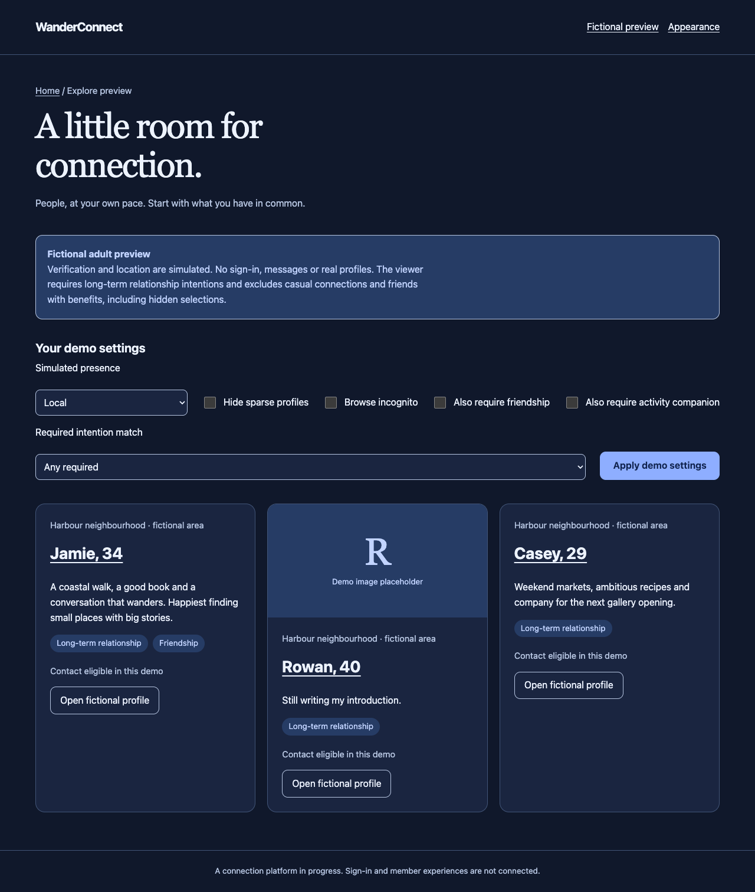
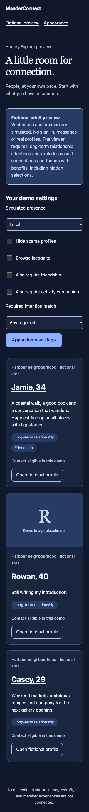

# Phase 2 — fictional local discovery preview

A vertical slice through API → Contracts/typed Client → static SSR Web. It demonstrates Domain list/profile/media/contact denials using fixed fictional adult fixtures. It does not connect Keycloak, create a member session, grant roles, process identity/location or complete earlier phase gates. All verification/location values are clearly labelled simulations. Protected application endpoints remain absent.

DEFAULT D22: register `/api/v1/prototype` only when both Development environment and `Prototype:Enabled=true` are explicit. Web preview `/prototype/people` also requires both flags. Default and Production-enabled hosts keep API prototype routes absent. Local start binds loopback; no public/dev deployment authorized. These routes return only repository-owned fictional data and must never connect to real storage. No configurable user/account ID or role is accepted: the viewer is a fixed adult persona with LTR required and FWB/casual excluded. Hidden FWB always participates in eligibility. Safe inputs select simulated local/upcoming/arrived travel, incognito, sparse filter and optional friendship requirement/ANY–ALL.

Resource routes reuse Domain before projection, return generic 404 for inaccessible people/media/contact, and never return excluded-person counts or denial reasons. DTOs carry display selections only, approximate fictional area, biography and explicit simulation metadata; no email/legal name/coordinate/private intention fields. Media is an abstract labelled demo placeholder, not a verified member portrait. A photo-free substantive person remains eligible. No message sending/real persistence or payments in this slice; a contact action only checks whether a hypothetical request would be eligible.

Design: retain six-scheme personal appearance; Explore-like People grid with purposeful text-first photo-free cards, optional abstract demo media, clear filter form/Apply and local/upcoming/arrived simulation selector. No popularity/compatibility score. Main page labels the entire preview as fictional and identifies the fixed viewing preference. Profile detail shows the same boundaries and a read-only eligibility check. Loading/error/off/empty states are explicit. Use accessible native GET controls/static SSR so authenticated render choice Q03 remains open.

Plan: first add local HTTP acceptance for opt-in/default/production gates, hidden-intention list/profile/media/contact denials, sparse/incognito/travel and malformed inputs; observe enabled route failure; implement API fixtures/projections and Client/SSR pages; run full checks, actual browser controls/narrow/keyboard/error states and local published containers where applicable; review, record evidence, commit and dependent PR. Seven projects remain unchanged; no Domain reference from UI.

The optional additional activity-companion requirement plus ALL provides a real empty-result case against the fixed dataset. Incognito contact requires an explicit disclosure checkbox on the read-only contact check. It never changes the browsing preference or sends a message. Web query inputs are bound as raw arrays and validated before conversion, so malformed/duplicate booleans display a controlled error/unavailable state rather than throwing a Blazor binding exception.

## Local demo

From the repository root, use two terminals (no Keycloak/SMTP/device setup needed for this fictional preview):

```sh
ASPNETCORE_ENVIRONMENT=Development Prototype__Enabled=true dotnet run --project src/DatingApp.Api --no-launch-profile --urls http://127.0.0.1:5080
ASPNETCORE_ENVIRONMENT=Development Prototype__Enabled=true dotnet run --project src/DatingApp.Web --no-launch-profile --urls http://127.0.0.1:5081
```

Open http://127.0.0.1:5081/prototype/people. `Prototype:ApiBaseUrl` can configure the trusted local server-to-server URL for container testing; it is never supplied by a browser. Do not point these fictional-only routes at a real account service. Omitting the opt-in flag disables both surfaces; Production suppresses API routes even with the flag.

`./scripts/check.sh` includes portable API/Web default/Production gating and malformed-input HTTP checks plus fictional API acceptance. With installed Edge and available Playwright, run `DATINGAPP_PLAYWRIGHT_PATH=/absolute/path/to/playwright node tests/prototype/discovery.browser.cjs`; optional `DATINGAPP_WEB_URL` selects another loopback web port. Screenshots stay under ignored `.local/discovery-browser` except the selected fictional evidence below. The script sends no messages and uses no identities/credentials.





Typed-client registration follows [Microsoft's IHttpClientFactory guidance](https://learn.microsoft.com/aspnet/core/fundamentals/http-requests). This adds no application projects and preserves Web → Client → Contracts dependencies.
