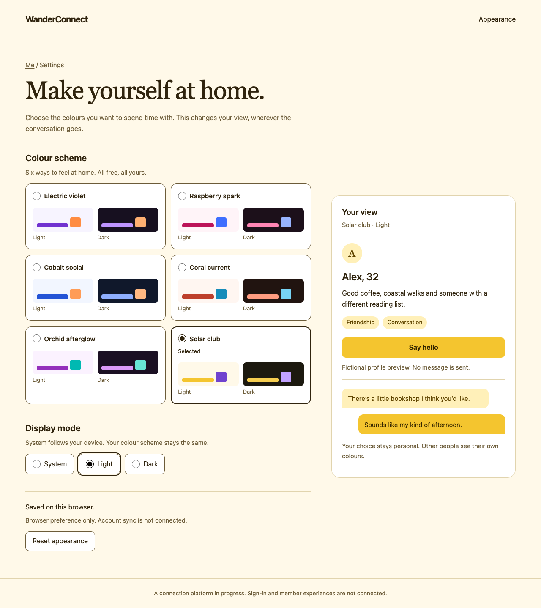
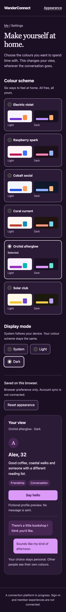

# Phase 2 — local web appearance

Partial Phase 2 slice. Follow the [confirmed appearance specification](../design/USER-APPEARANCE-THEMES.md). No account sync or authenticated web interaction is implied; Q03 remains OPEN. Static SSR serves accessible settings; small external scripts apply a guest browser preference before styles paint and enhance native controls. No extra project, framework dependency or render-mode decision is needed.

CONFIRMED: six schemes; independent System/Light/Dark; free personal choice; explicit onPrimary colors; no photo requirement or effect on matching/permissions. DEFAULT D20: store only a versioned scheme/mode pair under a dedicated guest localStorage key. This guest choice is deliberately retained on this browser. It is not attached to an account. Storage failures retain the current in-memory selection with an honest unsaved notice. Cross-tab guest changes synchronize through storage events. Malformed/unknown stored values safely use Electric violet + System without rewriting storage until an explicit choice. Reset restores that pair.

Design plan: existing canonical Electric light tokens (#F7F4FF background, #FFFFFF surface, #201331 text, #7132D0 primary, #FFFFFF on-primary, #FF8C42 accent) are only the default; all twelve schemes generated from themes.json. Use system sans-serif controls and a restrained Georgia title. A broad settings column beside a quiet, sticky live sample on desktop; collapse to one column on narrow screens. Native radio controls with text selection labels and explicit light/dark preview swatches. No remote fonts/images, animations, or marketing claims. Keep preview content clearly fictional. Focus and control boundaries use the readable text token against surfaces rather than decorative border alone.

Plan review against brief: prioritize usable personal settings over a global brand selector. All six named schemes are visible at once, both mode previews are included, System is persisted as requested, and changing one dimension retains the other. A sample text-first profile and message show recipient-local rendering without exposing a real member. Account sync is visibly unavailable; no fake save to a cloud service.

Implementation plan:

- [x] Add failing browser-independent JS tests for normalization, all 18 preferences/12 visuals, persistence errors, reset and system resolution.
- [x] Generate runtime palette CSS/data from canonical JSON and enforce drift in check_design.py. Implement external synchronous bootstrap plus accessible guest settings/controller; retain static SSR.
- [x] Run actual browser journeys for 18 choices, OS change, reload, cross-tab changes, malformed/blocked storage, keyboard and 320px/large text. Inspect screenshots and verify actual text/control contrast.
- [x] Document evidence/gaps, independent review, ./scripts/check.sh, commit and dependent PR to main. Reassess next unblocked work.

Account revision/conflict handling, real account switching, offline cloud retries, MAUI rendering/device evidence and all application-wide feature surfaces remain future acceptance gates. This slice must not claim the full appearance feature or phase complete.

## Review evidence

Actual headless Edge screenshots from the final published ARM64 container; fictional preview content only. These illustrate rendered layouts, not screen-reader or device certification.

See [validation](VALIDATION.md) for commands, failures/fixes and remaining gates.
