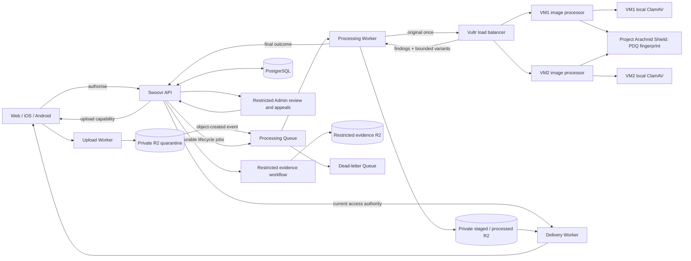

# Swoovr image pipeline: Cloudflare orchestration and always-on Vultr processing

Prepared 8 November 2026. Documentation branch: `codex/docs-vultr-image-pipeline`. Status: owner-requested implementation design and migration requirements; not implemented or deployed by this document. Tracking: https://github.com/repasscloud/wanderconnect/issues/294. Supersedes the Cloudflare Container hosting assumption in the [original overview](../../../Swoovr_Cloudflare_Image_Architecture_GitHub_Issues.md), not historical validation evidence.

## 1. Intent and requirement status

Keep image models loaded on two independently maintainable Vultr VMs behind a load balancer. Cloudflare handles upload, queue orchestration, private R2 storage and controlled delivery. The Swoovr API alone reads/writes PostgreSQL and owns current application state, permissions, human decisions and audit. Optimise normal uploads for one original-image transfer to Vultr, one processing visit and one durable final outcome report to the API; retries may repeat requests but never their effects.

### CONFIRMED by the owner in the design conversation

- Use two always-on Vultr VMs behind a load balancer instead of an always-running Cloudflare Container; maintain/patch one VM at a time while the other remains ready.
- Each VM has its own local ClamAV instance alongside the image-processing service. Models stay loaded in memory.
- Use Cloudflare Workers, R2 upload events and Queues to orchestrate image checks and preparation. R2 stores image bytes; API owns PostgreSQL.
- Automatic pass/review/block rules live in deployed Worker code. Developer changes update documented rules and redeploy Workers; no staff-editable thresholds.
- Avoid unnecessary round trips to the API between screening and image preparation. Report the completed outcome to the API; it commits state and verifies current lifecycle eligibility.
- Prepare private variants during the same Vultr processing visit for safe, decodable pass/review candidates, allowing later ordinary review approval without another visit where screening remains valid.
- Build/release/operate this processing service independently of the Swoovr web deployment. The owner will provision Vultr infrastructure and provide endpoints/IPs and private runtime credentials later.
- Owner supplies real secrets through private environment files/configuration, never git or image builds. This document does not authorise provisioning, billing changes, merge or deployment.

### Existing CONFIRMED safeguards to preserve

D201/D205: separate nudity, NSFW and known-content signals; fail closed for mandatory checks; known matches dominate; no automatic permanent account penalty from an ordinary classifier signal. D298: in-app outcomes; one eligible photo appeal within 30 days, different Admin, final; suspected-CSAM/known-illegal/specialist media excluded with no detailed reason; rejected file retained privately 30 days unless held; independent Admin reconsideration requires reason and re-screening. D216/D229/D230 and retention leases: preservation and holds override disposal; stale approval cannot replace a specialist block. D336: preserve existing support-attachment ClamAV behaviour and approved scanner digest unless separately reassessed.

### DEFAULT engineering choices

Three logical Workers; one processing Queue plus DLQ; three storage security areas; bounded synchronous Vultr processing requests orchestrated asynchronously by the Queue; Worker-mediated R2 transfer; one model process per VM initially; separate unmodified ClamAV sidecar; staged private variants and durable result manifests. Exact paths, resource names and contracts below are logical requirements, not implemented endpoints.

### OPEN release decisions

See Q171–Q174 in [QUESTIONS](../../delivery/QUESTIONS.md), tracked on https://github.com/repasscloud/wanderconnect/issues/294. VM region/size, real workload and target latency/budget, new raw-original retention, scanner freshness/re-screen policy, provider acceptance/licensing and externally configured connection details must be resolved before the relevant release gate. No arbitrary guessed number is an owner-approved limit.

## 2. Components and boundaries

| Component | Count per environment | Owns |
| --- | --- | --- |
| Upload Worker | 1 | Verify narrow upload capability, enforce byte limits, write immutable quarantine object |
| Processing Worker | 1 | Queue jobs, trusted context, transfer, versioned rules, private output persistence, API outcome reporting, cleanup jobs |
| Delivery Worker | 1 | Current access decision and approved variant delivery; GET/HEAD, secure caching |
| Main Queue and dead-letter Queue | 2 queues | Processing/promotion/cleanup jobs and failed-job recovery |
| Vultr load balancer | 1 | HTTPS routing to ready capacity, health checks and maintenance drain |
| Vultr VMs | 2 | Independently restartable identical processor stacks |
| Image processor | 2 containers total | One warm CPU model process on each VM; validate, inspect and prepare variants |
| ClamAV | 2 containers total | One local scanner per VM, signatures in its own persistent volume |
| R2 security areas | 3 | Raw quarantine; staged/processed variants and result manifests; restricted evidence |
| Swoovr API + PostgreSQL | Existing | Upload records, identities, current purpose/state, review/appeals, access, holds, audit, inbox/outbox |

Counts exclude supporting TLS/monitoring agents, model-cache volumes and existing application infrastructure. Three areas need independently enforceable permissions; exact bucket separation/names remain an implementation choice. Staged and deliverable variants can share a private processed bucket with state-authorised access, avoiding a copy on every approval. Routine Workers must not have evidence decryption/read permission. No new .NET project by habit; preserve existing project dependency rules. Python processing belongs in the existing image-moderation-api repository by default, with coordinated PRs linked back to the tracking issue.

The load balancer response arrows represent responses from the selected backend. It does not perform processing. No Worker/container connects to PostgreSQL. A stored object or `processed/` prefix never establishes delivery permission.

## 3. Current implementation inventory and differences

Inspected local main during this design conversation; all references are point-in-time source evidence, not hosted acceptance.

| Existing source | Behaviour today | Required transition |
| --- | --- | --- |
| `src/Swoovr.Api/Media/MediaPipeline.cs` | API processes upload, stores quarantine, owns screening queue/worker and publication/preservation | API becomes upload/lifecycle authority and authenticated outcome consumer; retire old automatic scan/publish path after cutover |
| `src/Swoovr.Infrastructure/Media/PhotoProcessor.cs` | SkiaSharp accepts JPEG/PNG/WebP under limits, rejects animation, applies EXIF orientation, stores metadata-free JPEG; original bytes not stored | Scan original before re-encoding; bounded processing moves to Vultr; explicitly govern newly retained originals |
| `src/Swoovr.Infrastructure/Media/ImageModerationScreening.cs` | API calls `/ready`, then multipart `/v1/scan`; parses strict independent signals | Worker invokes new processor contract; retain old adapter only during controlled transition |
| `src/Swoovr.Domain/Media/Media.cs` | Automatic policy in Domain; threshold 0.40 for selected exposed-anatomy labels; NSFW flag -> review; known match -> blocked; unknown -> pending | Move automatic evaluation to versioned Worker module and fixtures; API retains lifecycle/auth/state-transition validation, not a second threshold implementation |
| `src/Swoovr.Api/Media/MediaEndpoints.cs`, `Connections/MessagingEndpoints.cs` | Profile/album and chat uploads use common pipeline | Move all in-scope clients to authorised ingress without bypassing ownership, quotas, message/album rules |
| `src/Swoovr.Api/Media/PhotoReview*` and existing review workflows | Human decisions, notices, appeals and re-screen/reconsideration protections | Preserve behaviour while using staged objects and new recorded scan evidence |
| `src/Swoovr.Infrastructure/Scanning/ClamAvScanner.cs`, `Api/Ticketing/*`, `compose.local.yaml` | Separate support-attachment ClamAV integration, INSTREAM and fail-closed limits | Reuse protocol/behaviour knowledge; preserve support pipeline rather than silently reroute it |
| Sibling `image-moderation-api`, inspected at `d0aa1d6` | Python/FastAPI CPU NudeNet 3.4.2, nsfw-image-detector 0.1.2, PDQ 0.2.8, optional Shield; no member-image ClamAV/variant/job pipeline | Extend with required scanner, bounded processing, result/variant contract, version reporting and standalone Vultr packaging |
| `compose.local.yaml`, `scripts/local-platform.sh`, `infra/uat/*` | Local scanner container and app-linked screening wiring | Add independent processor release/runbook; explicitly unwind old automatic invocation and hosted startup assumptions |

Cloudflare's separately configured CSAM Scanning Tool is not a substitute for the mandatory Shield check in this design and is not proven active by repository code. Identity documents/liveness stay in Didit's restricted pipeline. Support attachments remain on their existing scanner path unless separately approved. Initial image scope: member profile/photo pool, private albums and chat images; inventory every other upload path before declaring coverage. DeepFace/identity inference is not added.

## 4. Automatic policy, context and versions

Implement a pure, tested Worker policy module with explicit policy version, source revision and documented rule table. Document and executable fixtures change together. Unknown versions/labels/statuses, disabled required checks, malformed scores and missing fields fail closed. Scores must be finite and within their documented domain. A positive specialist match dominates failures or negatives from other models.

Initial compatibility baseline: retain the existing selected NudeNet classes (exposed female/male genitalia, anus, female breast and buttocks) at >=0.40 and Freepik `is_nsfw=true` as review signals; retain `csam` and `harmful-abusive-material` as specialist blocks; `test` classification -> non-deliverable controlled review/test outcome. The threshold is an existing owner-accepted but uncalibrated starting point, not a measured accuracy claim. Do not silently reinterpret cumulative Freepik scores as exclusive probabilities.

Rules must distinguish purpose (public profile/private album/chat) using API-authenticated job context. Eligibility, ID/SEM consent, current account restrictions and viewer permissions are live API state, not hard-coded claims. Capture source purpose and policy version in the job; require a new valid decision if purpose changes. Separate findings from the policy decision so a new policy can be audited/reassessed. A policy deployment does not silently relabel old images: specify an explicit re-evaluation/re-screen plan when changes warrant it. API may maintain an accepted policy-version allowlist and reject obsolete results without reimplementing model thresholds.

Deploy Worker rule changes through review and local checks, record policy/version provenance, support rollback and test mixed-version jobs. Do not enable hosted Actions except the owner's named allowance. Confirm existing explicit-private-content policies from current decisions; no new permission to expose nudity is created here.

## 5. Processing order and single-transfer protocol

1. API authorises member/purpose/quotas and creates immutable upload identity and short-lived capability. No processing authority derived solely from R2 event metadata.
2. Upload Worker verifies capability, allowed origin/CORS where applicable, byte limit and exact object key; disallows overwrite and replay. Store original in private quarantine; emit via R2 object-created notifications, filtered to ingress objects only to prevent recursive variant events.
3. Processing Worker validates event and claims current job through the API (or equivalent verified upload context with a durable claim). Correlate environment, image ID, immutable object key/version/ETag and SHA-256. ETag is not assumed to be a SHA-256 checksum.
4. Stream bounded original bytes once over authenticated HTTPS to a ready Vultr VM. Reject arbitrary fetch URLs and untrusted bucket/key selections. Stream into bounded memory/tmpfs; no unlimited buffering, archive expansion or request queue inside the VM.
5. Run local ClamAV on the ORIGINAL bytes before full image decode or transformations. Minimal signature sniffing/limits may precede it. Infection -> stop normal pipeline; scanner error, exceeded limits, unavailable/stale database -> pending/unsupported according to explicit policy, never pass.
6. Safely validate format, dimensions, pixel count, frame count and decoder resource limits. Use bounded process isolation/timeouts for hostile decoding; update decoder dependencies. Respect orientation. Confirm decoder differences across SkiaSharp/Pillow/OpenCV in tests.
7. Compute PDQ locally from a bounded decoded representation and call Shield. Run independent nudity/NSFW inference with bounded concurrency; benchmark sequential versus parallel execution before enabling parallel engines. Stop unnecessary work when a specialist block is established. Provider failures remain separate from negative findings.
8. For non-malware, non-specialist, safely decodable images with completed required checks, prepare a small fixed manifest of metadata-free variants DURING THIS SAME REQUEST, including review candidates. This is speculative private preparation, not approval. If any required check fails, no ordinary delivery output is accepted. Do not make thumbnails of specialist-match material for normal review.
9. Return strict bounded findings plus a bounded binary variant stream/package and manifest (not base64 image fields in ordinary JSON). Each entry includes name, type, dimensions, byte length and SHA-256. Set a total response limit; never extract arbitrary paths from a returned archive. Exact framing is left to the implementer and must be contract-tested before integration.
10. Worker evaluates deployed rules, verifies response/job identity and each variant's bounds/digest, stores immutable staged variants and a durable private result manifest. Report final outcome once to API. Return/ack only after durable API commit or an explicitly durable next-stage handoff.
11. API authenticates report and validates current job, accepted policy version, object identity, expected manifest, lifecycle revision, deletion/restriction/hold state; records receipt, state and notifications/outbox atomically. It does not run a second model-threshold evaluator. Only a committed eligible state permits delivery.
12. Cleanup raw originals and unused outputs according to approved retention/holds. Container scratch is deleted on success, error and restart; no member images in model-cache volumes, swap, core dumps, diagnostics or ordinary backups.

A Worker cannot call a rule that exists only inside itself halfway through a single synchronous Vultr response. Therefore Vultr prepares bounded variants for eligible review/pass candidates without knowing the final Worker verdict. This deliberate small CPU/storage cost removes a second transfer and later review reprocessing. If measurements show this cost is material, propose a separately reviewed protocol change; do not assume VM-local cached bytes will survive retries/load balancing.

## 6. Outcomes, step by step

### Automatic pass

1. Common steps 1–9 inspect and prepare in one visit.
2. Worker sees all required checks completed and no rule requiring review/block.
3. Persist variants + result manifest privately; submit completed pass report to API.
4. API atomically commits outcome only if still eligible, along with audit/notification intent.
5. Acknowledge queue job; authorised delivery becomes available. Schedule safe original cleanup.

Normal count: one original transfer to Vultr, one processor request, one variants/findings response, one final API report (plus initial authorisation/job claim). A report retry reuses durable results rather than routinely rerunning models.

### Refer to Admin

1. Common inspection completes; rules identify ambiguity/ordinary review signal.
2. Prepared versions are saved privately for later review/approval, not normal delivery.
3. Worker reports review outcome and minimum findings; API creates the restricted queue entry and member-visible appropriate status.
4. Finish/ack the processing job. No long-held request waits for staff.
5. Authorised Admin uses existing acknowledgement, blurred/reveal, purpose, conflict, sensitive-access and audit controls.
6. Approval records reason/actor and validates evidence/current policy/preservation state. Enable existing variants when valid; do not bypass any existing required re-screen rule. A required re-screen is a new job, with no delivery until complete.

Normal first-stage count is the same as auto pass; ordinary later approval can add zero Vultr requests. Every prepared variant remains inaccessible unless API state and viewer authorisation both permit delivery.

### Rejected by Admin

1. Admin records approved reason code and appropriate notes through API.
2. API atomically records rejection, removes any placement/delivery eligibility, records audit and member-notification intent.
3. Preserve review material privately for the confirmed 30-day rejection/appeal window, subject to stronger holds/retention.
4. Member receives allowed notice and eligible appeal route. Existing sanction appeals remain separate.
5. No automatic second Vultr visit. Hold-aware cleanup disposes bytes after applicable retention expires.

### Appeal upheld (member succeeds)

1. Member submits their one eligible appeal within 30 days; API records it durably and prevents cleanup while unresolved.
2. Different authorised Admin reviews prior findings, rejection, image and member submission; existing conflicts apply.
3. Admin requests overturning the rejection; API records a pending reconsideration command, not a completed successful appeal.
4. A NEW mandatory re-screen job retrieves the retained inspected source and sends it to Vultr. This preserves current `PhotoReviewWorkflows.ResolveAsync` -> `MediaPipeline.ReconsiderAsync` behaviour: a fresh complete pass is required for appeal approval and independent reconsideration. This path deliberately adds a Vultr visit.
5. Only a fresh complete pass permits the API to finalise the successful appeal and restore the library item, with audit and notice. Never silently restore former profile/mode placements or album sharing. Pending/failure remains unavailable; a specialist match enters restricted handling and cannot be overridden.
6. Existing variants may be reused only if their input digest/recipe still matches the freshly cleared bytes and policy; otherwise regenerate in that same visit. Missing source/variants requires reconciliation, never a Ready state.
7. Terminology: “appeal upheld” here means member succeeds. Existing wire `outcome=upheld` means the ORIGINAL REJECTION stands; preserve the actual wire mapping and avoid reversing notices or decisions.

### Appeal declined (rejection stands)

1. Different authorised Admin assesses appeal and records final reason/outcome.
2. API retains rejected/non-deliverable state and records final notice/audit.
3. Cleanup follows rejection/appeal retention schedule and holds; no automatic new Vultr processing.

### Known-content CSAM/harmful-material match or specialist suspicion

1. Shield known match takes priority over negative model signals. Human specialist escalation can also block an item; nudity scores alone cannot establish age, consent or CSAM.
2. Stop ordinary preparation; no normal review thumbnail or deliverable variants.
3. Worker durably reports specialist outcome to API. API commits blocked state, incident/preservation recovery intent and appropriate restricted escalation.
4. Evidence custody service secures the source with the existing sealing/encryption/hold semantics. Restrict ordinary access immediately; no deletion before confirmed evidence capture. Preserve relevant original and exact inspected-byte identity as required; adapt existing preservation rather than invent an untracked copy.
5. Ack only after durable handoff with recovery authority. A custody outage leaves blocked, retryable preservation; it never permits release or ordinary cleanup.
6. Trained authorised specialist/legal workflow handles further action. No ordinary photo appeal, detailed match notice or automatic permanent account ban from this worker.
7. If a late specialist block supersedes an ordinary earlier result, revoke delivery and staged outputs and follow evidence rules. Ordinary stale approval cannot undo it.

A known-content match is not a complete detection system for newly created abuse material. Provider error/timeout/no credentials is not a negative match. Provider `test` results are not real matches or ordinary passes.

### Malware, invalid input and operational failures

| Outcome | Required behaviour |
| --- | --- |
| Malware positive | No decode/variants/normal review; blocked malware outcome, minimum diagnostic metadata, agreed retention; no implied CSAM classification |
| Unsupported/invalid/oversized/animated input | Non-deliverable clear supported outcome; preserve current accepted-format rules until deliberately changed |
| Decoder limit/crash, ClamAV limit or unavailable engine | No pass; bounded failure/retry or unsupported outcome; no manual approval bypass |
| Shield 401/403 | Configuration/credential alert; pending, no endless unchanged rapid retry |
| Shield 429/timeout/5xx | Backoff and retry with bounded concurrency; never treat as no-match |
| Processor busy | 429/503 or equivalent retryable response; queue absorbs backlog |
| Worker/VM crash after partial writes | Immutable attempt keys, result manifest/reconciliation detect incomplete work; no delivery |
| API unavailable after successful processing | Resume from durable private result; retry report without routine inference repeat |
| API committed but reply lost | Identical event replay acknowledged as successful no-op |
| Delete/account restriction during scan | API prevents publication; deletion/hold rules govern storage cleanup |
| Multiple out-of-order jobs | Current revision and monotonic transition guards; obsolete result cannot revive an image |
| Queue expiry / exhausted retries | API reconciliation discovers stranded pending records; DLQ and alerting are recovery aids, not permanent records |

## 7. Contracts, durability and idempotency

Establish versioned local OpenAPI/JSON schemas and executable fixtures before implementing interfaces. Preserve stable Swoovr API paths/version-header conventions. Do not copy illustrative routes into code without checking existing contracts.

Upload intent/context: `imageId`, `uploadId`, `purpose`, `account reference` (only if required), maximum bytes/type, immutable object reference, expiry, environment, lifecycle revision. API issues signed scoped capability; never trust client owner/purpose fields without validation.

Processing request: protocol version, `jobId`, image/upload identity, expected source digest/object identity, context/policy applicability, bounded requested variants, deadline and attempt. Authenticate Worker to processor; bind identity to request body/digest, prevent replay and rotate identities. Processor does not accept arbitrary URLs or callback destinations.

Result: engine completion states, exact model/build/digest versions, scanner engine/signature versions and signature timestamp, approved minimum findings, input hash, variant manifest, start/end times and explicit errors. Do not send Shield raw JSON or PDQ hashes to ordinary logs/client payloads. Include source orientation/normalisation recipe version where relevant.

Final report: stable `eventId`, `jobId`, image ID, lifecycle revision, source digest/ref, policy version, outcome/reason, engine versions/status, variant manifest/result reference and timestamps. API checks protocol/version, current purpose and trusted producer. Normal findings are not proof of owner/ID/consent.

API inbox uniqueness is database-enforced. Canonical payload digest and image transition commit in one transaction with audit and notification/outbox intents. Exact duplicate -> success no-op. Same event ID/different payload -> reject/audit. Stale/deleted state -> explicit permanent reconciliation outcome; do not blindly retry forever. Temporary API/DB failure -> retryable failure, not success. Permanent auth/schema failures alert and stop unchanged retries.

Use API-owned outbox for durable promotion/re-screen/cleanup commands and notices. DB commit followed by an unrecorded queue send is not reliable. Bind command to current lifecycle revision and expected object digest; Cloudflare consumer authenticates it. Inbox/outbox reconcile lost acknowledgements and queue exhaustion. API holds leases for short transactions, not across long external scan requests; implement job leases/fencing and final compare-and-swap to replace old long-running lifecycle locks safely.

Persist a private result manifest and staged objects before reporting. Deterministic per-job/attempt identifiers and hashes allow callback-only recovery. If crash precedes completed manifest, a scan may have to repeat; the design promises safe at-least-once execution, not exactly-once compute. A changed policy or required fresh scan creates a new job, rather than reusing invalid evidence.

## 8. Independent container build and release deliverables

Implement these in coordinated PRs, defaulting to the existing image-moderation-api service repository rather than embedding the service into Swoovr web deployment:

- Production Dockerfile with pinned/reviewed base and dependency locks, CPU-only libraries, explicit model revisions/digests, build-time downloaded weights and offline runtime model loading. Extend current multi-stage Python 3.12 CPU build; confirm target VM architecture. No secret in build arguments/layers/history.
- Preserve NudeNet 3.4.2 / nsfw-image-detector 0.1.2 / PDQ 0.2.8 as inspected baseline until compatibility/licensing/security review changes them. Resolve the existing NudeNet licensing discrepancy before hosted use; record model and package licences/SBOM.
- Processor module for raw-byte ClamAV INSTREAM, bounded decoder/orientation, classifiers/Shield, variants, strict binary response/manifest, request authentication, health/drain, metrics and cleanup. Reuse tested contracts; do not assume current `/v1/scan` already supports this.
- Two identical host Compose manifests/config templates (one manifest parameterised per host), unmodified ClamAV sidecar, private scanner network, signature/model-cache volumes, resource limits, non-root/read-only processor with bounded scratch, restart policy and logging limits.
- Initial approved ClamAV pin from D336: `clamav/clamav@sha256:c21aa18cc0a358678255a3dfb343a4555b58f71b97d7b869df8fdf7ea0a5b4b1`. Reassess existing supply-chain concerns/architecture compatibility rather than silently using `latest`. Keep definitions updated with freshclam independently of engine-image rebuilds. No public TCP 3310 mapping.
- New image-scan limits derive from approved member upload limits and decoder pixel limits; do not blindly copy support attachment 160M/400M limits. Limit exceeded/unsupported must never become Clean.
- One model process per VM initially avoids duplicate model RAM from multiple HTTP worker processes. Bound CPU/thread pools, request slots and memory. ClamAV memory includes reload/signature-update peaks; benchmark whole host, not just ML process.
- Build script, local smoke/contract/failure test scripts, digest-based publish instructions, per-host install/update/drain/rollback scripts or runbook, `.env.example` placeholders, ignored real `.env`, release manifest (image/model/policy/protocol versions), operator checklist and troubleshooting.
- Local explicit image build/publish/release commands operate independently of Swoovr web/API deploy commands. A web release must never recreate Vultr VMs, restart processors or replace their secrets. Coordinated API/Worker protocol compatibility is still required.
- Keep hosted Actions commented except named enabled workflow; no new active build/deploy Actions. Manual documented build/release first.

ClamAV signatures have separate persistent state on each VM. Rolling engine/model/container upgrades drain one VM, wait for active requests or deadline/retry, deploy pinned release, warm models, check scanner freshness and readiness, perform safe smoke scan, restore rotation, then repeat on second VM. A load balancer only directs new work; it cannot guarantee survival of in-flight requests. The Queue and API job fencing handle interrupted work.

## 9. Project Arachnid on Vultr and private configuration

The inspected adapter uses **Shield Basic authentication with `ARACHNID_API_USERNAME` and `ARACHNID_API_PASSWORD`**, not a single generic API key. `API_KEY` is the existing processor inbound bearer key and is a different secret. If the provider account uses a changed authentication contract, verify official terms/docs before altering the adapter.

On each VM the processor safely decodes a bounded image, converts BGR to RGB as appropriate, computes a 256-bit PDQ fingerprint and quality using `pdqhash`, packs bits and Base64 encodes the 32 bytes. It sends `{"hashes":["<fingerprint>"]}` to the existing fixed HTTPS `https://shield.projectarachnid.com/v1/pdq` endpoint with Basic auth. It sends the fingerprint, not the image, to Shield. TLS certificate validation stays on, redirects stay off, fixed endpoint/egress rules prevent arbitrary fetches. Confirm low-quality hash/provider interpretation; do not invent a no-match when unusable. Current adapter readiness means configured client only, not proven provider authentication/acceptance.

Require BOTH credentials and successful local model/scanner initialisation for hosted operation. Missing credentials must fail readiness/configuration validation, never silently disable the mandatory check. Use separate provider identities per environment where permitted; confirm both VM identities/IPs, agreement, shared rate limits, rotation and provider test acceptance. Do not parallelise upstream requests beyond approved account capacity. Track rate-limit/error telemetry without sensitive fingerprints/raw bodies. Never use real abuse imagery for testing; use provider-authorised harmless test fixtures and controlled contract responses.

| Location | Configuration/secrets | Must not contain |
| --- | --- | --- |
| VM private `.env` / runtime secrets | Processor inbound auth, Shield username/password, model/scanner endpoints/settings, approved thread/limit configuration | PostgreSQL credentials, Worker-wide R2 admin token |
| Cloudflare Worker secrets/bindings | Scoped processor auth, API callback auth, R2/Queue bindings, verification key and environment identifiers | Shield credentials, PostgreSQL credentials |
| Swoovr API private config | Trusted Worker identity/key, accepted policy/protocol versions, upload signing keys, job/retention state configuration | Unnecessary Shield credentials |
| Operator-only configuration | VM addresses, LB hostname/TLS, registry access and deployment credentials | Secrets committed to docs or issue |

Owner will supply VM IPs/hostname, region and private values later. Example files contain placeholders only, with missing mandatory settings rejected. Actual `.env` files must be gitignored, readable only by operator/service, supplied at runtime, excluded from build context/logs/backups and never pasted into GitHub. Cloudflare secrets are installed with the appropriate secret mechanism, not committed `.env` contents. Do not claim readiness from simply populating the files.

## 10. Delivery, retention, deletion and evidence

Delivery checks current API authority for image readiness AND viewer permission: owner/profile visibility, mode, block/restriction, album grant, SEM/ID rules and expiry. GET and HEAD must both enforce it; no direct public R2 origin. Prefer mediated current checks initially; token/caching optimisation requires an explicit maximum revocation delay and proof. Do not cache private bytes across viewers or leak existence through HEAD. Existing signed links cannot silently survive deletion/restriction indefinitely.

Raw-original storage is NEW. Before enabling uploads, approve maximum lifetime for successful uploads, unresolved review/failure, rejection/appeal and interrupted jobs. Do not let a broad R2 lifecycle rule erase held evidence or pending appeals. Retain minimum required original/derived evidence with independent protected references; ciphertext is never re-scanned as if it were the original. Existing 30-day rejection rule is not permission to erase qualifying longer-lived review evidence or holds.

API records revocation first, emits durable cleanup, and considers deletion complete only under the existing account/hold semantics. Worker deletes only exact authorised refs with current revision; missing object is safe idempotent completion, ambiguous hold status postpones deletion. Remove partial variants/result manifests when safe. Logs/analytics/export/backup paths must use new object refs without giving ordinary tools specialist access. Review and user export use prepared approved bytes according to existing policy; quarantine/evidence remain excluded from normal export.

## 11. Capacity, cost and operational readiness

Measure original bytes, decoded pixels, variant total bytes, queue wait, transfer, ClamAV/Shield/model/encode timings, API commit and delivery latency at p50/p95/p99. Measure idle/peak RAM, CPU/thread contention, scratch, signature reload and model warm-up. Test representative maximum sizes, bursts and one-VM operation; set fixed Worker concurrency and per-VM request slots from measurements, not default queue autoscaling. Busy responses back off; monitor oldest queued job rather than only depth.

Queue Worker wall-clock limit is currently 15 minutes; processor and network deadlines must be substantially shorter. Never wait for human review inside a queue invocation. Configure retention and DLQ recovery explicitly; API reconciliation is required because both normal and dead-letter messages expire. Long outages must not silently strand uploads or remove evidence.

Budget includes two VMs, LB, registry/operations, Vultr transfer, Workers, Queues, R2 reads/writes/storage and speculative review variants. R2 direct egress currently has no R2 bandwidth charge; other services can still charge. Do not claim a measured saving, VM fit, Australian residency or fixed latency without evidence. Verify selected Vultr region, R2 jurisdiction/location and actual processing path; update privacy/provider disclosures and obtain required owner/legal approval before hosted use.

Alert on stale signatures, missing models/credentials, Shield auth/rate failures, scan coverage gaps, DLQ/oldest age, callback failures, repeated stale events, preservation recovery, disk/memory pressure and unhealthy backend count. Keep monitoring/logs content-free. One VM must sustain agreed peak demand or explicitly acceptable queue delay during maintenance. Two VMs do not guarantee zero downtime or multi-region resilience.

## 12. Migration from current model

Use small PRs to main, coordinated with the service repository. No historic production-image migration is assumed (original overview); verify actual current data before cutover. Existing fictional local data can be reset only with explicit scope and preservation checks, not by deleting unrelated developer state.

1. **Inventory and freeze contracts.** Enumerate profile/photo pool, album, chat, staff review, appeals, reports/evidence, export, replacement and purge paths; map current limits and statuses. Record exact source refs and live configuration separately. Identify Q171–Q174 gates and existing #260–#265 scope updates.
2. **Build independent processor release.** Extend sibling service and ship tested Dockerfile/locks/models, Compose, ClamAV integration, Shield contract, variants, auth, health/drain, configuration examples and manual scripts. Prove synthetic local end-to-end operation before any hosted connection.
3. **Add API metadata and transport.** Upload intent, lease/fencing/revision, purpose, source/variant manifest refs, policy/model/signature evidence, transactional inbox/outbox and deletion/reconciliation. Migrate additively where needed; preserve existing privacy/moderation grants and evidence custody semantics.
4. **Build Workers and R2/Queue resource definitions.** Versioned policy+fixtures, upload caps, immutable keys, processing/result durability, authenticated callbacks, DLQ/recovery, delivery and hold-aware cleanup. Separate environment resources/identities; no real keys in IaC.
5. **Integrate all clients/review.** Web/iOS/Android use new upload authorisation/status; Admin retains safety acknowledgement/conflicts/reveal/appeals. No test/development/UAT notices in application UX (D321); configuration selects providers.
6. **Validate isolated environment.** Owner supplies endpoints/secrets; exercise mandatory real provider acceptance with harmless permitted fixtures. Real credentials/configuration are a gate, not an excuse to call mocked evidence live.
7. **Cut over exactly one authority per upload.** Bind pipeline generation at upload creation; old jobs drain under their generation, new jobs use Worker path. Do not run both publishers against one item. Reconcile all pending/review/held items; protect old read paths until no references depend on them.
8. **Unwind old path.** Disable/remove API's automatic media screening queue, old `ImageModerationScreening` calls and local/hosted `Media:Screening:*` assumptions when coverage is proven. Preserve API human workflows, preservation recovery, unrelated support ClamAV and lifecycle checks. Remove obsolete config/startup gates/scripts/contracts only with tests proving replacement. No needless Domain policy duplication.
9. **Update documents/disclosures and rollback.** Replace current operational guidance, requirements and privacy text that still describes API-side re-encoding/no original retention or old hosting. Retain historical evidence as historical. Record actual checks/gaps. Release processors separately from Swoovr web/API.

Rollback is generation-aware: stop issuing new-path intents, preserve new objects/results, drain/reconcile safely and restore compatible Worker/service versions. Old API must not reinterpret new staged objects as approved or scan sealed evidence. Database migration reversals must not erase decisions/holds. Prefer disabling new uploads over unsafe automatic fallback. Operator approval remains required for hosted cutover and deployment.

## 13. Acceptance requirements

- [ ] All in-scope upload paths inventoried and protected; API-only PostgreSQL access demonstrated.
- [ ] Independent digest-pinned processor release and ClamAV sidecar build/run instructions work on target CPU architecture; no web deployment dependency.
- [ ] Models are loaded before readiness; each local scanner uses updated signatures; one VM maintenance/OOM/restart tests preserve fail-closed behaviour.
- [ ] ClamAV runs on original upload; EICAR fixture (controlled scanner test), clean fixture, limits, scanner outage and stale signatures produce expected outcomes. Never decode malicious test input unnecessarily.
- [ ] Actual model inference exercised with safe synthetic/owned permitted imagery; unknown fields/scores/labels fail closed; thresholds and purpose rules have executable fixtures.
- [ ] Shield missing/partial credentials, 401, 429, timeout, unknown/test/no-match/match classifications tested; real provider-authorised harmless acceptance distinguished from mocks and configured readiness.
- [ ] Auto pass: one normal original transfer/processor request, bounded variants, durable manifest, final API report, authorised delivery; measured timings recorded.
- [ ] Review referral, Admin approval/rejection, successful/declined appeal, mandatory reconsideration re-screen and expired retention all tested with existing roles/conflicts/acknowledgements/notices.
- [ ] Specialist result creates restricted evidence/incident/recovery with no ordinary image rendering, appeal or download; known matches simulated or provider-authorised harmless fixtures only.
- [ ] Parallel duplicate events/reports, changed event payload, late result, revoked account, deletion mid-scan, competing review and newer policy job cannot revive/refinalise images incorrectly.
- [ ] Crash before/after variant write, manifest write, API commit and ack recovers safely; lost API reply yields no duplicate audit/notice/side effects; callback-only retry avoids unnecessary inference.
- [ ] API outbox dispatch and reconciliation recover queue expiry/DLQ exhaustion and preservation failures; missing objects do not become Ready.
- [ ] Delivery tests include GET/HEAD, cross-member grants, blocked/revoked albums, SEM/ID changes, signed-link expiry, cache isolation and variant enumeration.
- [ ] Raw retention/privacy approvals, environment isolation, key rotation, log redaction, scratch cleanup, image/model licence review and provider terms complete.
- [ ] Old media pipeline retired only after complete coverage; support attachment scanner remains operational; no new enabled Actions.
- [ ] `./scripts/check.sh` passes before commits; appropriate local/provider/browser/native/load evidence and unverified gaps recorded separately.

## 14. Ticket coordination and next inputs

Current implementation epic: [#294](https://github.com/repasscloud/wanderconnect/issues/294). Superseded parent [#267](https://github.com/repasscloud/wanderconnect/issues/267) is closed as a duplicate; its six image children and release gates now belong to #294. Architecture [#260](https://github.com/repasscloud/wanderconnect/issues/260), ingress [#261](https://github.com/repasscloud/wanderconnect/issues/261), processor [#262](https://github.com/repasscloud/wanderconnect/issues/262), delivery [#263](https://github.com/repasscloud/wanderconnect/issues/263), contracts [#264](https://github.com/repasscloud/wanderconnect/issues/264), operations [#265](https://github.com/repasscloud/wanderconnect/issues/265). This design amends their Cloudflare Container assumption; it does not close them or claim implementation. Inspect live ticket requirements before implementation and reconcile changed scope through linked PRs.

Owner setup inputs later: region, VM resources/architecture, IPs, LB hostname/TLS and network constraints, private credentials, registry destination, Cloudflare account/environment resource identifiers, and monitored operational contact. Values belong in private configuration, not issue comments. Work on contracts, fixtures, builds and local integration can proceed independently of hosted provisioning.

## 15. Reference evidence and limitations

- Source inventory above and sibling moderation README/engines/Dockerfile were inspected locally; no provider, VM sizing or real-image safety accuracy is established here.
- [R2 events](https://developers.cloudflare.com/r2/buckets/event-notifications/): events can feed a Queue; event metadata does not authorise content.
- [Queue limits](https://developers.cloudflare.com/queues/platform/limits/), [concurrency](https://developers.cloudflare.com/queues/configuration/consumer-concurrency/), [DLQ](https://developers.cloudflare.com/queues/configuration/dead-letter-queues/): verify again when implementing; finite runtime/retention requires reconciliation.
- [R2 conditional operations](https://developers.cloudflare.com/r2/api/workers/workers-api-reference/), [pricing](https://developers.cloudflare.com/r2/pricing/): conditional object access, operation/storage costs and direct R2 egress behaviour.
- [Vultr health checks](https://docs.vultr.com/products/network/load-balancer/configuration/health-checks): supports backend readiness routing, not automatic durable job recovery.
- [Shield provider documentation](https://shield.projectarachnid.com/docs/): verify actual account authentication, agreement, rate/quality semantics and harmless test acceptance before hosted use.

This change documents the intended implementation. Container code, Workers, infrastructure, performance measurements, provider acceptance and deployment remain follow-up work.

## Documentation validation — 8 November 2026

A fresh builder review identified the existing mandatory fresh scan for successful appeal/reconsideration and library-only restoration; this design now explicitly preserves both. `git diff --check` passed. `./scripts/check.sh` was run before this documentation commit: naming/source checks and earlier suites ran, but the command exited 134 at database persistence checks with PostgreSQL SQLSTATE 28P01 (local password authentication rejected). No credential values were printed or changed. Full database coverage is therefore not claimed. No container/Worker implementation, hosted provider scan, load test or deployment was performed by this documentation change.

## Implementation follow-through

Work is tracked in the [implementation plan](../plans/2026-11-08-vultr-image-pipeline.md) and [operator runbook](../../delivery/VULTR-IMAGE-PIPELINE.md). Read their validation and cutover gaps before interpreting this design as operational functionality.
